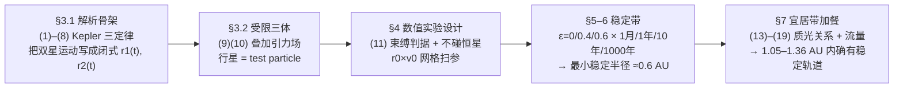

# 2014-GM-A-726（2014 题A · 队伍 726 · 25 页）

## 来自赏析

### 论文速览

论文把"三体问题无解析解"这一困境直接转化为数值实验设计：先用 Kepler 第三定律（式 1-2）由 30 天周期定出双星间距，再在 $(r_0, v_0)$ 二维初值平面上扫参（50 个半径 × 150 个速度），用 Mathematica NDSolve 积分行星运动方程（式 10）至 10 年，并对缩小的参数范围积分到 1000 年，以"能量仍为束缚态（式 11）+ 从未进入恒星一个太阳半径内"判据标记稳定黑格，得到稳定带状区域。三种双星偏心率 $\varepsilon=0,\,0.4,\,0.6$ 对比后结论：1000 年后持续稳定的最小轨道半径约 0.6 AU；并进一步用质光关系与流量判据算出宜居带 1.05–1.36 AU，确认其中有稳定轨道。摘要 8 行，直接给出 0.6 AU 的定量答案。

### 获奖密码

1. **把开放题变成可判定的数值实验**：不空谈"三体混沌"，而是定义两条可操作的稳定判据（式 11 能量判据 + 不碰恒星），让"哪里稳定"有明确答案。
2. **扫参维度选取正中题目要害**：$r_0\!-\!v_0$ 平面恰好对应"何处、以何速度"两个自然问句，稳定带及其上下边界的物理解释（上界=逃逸速度曲线、下界渐近）让数据有理论回声。
3. **多偏心率 + 多时长的系统对比**：$\varepsilon=0/0.4/0.6$ 三组平行实验，得到"偏心率越高稳定带越窄"的规律性结论，超出题目最低要求。
4. **诚实的局限分析**：8.1-8.5 节五条局限（test particle 假设、1000 年太短、初始取向单一、稳定轨道形态未知、S 型轨道未展开），并配图 15 的反例证据，评委最看重的自洽性意识体现充分。
5. **宜居带闭环**：把"稳定存在吗"升级为"宜居行星可能存在吗"，式(19)与图 14 是漂亮的附加分。
6. **附录完整代码**：25 页内附带注释的 Mathematica 源码，可复现性拉满。

### 可借鉴清单

1. 数值扫参前先用解析近似（式 12 圆轨道速度估计、式 11 逃逸边界）框定参数窗口，避免盲目撒点。
2. 给"稳定"这类模糊概念写出书面化、可编码的判据，并在论文正文明确陈述。
3. 用"短时长全扫 + 长时长缩域"两级模拟平衡算力与结论强度。
4. 主动寻找自己模型的反例（图 15 的晚期坠星）并展示，比只报好结果更可信。
5. 相空间"稳定/不稳定"黑白网格图是呈现大样本数值实验的高效图式，附刻度与参数即可复现。
6. 附录附注释版源码；局限小节逐条写"假设→何时失效→如何扩展"。

## 来自精读

### 全文骨架

论文回答一个问题：**1 M☉ + 0.5 M☉、周期 30 天的双星周围，行星轨道在哪里还能长期稳定？**



**为什么这个骨架好？** 三体问题没有解析解，作者不去"解"它，而是把问题改造成一个**可判定的数值实验**：双星运动全部解析化（省掉耦合积分），行星当试验粒子，稳定/不稳定变成两条可编码的判据。整个 §3 都是为此服务的"基础设施"。你要学的是：**把不可解的问题变成可枚举的问题**。

---

### 建模决策链

| 决策 | 作者的选择 | 被放弃的替代 | 为什么 |
|---|---|---|---|
| 双星运动 | 解析参数化 (5)–(8) | 三体一起数值积分 | 计算量减半、双星位置零误差 |
| 行星动力学 | 试验粒子 (9)(10) | 全三体 | 行星质量≪恒星；代价（能量不守恒）在 §8.1 偿还 |
| 维度 | 2D 平面 | 3D | 双星系统角动量定向，P 型轨道近似共面；维度减半、网格翻密 |
| 稳定定义 | (11) + 不碰恒星，两条判据 | 只看"还没逃出" | 单判据各有盲区，二选一都会误判 |
| 扫参平面 | r₀×v₀ | r₀×θ₀（初方位） | 速度是"何种轨道"的第一决定量；初方位单一化的风险由 §8.3 声明 |
| 算力分配 | 10 年全扫 + 1000 年缩域 | 全网格跑 1000 年 | 缩域 4 倍、步长×3，结论强度与算力平衡 |
| 偏心率 | 0/0.4/0.6 三组对照 | 只算 ε=0 | 对照出"偏心率侵蚀稳定带"的规律，超出题目最低要求 |
| 宜居带 | 最保守交集（max 内界/min 外界） | 取平均或最大带 | 行星必须全程在带内，交集是唯一物理正确的取法 |

**总规律**：每个"偷懒"（2D、test particle、单一取向）都在正文有理由、在 §8 有回收。**简化不是罪，不被管理的简化才是**。

---

### 可复用模板

**结构模板**：

```
Abstract        一句话方法 + 一个可引用的数字（0.6 AU）
1 Background    为什么这个问题真实存在（观测证据）
2 Introduction  钉死参数与范围；宣告"解析不可解"引出数值
3 Theory        能解析的全部解析化（本场：双星轨道闭式）
4 Method        判据书面化 → 理论框定窗口 → 网格与算力分配
5 Results       个案快照 → 相空间稳定图（按参数分组、按时长递进）
6 Data analysis 每条边界找解析解释
7 加餐          把"存在吗"升级为"宜居吗"（文献公式+几何合成）
8 Limitations   逐条：假设→证据（含反例图）→扩展方案
9 Conclusion    按问题的问句逐条回收
Appendix A      全部带注释代码
```

**句式库（原文摘录）**：
- "analytical solutions for the general case are not possible with our present mathematical tools"（宣告解析不可解，为数值铺路）
- "Orbits were considered stable if: 1. ... 2. ..."（把模糊概念写成编号判据）
- "This was verified by the results a posteriori."（先验选择、后验补救的诚实写法）
- "The upper bound on each plot is a well defined curve. This is because ... This curve is simply given by (11)."（数值边界挂回解析式）
- "It is likewise also possible that orbits returning stable after 1000 years are unstable in the longer run."（给自己的结论标注保质期）
- "This study can be extended to ..."（每个局限配一条扩展）

**图表配方**：初值平面扫参 → 黑白网格稳定图 + 理论边界线叠加；时长敏感性 → 同布局多联图按时间递进；个案 → 轨道快照三连（稳定/逃逸/碰撞）；双源辐照 → r–φ 相空间等值填色带。

---

*精读完这篇后，建议对照 `05_论文赏析/2014/2014-GM-A-726.md`（宏观赏析）与 `07_题目解读/2014_题A_环双星行星.md`（题目全解）形成三位一体。*
