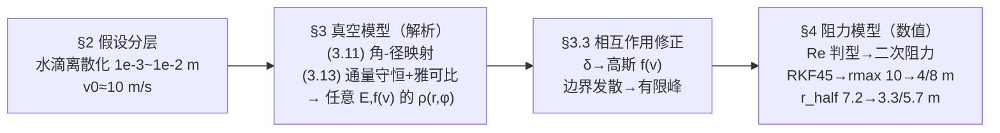

# 2014-GM-B-807（2014 题B · 队伍 807 · 17 页）

## 来自赏析

### 论文速览

论文把"分子"合理重构为半径 $10^{-3}\sim10^{-2}$ m 的离散水滴，先在无阻力情形下用抛体运动的角-径映射 $r=v_0^2\sin 2\theta/g$（式 3.11）与雅可比行列式（式 3.13-3.14）推出对**任意**喷射角分布 $E(\theta,\varphi)$ 和速度分布 $f(v)$ 都成立的落点密度解析式（式 3.17-3.18）；取 $\delta$ 型速度分布得最概然落点（圆心与边界 $r_{max}=v_0^2/g$）及中位圆 $r_{half}=v_0^2/(\sqrt2 g)\approx 7.215$ m（式 3.24）；再以高斯型 $f(v)$ 修正水滴间相互作用（式 3.31-3.33）；最后由 Reynolds 数 $1<R<10^5$ 论证二次阻力（式 4.2），用 RKF45 数值积分得阻力下中位圆 3.30 m（1 mm 滴）/5.68 m（5 mm 滴）（式 4.8-4.9），证明阻力修正不可忽略。

### 获奖密码

1. **通量守恒 + 雅可比的概率映射**（式 3.13-3.17）：把"落点概率"变成严格的测度变换问题，且对任意 $E(\theta,\varphi)$、$f(v)$ 成立——比只能算特定分布的队伍高一个层级。
2. **三段递进的"理想→修正"叙事**：摘要与正文都以"真空解析解 → 相互作用高斯修正 → 阻力数值解"推进，每一步修正都有明确的物理触发条件，结构自洽。
3. **量纲/Reynolds 数选型阻力形式**：不默认套公式，先用 $R_e$ 范围论证必须用二次阻力，还反证线性阻力只适用于 0.02 m 高的迷你喷泉——典型评委欣赏的"物理判断先行"。
4. **对称性捷径**：利用抛物线升降对称 $\pi-\theta=\theta'$ 直接得 $r=v_0^2\sin2\theta/g$，省去完整轨迹推导。
5. **中位圆的多情形通解**：式 3.25-3.30 按 $\theta_0$ 与 $\pi/4$ 的关系分三种情形闭式讨论，覆盖题目隐含的所有喷射锥角。
6. **诚实量化结论**：给出阻力使 $r_{max}$ 从 10 m 降到 4 m/8 m、中位圆从 7.215 m 降到 3.30/5.68 m 的对比，明确回答"修正是否可忽略"。

### 可借鉴清单

1. 遇到"概率分布"类题目，优先寻找守恒量（粒子数/通量）+ 坐标映射的雅可比，往往一步得到解析密度。
2. 分布函数保持符号形式 $E(\theta,\varphi)$、$f(v)$ 推到底，最后再代入特例——结论通用性即竞争力。
3. 流体阻力选型先算 Reynolds 数，并在论文里写出判断依据和适用范围。
4. 数值打靶时用 ODE 事件函数精确捕捉目标面穿越，再以"角均分 + 直方图"把轨迹族转成概率密度。
5. 每引入一个修正，就用同一张图/同一个量（如 $r_{max}$、$r_{half}$）给出前后数值对比，让评委看到修正的贡献。
6. Discussion 分 Weakness/Strength 两栏各写 2-4 条，Weakness 具体到"哪种情形会失真"，Strength 给出"为什么这么简化是安全的"。

## 来自精读

### 全文骨架

论文回答一个问题：**喷泉喷出的水，落在池塘任一点 (x, y) 的概率密度是多少？最概然落点在哪？把一半水量圈住的"中位圆"多大？**



**为什么这个骨架好？** 它是教科书级的"**理想 → 修正 → 再修正**"三级火箭：第一级全部闭式（连中位圆都解析），第二级只改一个函数（速度分布），第三级才请出数值方法。每一级的"修正触发条件"都写明（水滴碰撞→速度弥散；Re 范围→二次阻力），所以读者永远知道"现在在哪一层近似里"。**先一般后特例**：核心公式 (3.17)(3.18) 对任意喷射分布 E(θ,φ) 和任意速度分布 f(v) 成立，δ 函数只是最后一步代入——通用性本身就是竞争力。

---

### 建模决策链

| 决策 | 作者的选择 | 被放弃的替代 | 为什么 |
|---|---|---|---|
| 建模对象 | 半径 1–10 mm 的离散水滴 | 真正的"分子"（连续介质/分子动力学） | 1–10 mm 滴的 Re 落在数据充足的阻力区；分子尺度反而是未知领域 |
| 概率方法 | 通量守恒+雅可比 (3.13) | 蒙特卡洛撒粒子（真空阶段） | 解析解对任意 E、f(v) 成立；蒙特卡洛留到阻力阶段才用 |
| E、f(v) 处理 | 全程符号形式，最后代入 δ/台阶/高斯 | 一开始就取具体分布 | 通用公式=可复用到任何喷嘴；特例只是它的一行代入 |
| 相互作用 | 高斯速度再分布（a=10） | 逐对碰撞动力学 | 多体碰撞无精确解；统计化换来 (3.18) 框架内的最小改动 |
| 阻力形式 | Re 判型 → 二次 + C_D≈0.5 | 默认线性或三次 | Re≈10³–10⁴ 明确落在二次区；线性只对 2 cm 喷泉成立 |
| 数值方法 | RKF45 + 事件函数 + 5000 角直方图 | 解析近似（如微扰） | 阻力 ODE 无闭式通解（§5.1 自认）；自适应步长+事件捕捉兼顾精度与效率 |
| 滴径选择 | 1 mm 与 5 mm 两档 | 连续滴径分布 | 两档跨一个量级的 k/m，足以展示"阻力敏感度"；完整分布是伪精度 |

**总规律**：每个阶段的模型复杂度都由**前一阶段留下的残差**驱动——解析阶段发现边界发散（理想化痕迹）→ 高斯修正抹平它；理想抛体与现实的残差 → 阻力修正量化它。复杂度从不在没有证据的地方先行。

---

### 可复用模板

**结构模板**：

```
Abstract        第一句宣布对象重定义（分子→水滴）；四句四层（离散→解析→修正→数值）
1 Introduction  为什么统计结果有趣（喷射照片）
2 Assumptions   分阶段假设合同（每阶段解除哪条写明）
3 理想模型
  3.1 运动学+映射    对称捷径 → (θ,φ)→(r,φ)
  3.2 通量守恒+雅可比 任意 E、f(v) 的闭式密度；δ 特例+解析中位圆
  3.3 修正 I         相互作用→分布展宽（最小改动原则）
4 修正 II（数值）
  判型（无量纲数）→ 方程 → 打包参数 → 自适应积分+事件+直方图 → 前后数值对比
5 Discussion     Weakness（何种情形失真）/ Strength（为何简化安全）
Appendix        全部代码（δ、高斯、轨迹、直方图、中位圆五段）
```

**句式库（原文摘录）**：
- "we first modeled the water flux as discrete small drops (with radius ...)"（摘要第一句重定义对象）
- "we take a shortcut here for the benefit of the symmetry of ..."（宣布走捷径及其合法性）
- "the range of θ is uncertained for the fountain. In order to give examples, we choose ..."（自由度过多时先给示范解）
- "It's fortunate to see that C_D correspond to our R is very stable (~0.5)"（系数落在平台段的运气要写出来——它是稳健性的来源）
- "this tiny fountain is of course out of interest"（反证替代方案荒谬）
- "we give up analyzing ... since multi-body-interaction will make this problem so complicated that no one can get a precise solution"（放弃精解的正当性声明）

**图表配方**：分布族对比 → 8 联同轴小图按参数排序；修正效果 → 同轴同范围新旧曲线并置；轨迹族 → 抛物线束+包络线；数值密度 → 直方图+拟合曲线双联图；每个修正给出前后同量数值表（r_max、r_half）。

---

*精读完这篇后，建议对照 `05_论文赏析/2014/2014-GM-B-807.md`（宏观赏析）与 `07_题目解读/2014_题B_喷泉优化.md`（题目全解）形成三位一体。*
