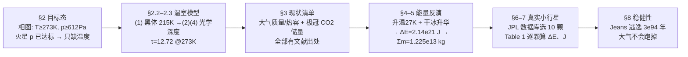

# 2015-GM-A-190（2015 题A · 队伍 190 · 10 页）

## 来自赏析

### 论文速览

论文把"改造火星"分解为一条清晰的能量因果链：撞击动能（60% 转化为热，效率取自 Maindl et al. 2015 的模拟）→ 大气升温 27 K（123 K→150 K）触发极区干冰升华 → CO₂ 全部入大气加厚温室效应 → 光学深度从 1.7 量级升至 54.45、平衡温度达 285-286 K，液态水可稳定存在。反解出所需总能量 $2.14\times10^{21}$ J、撞击体总质量 $1.225\times10^{13}$ kg（碰撞速度取 24 km/s）、单颗冲量 $10^{16}$ N·s 量级；并从 JPL 小天体数据库挑出 10 颗 Icarus 型真实小行星（Table 1）逐一算出 $\Delta E$ 与 $J$。全文 10 页，几乎无数值模拟，靠文献参数 + 量纲清晰的解析估算闭环。

### 获奖密码

1. **物理因果链完整且可反推**：目标态（液态水）→ 状态量（τ、CO₂ 密度）→ 触发条件（27 K 升温 + 升华潜热）→ 撞击动能 → 质量与冲量，每一步都可检验，正反两个方向都闭环。
2. **文献参数替代理拍脑袋**：60% 撞击热效率引 Maindl et al. 2015 的模拟、半灰模型与 β=0.7 引 Miyazaki、升华焓引 NIST——每个关键系数都有出处，评委可逐条核对。
3. **真实数据落地**：Table 1 的 10 颗小行星来自 JPL 数据库并逐一计算，把"假设存在撞击体"升级为"这些小行星确实可行"，工程感极强。
4. **主动做自洽性检验**：大气逃逸时标 $3.12\times10^{94}$ 年虽是"夸张的大数"，但证明结论对升温鲁棒；正反馈回路（升华→增温→更多升华）被明确用于论证方案自持。
5. **诚实的边界意识**：8.3 节公开承认角动量方法因不会建模螺旋轨道而放弃；8.1 节讨论热传导时标可能削弱撞击效率并给出缓解策略（缩小间隔、瞄准极区）。
6. **极简篇幅**：10 页说清全部逻辑，信息密度高，符合评委 48 小时内评审的阅读习惯。

### 可借鉴清单

1. 先用相图/物性数据把开放题的"成功标准"翻译成可计算的不等式（273 K、612 Pa），再开始建模。
2. 复杂物理（辐射传输、撞击效率）不硬算，找一篇可信文献取标定值或效率因子并显式引用。
3. 建立"输入参数表"式写作：每个物理量（温度、密度、热容）给出数值+来源+单位，全文数字可审计。
4. 方案类题目务必回到真实目录/数据库选型（JPL 小天体库），并附上每个候选的参数表。
5. 结尾加一个"方案会不会自我瓦解"的检验（如大气逃逸、热耗散时标），哪怕结果是 $10^{94}$ 年这种数量级判断。
6. 用熟悉工具画一条关键曲线（τ–T）并附代码于附录，既支撑读数又展示可复现性。

## 来自精读

### 全文骨架

论文回答一个问题：**用 10 次小行星定向撞击把火星改造成能有液态水，需要多大的撞击体、多大的冲量？**



**为什么这个骨架好？** 整条链是**可逆的**：从目标态（液态水）出发正向推到 τ、CO₂ 密度，再从撞击能量反向推到质量与冲量——评委可以从任何一端开始检验。每一步的输入要么是物理常数、要么是文献值，全文没有一个"拍脑袋系数"裸奔。这是开放工程题最稳的写法：**把"改造火星"翻译成一道能量守恒应用题**。

---

### 建模决策链

| 决策 | 作者的选择 | 被放弃的替代 | 为什么 |
|---|---|---|---|
| 成功标准 | 相图两点（273 K、612 Pa） | 模糊的"宜居" | 不等式可检验；且立刻砍掉气压维度 |
| 温室模型 | 半灰模型+地球单点标定+线性外推 | 自建辐射传输 | 48 小时不可能硬算；标定让模型至少对一个真实行星精确 |
| 大气成分 | 100% CO₂ | 真实 95.32%+微量 | 简化误差 ~5%，远小于 24 km/s 等其他不确定度 |
| 极冠几何 | 圆柱近似（πr²×厚度） | 真实极冠形状+季节演化 | 只需体积量级；取最冷时储量为保守下限 |
| 升华时标 | 忽略（"not of interest in this first approximation"） | 建立升华动力学 | 第一近似只问"需要多少能量"，时标留给 §8.1 讨论 |
| 撞击效率 | 60%，外包文献 | 自建撞击模型 | Maindl 的 SPH 模拟连敏感性结论一并引用 |
| 碰撞速度 | 24 km/s（任意但自辩） | 扫描速度 | 结果尺寸"very physical"即保留；务实的工程取舍 |
| 候选体 | JPL 真库筛选+质量代理假设 | 虚构"假设小行星" | Table 1 把方案落到可查证天体，工程可信度倍增 |

**总规律**：全文每个"硬算不动"的环节（辐射、撞击、螺旋轨道）都以"文献系数"或"明确放弃"处理——**没有一处假装算过**。极简论文的安全性来自诚实。

---

### 可复用模板

**结构模板**：

```
Abstract        三个硬数字对应题目三问
2 目标态        相图/物性数据把"成功"写成不等式；砍掉已满足的维度
2.2–2.3 机制    文献模型 + 单点标定 + 线性外推；画一张可反读的标尺图
3 现状清单      每项：数值+单位+文献号（可审计输入表）
4 方案机制      效率系数外包文献；正反馈自持性一句话校验
5 能量反演      显热+潜热两账相加 → 反解质量
6–7 选型        理想基准 → 真实数据库筛选 → 逐候选参数表
8 稳健性        时标担忧+缓解策略；逃逸/瓦解检验（哪怕 10^94 年）；未完成方向如实交代
9 结论          复述全部关键数字
```

**句式库（原文摘录）**：
- "This was determined with the location of the triple point on the phase diagram of water"（成功标准的可追溯定义）
- "however, Mars' surface temperature is another story."（一句话聚焦问题）
- "This collision velocity was chosen arbitrarily, but led to a very physical size estimate ... and so was kept."（任意参数的自辩）
- "We won't need to worry about CO2 escaping from the Martian atmosphere any time soon."（夸张大数结论的人性化表述）
- "We do not know how to model ..., so this method was too difficult for us to use, but it could be used to find ..."（诚实交代失败路径与价值）

**图表配方**：隐式关系 → 带双十字参考线的"标尺图"（正读反读两用）；方案落地 → 数据库候选表（每行带出处编号）；量级翻译 → TNT/沙皇炸弹类比句。

---

*精读完这篇后，建议对照 `05_论文赏析/2015/2015-GM-A-190.md`（宏观赏析）与 `07_题目解读/2015_题A_改造火星定向撞击.md`（题目全解）形成三位一体。*
