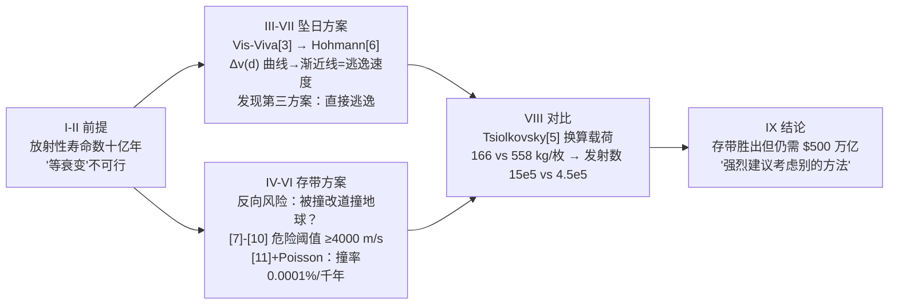

# 2016-GM-A-331（2016 题A · 队伍 331 · 16 页）

## 来自赏析

### 论文速览

论文以 $\Delta v$ 为统一货币对两条处置路线做全链路对比：坠日方案先 Hohmann 转移飞到远处再减速下坠，发现二次点火点越远越省——10 AU 处需 $\Delta v=14106.2$ m/s，且存在一条更省的"逃逸出太阳系"捷径（12337.5 m/s，Fig 6）；小行星带方案在 2.7 AU 圆轨道入轨需 10977.4 m/s。再用 JPL 小天体数据库 5 万余颗小行星的数据构建概率模型（式 11 + Poisson 过程），算出小行星带内 1000 年被撞击概率仅 0.0001%、10 亿年内碰撞累积 $\Delta v$ 仅 2115 m/s（远小于改道撞地球所需的 ≥4000 m/s），安全 store 得以论证。最终结论：小行星带方案显著更优（Saturn V 单枚载荷 558 kg vs 坠日 166 kg），但处理全球 $2.5\times10^8$ kg 废料仍需 $4.5\times10^5$ 次发射、花费超 500 万亿美元——"完整解决了搬运全部核废料这个完全不可行的问题"。

### 获奖密码

1. **$\Delta v$ 作为统一度量衡**：把"哪种更容易"翻译成可加可比的 $\Delta v$，再经 Tsiolkovsky 换算成载荷与发射次数，物理量与工程量、成本三级贯通。
2. **渐近线里挖出第三方案**：Fig 1 的水平渐近线=太阳逃逸速度这一观察，自然引出"逃逸比坠日更省"的结论（Fig 6），展示了从数据形态反哺物理判断的能力。
3. **真实大数据支撑的概率论证**：不满足于"小行星带很空"的定性说法，用 5 万颗真实小行星算出 $P_{coll}$ 与碰撞累积 $\Delta v$，并用"2115 m/s < 4000 m/s 阈值"的双指标闭环回答"能安全存放多久"。
4. **反向风险建模对称完整**：对两个方案各自设计"失败模式"分析（坠日=容器回落大气层烧毁散布；存带=被撞改道撞地球），比较才显得公平。
5. **对简化假设的传播性论证**：明确说明 Tsiolkovsky 简化"高估绝对成本但不改变相对排序"，正面处理了评委最可能质疑的点。
6. **可复现性**：附全部数据抓取与分析代码，包括与官网交互的原始命令。

### 可借鉴清单

1. 比较类题目先选定一个"通用货币"（$\Delta v$、能量、成本），让所有方案在同一标尺上排序。
2. 画参数曲线时留意其渐近线/极值，往往隐藏着比题目要求更优的第三方案。
3. 概率问题优先找数据库（JPL 小天体库等）用真实样本算 $P=\sum A_kv_k/V$ 一类的扫掠概率，再按 Poisson 过程外推到题目时标。
4. 每个方案都配一个"危险阈值"（如改道 $\Delta v\ge4000$ m/s），把安全论证变成不等式判断。
5. 用半值层（halving distance）做屏蔽估算：所需层数 = 剂量对数 / 半值层，简单且站得住。
6. 引入粗糙假设后，论证结论对假设不敏感（单调性/共同偏置），并在结论中明说。

## 来自精读

### 全文骨架

论文回答一个问题：**把地球上的核废料送进太阳还是存进小行星带，哪种更容易实现？存进去安全吗？**



**为什么这个骨架好？** 比较——度量——闭环：先立 Δv 这个统一度量（III），两条路线各自算 Δv（坠日 IV、存带 IV/VI），反向风险各自建模（坠日=容器回落烧毁；存带=碰撞改道），最后经 Tsiolkovsky 换算成发射次数与钱。**每个方案都配有自己的失败模式分析**，比较才显得公平。Fig 1 的水平渐近线（=太阳逃逸速度）顺藤摸瓜引出"直接逃逸更省"的第三方案——**从曲线形态反哺物理判断**是全文最漂亮的一笔。

---

### 建模决策链

| 决策 | 作者的选择 | 被放弃的替代 | 为什么 |
|---|---|---|---|
| 比较度量 | Δv（[3][4] 统一生成） | 能量、时间、直接用钱 | Δv 可加、可比、可经 [5] 换算成任何工程量 |
| 火箭失败率 | 从比较中剔除 | 计入风险模型 | 6% 对两方案是常数，剔除后比较更纯（§I 明说） |
| 坠日路线 | 先抬远再压低（两段 Hohmann） | 地球轨道直接刹车 | Fig 1 曲线显示远处二次点火更省；渐近线还送了第三方案 |
| 存带轨道 | 2.7 AU 圆轨道（也算了 2.2 AU） | 3.2 AU 外缘 | 主带中部最典型；2.2 AU 展示 Δv 对目标半径的敏感度 |
| 撞击数据 | JPL 真库 5 万+ 颗，密度 3400 补全 | 解析估算撞率 | 真实样本给出数量级可信的 ΣA_kv_k；代码全部公开 |
| 速度分布 | 正态 3σ 覆盖速度极值 | 均匀分布/实测直方图 | 正态有闭式期望速率（D 因子）；3σ 论证有正文自辩 |
| 累积效应 | 期望 Δv（剂量学）与阈值比较 | 只报单次撞率 | 危险来自累积偏移；2115<4000 才是完整的安全论证 |
| 容器屏蔽 | 半值层数=剂比对数（15 层铅） | 蒙卡辐射输运 | 量级估算足够，工程余量 20 cm 兜底 |
| 成本口径 | 1970 单价通胀换算 | 现价火箭 | 有公开单价可查；共同偏置不影响排序 |

**总规律**：全文没有一处"两个方案用不同精度算"——同一套 [3][4][5] 工具、同一种数据源、同一种误差论述。**比较的公平性是比较型论文的生命**，本文把它做成了方法论。

---

### 可复用模板

**结构模板**：

```
Abstract        成绩单式：方案A数 → 方案B数 → 安全数 → 成本数 → 倾向
I Introduction  背景小教学（半值层）+ 剔除等权重因素（失败率）
II 物理前提     两行公式关闭"等待"选项（衰变太慢）
III 工具箱      Vis-Viva / Δv / 火箭方程一页陈列，每个附 Where 表
IV 方案A        两段式 + Δv(d) 曲线 + 渐近线解读（第三方案）
IV/VI 方案B     反向风险三段式：阈值([7]-[10]) → 撞率([11]+Poisson) → 累积剂量 vs 阈值
V  工程件      半值层估算（几行算术）
VIII 对比       Δv 总表 → [5]换算载荷 → 发射数 → 钱
IX Conclusion   负结论 + 替代方向（离子引擎缓降、直接逃逸）+ 假设传播声明
附录            分析代码 + 数据抓取代码 + 原始 curl 命令
```

**句式库（原文摘录）**：
- "then we can also disregard the rocket failure rate as it would be a constant that we could do nothing about"（剔除等权重因素）
- "The plot has a horizontal asymptote at the escape velocity of the Sun"（渐近线的物理指认）
- "barring some lucky and extremely improbable slingshot around a distant black hole"（极小概率的生动排除）
- "This overestimated the amount of payload ..., and underestimated the fuel needed. However, any comparisons between the methods still behaved the same way."（误差的方向+传播性论述）
- "This approach fully solved the completely infeasible problem of moving all of Earth's nuclear waste off-planet."（自嘲式总结：完整地解决了不可行的问题）
- "the authors of this paper strongly urge the consideration of a different method"（负结论的强表达）

**图表配方**：成本-参数曲线 → 必画渐近线并标注其物理身份；风险论证 → 阈值曲线（[7]-[10]）+ 剂量累积对比不等式；数据分布 → semilog 排序图；多方案对比 → Δv 总表 + 载荷/发射数两级换算。

---

*精读完这篇后，建议对照 `05_论文赏析/2016/2016-GM-A-331.md`（宏观赏析）与 `07_题目解读/2016_题A_核废料太空处置.md`（题目全解）形成三位一体。*
