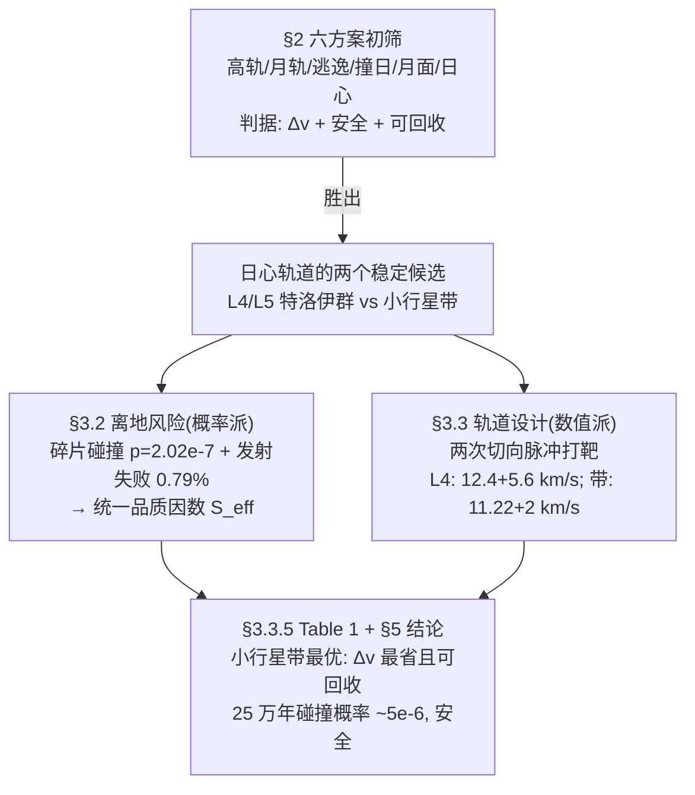

# 2016-GM-A-412（2016 题A · 队伍 412 · 24 页）

## 来自赏析

### 论文速览

论文先横向比较**六种**太空处置目的地（高地球轨道、月球轨道、逃逸太阳系、撞日、月面软着陆、日心轨道），以 $\Delta v$ 与安全性双准则锁定"日心轨道"，再依据稳定性论证（"那里有大量小行星"本身就是稳定性的证明）聚焦两个候选：木星 L4/L5 拉格朗日点与小行星带。确定性部分用自适应 Cash-Karp RKF45 数值积分火箭在太阳+木星+地球(+火星)引力场中的运动，设计出两次切向脉冲（Hoffman 机动）的转移方案（L4: 12400+5600 m/s；带: 11220+2000 m/s）；随机性部分给出四套概率模型（碎片撞击、发射失败、特洛伊小行星撞击、主带小行星撞击），用"有效污染面积" $S_{eff}$ 与 $10^{-6}$ 量级碰撞概率论证安全，最终结论：小行星带是最优存址，可安全存放 Pu-239 衰变所需的 250 000 年。

### 获奖密码

1. **先广后深的方案筛选**：不直接坠入题目给的两方案，而是六方案横向比较后论证"日心轨道最优"，再解释为何小行星带/L4/L5 是其中最稳——展现了完整的决策树，且结论仍落在题目问的"小行星带"上。
2. **风险链条全覆盖**：发射前（碎片 $2.02\times10^{-7}$、失败 0.79%）、后果（弥散面积 ≈ 科罗拉多州）、目的地（特洛伊 $2.4\times10^{-6}$、主带 $5\times10^{-6}$）四段风险模型 + 两个品质因数（$S_{eff}$、$P(T)$），把"安全性"从形容词变成数字。
3. **确定性轨迹是真积分**：自适应 RKF45 在含木星扰动的时变场中打靶，L4 相位几何（旋转矩阵 + 60°）精确可查，比只做 Hohmann 估算的论文多一个技术层级。
4. **指数分布的推导而非套用**：由"不相交时间区间独立 + 连续性"两假设数学证明碰撞时标服从指数分布，再用组合技巧（$2/(m+1)$ 对撞概率）定出期望等待时间——概率建模有完整推导链。
5. **"可回收性"作为差异点**：Table 1 中把 Restore 列与 $\Delta v$ 并列，指出存带方案保留了未来回收废料的可能性，体现了对问题长期视角的理解。
6. **规范的 Future Work**：7 条后续方向（借力机动、OTV、市场调查等）显示了对工程全貌的把握。

### 可借鉴清单

1. 开放比较题先建"方案空间"再收敛：用统一的 $\Delta v$ + 风险双准则列表筛选，比单点深入更能展示物理判断。
2. 轨道转移用"两步切向脉冲 + 目标相位反推发射角"的打靶框架，相位条件（如 L4 的 60°）写成旋转矩阵约束。
3. 混沌系统积分必须用自适应步长 RKF45 并说明精度动机；把积分器源码放附录增加可信度。
4. 碰撞概率的通用范式：参考系变换 → 扫掠体积/截面 → 单体概率 → $(1-p)^n$ 或 Poisson/指数外推。
5. 给不同性质的风险定义共同品质因数（$S_{eff}=P\cdot S$），让"哪种事故更糟"可量化排序。
6. 概率模型参数逐条引文献（碎片数、失败率、天平动周期），不确定处声明"wild guess"的性质。

## 来自精读

### 全文骨架

题目问"核废料扔太阳 vs 存小行星带，哪个更容易实现、能存多久"。论文没有二选一直接开算，而是先扩成**六方案决策树**，再对胜出的"日心轨道"做两层风险+一条轨道设计：



**为什么这个骨架好**：开放性比较题最忌"题目问什么就只算什么"。这篇先自建方案空间（六选一），让最终落在小行星带的结论变成**推理的终点**而非**题目的默认**；再用"确定性（轨道）+ 随机性（风险）"双线并行，把"safety"这个形容词拆成四个可计算的数。评委看到的不是一个答案，而是一整套决策与量化体系。

---

### 建模决策链

| 决策 | 作者的选择 | 被放弃的替代 | 为什么 |
|---|---|---|---|
| 方案空间 | 自建六方案横向比较 | 直接算题目给的两方案 | 决策树完整，结论成为推理终点；代价是 §2 篇幅 |
| 稳定性判据 | "哪里有天体哪里就稳" | 数值 Lyapunov/长期积分判稳 | 45 亿年自然实验免费；正式判稳在 48h 内不可行 |
| 动力学范围 | 日+木+地(+火星)四体、平面 | 全 N 体 / 三维 | 主要摄动源保留，维数减半；五星引力对结果量级无关 |
| 行星轨道 | 圆轨道（附偏心率数据） | 真实椭圆历表 | e_J=0.048、e_E=0.017 的位置误差 ≪ 相位匹配容差 |
| 转移方式 | 两次切向脉冲打靶 | 单脉冲/连续推力 | 切向=能量最优；脉冲让打靶问题降为两点边值 |
| 数值方法 | 自适应 Cash-Karp RKF45（tol=1e-10） | 定步长 RK4 | 摘要自辩："system is highly chaotic"；近地/近日大梯度段自适应缩步 |
| 碰撞概率 | 几何截面+指数分布（有推导） | 蒙特卡洛模拟 | 参数极少（颗数+频次两条数据），解析模型刚好够用 |
| 风险比较 | 品质因数 S_eff=P×S | 定性讨论 / 期望死亡数 | 把不可比的事故统一到"每次发射有效摧毁面积"一个数 |
| 小撞击忽略 | 只算 ≥10 km 天体 | 全尺寸谱 | 只有 10 km 级动量才足以踢出稳定轨道（给了动量论证） |

**总规律**：确定性端"能解析就解析、解析不了上高精度自适应积分"；随机端"数据只有两条，就造只需两条参数的模型（几何+指数）"——**模型复杂度被数据量锁定**，这是本篇最深的一条方法论。

---

### 可复用模板

**结构模板**：

```
Abstract       双方法论预告(deterministic+stochastic)+技术名词清单+结论
1 Introduction 现状痛点(真实失败案例)→提出新方案
2 First insights 方案空间(6个)逐个: Δv+风险 → 收束到1个
3 Model
  3.1 假设清单(每条带量级/数据理由)
  3.2 阶段一风险: 概率(参考系变换+几何) → 后果(分布+映射) → 品质因数
  3.3 阶段二方案: 机制科普 → 几何打靶(相位=旋转矩阵) → 积分 → 目的地风险
  3.4 方案对比表(Δv+可回收性)
4 Strengths/Weaknesses  实质化(敢承认Δv不占优)
5 Conclusions  主结论+政策级建议
6 Future Work  分类列点(机动/载具/回收/市场)
Appendix       完整积分器源码
```

**句式库（原文摘录）**：
- "Both deterministic and stochastic modeling techniques have been used to solve different stages of the problem."（摘要宣示方法论分工）
- "The proof is simple, there are plenty of asteroids there."（用自然存在代替证明——仅限直觉显然处）
- "This assumption is justified due to the fact that the eccentricity of the orbits... is really low."（假设+数据自辩）
- "The most efficient way to kick a rocket is tangential to its velocity."（设计原则一句话立骨架）
- "we can also make the same wild guess as before"（明示量级估算的诚实）
- "However, our model is slightly optimistic, as it considers..."（自检偏差方向）
- "we have two possible accident causes, one less probable but more lethal, and the other more possible but less dangerous"（两难引出品质因数）

**图表配方**：决策类论文 → "示意图定义符号 / 计算图展示结果 / 外部图提供证据，三类不混用；计算图颜色语义全文固定；终局放一张对比表（指标+布尔列如 Restore）"。风险类 → "品质因数柱状图，把 P 与 S 压成一个可排序的数"。

---

*精读完这篇后，建议对照 `05_论文赏析/2016/2016-GM-A-412.md`（宏观赏析）与 `07_题目解读/2016_题A_核废料太空处置.md`（题目全解）形成三位一体。*
