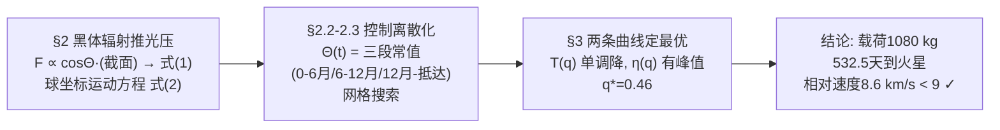

# 2017-GM-A-670（2017 题A · 队伍 670 · 5 页）

## 来自赏析

### 论文速览

这是本批次最短的一篇金牌论文（正文仅 5 页）。队伍（华沙大学）把太阳帆光压按黑体辐射推导，在球坐标下写出运动方程，再将帆的倾角 $\Theta(t)$ 参数化为三段常值（起飞→6 个月→12 个月→接触火星），用启发式网格搜索优化。最终结论：帆质量占总质量比 $q=0.46$ 最优，此时载荷 1080 kg、飞行 532 天（精确值 532.517 天）、到达时与火星相对速度 8.6 km/s、距离火星中心 $1.07\times10^7$ m，满足题设 9 km/s 的安全着陆约束。

### 获奖密码

1. **摘要自带可复算结论链**：$q=0.46\to$ 1080 kg 载荷 $\to$ 532 天 $\to$ 8.6 km/s，评委 30 秒内即可核对题设全部约束。
2. **物理洞察清晰**：把光压+引力统一为 $1/r^2$ 的修正引力场，使模型行为可预期、可解释。
3. **自由度收敛有交代**：明确论证"三段常值已接近光滑 $\Theta(t)$ 的效果"，防止评委追问优化是否欠拟合。
4. **结果的 sanity check 出色**：优化出的三段式机动（外旋加速—减速—等待火星）与轨道力学直觉一致， Figure 2 的效率曲线在 $q\in(0,1)$ 内出现清晰极大值。
5. **诚实的边界讨论**：结论段指出若允许改发射日期（火星超前于地球）结果还能更好，但严格按题设不做——展示了对题意的精确理解。
6. **5 页写完一道 35 页才能装下的题**：没有冗长文献综述，全部篇幅给模型、结果与检验，说明 UPC 评分核心是物理与结论而非厚度。

### 可借鉴清单

1. 用"所有力 $\propto 1/r^2$"的量纲/标度论证先给模型定性，再上数值。
2. 连续控制量离散成 2–3 段常值即可拿到接近最优的解，并在文中说明"增加分段收益递减"。
3. 网格搜索前先用物理先验缩小参数盒（如禁止初始减速角），可大幅省时。
4. 摘要必须含：最优参数值 + 两个题设约束的核对数字（时间、相对速度）。
5. 给出极限情形检验（$q\to0,1$、$\Theta\to0$）证明解的合理性，成本极低、说服力极高。
6. 结论段主动指出"题设限制了进一步优化"，把局限转化为对题意的把握。

## 来自精读

### 全文骨架

问题：2000 kg 的太阳帆船去火星，帆该做多大（质量占比 q）、帆面朝向 Θ(t) 该怎么调，才能让"载荷/飞行时间"η 最大？论文的链条极短：



**为什么这个骨架好**：全链只有三个模型决策（光压怎么算、控制怎么参数化、指标怎么定义），每个决策后立刻进入计算，没有一章是"背景介绍"。5 页能装下一道大题的秘密是：**每个环节都选了"够用的最简版本"**——黑体辐射代替光压表、三段常值代替光滑控制函数、两个一维曲线图代替大表格。极简不是少做，是把每一步做到"刚好无法再删"。

---

### 建模决策链

| 决策 | 作者的选择 | 被放弃的替代 | 为什么 |
|---|---|---|---|
| 光压模型 | 黑体辐射推导 + 理想镜面反射 | 查光压系数表/考虑吸收 | A⊙σT⊙⁴=光度免费精确；镜面假设给系数 2 的解析上限 |
| 坐标系 | 球坐标（平面极坐标） | 笛卡尔 | 力天然沿 r̂/φ̂ 分解，Θ 的定义直接进入方程 |
| 轨道简化 | 地球火星共面圆轨道、共面运动 | 真实倾角/偏心 | 倾角 1.85° ≪ 待优化的相位效应；圆轨道让"最近点发射"的初值无歧义 |
| 控制参数化 | Θ(t)=三段常值，固定切换点 6/12 月 | 光滑 Θ(t) / 最优控制（Pontryagin） | 网格可搜；附"分段收益递减"论证；三段恰好对应三个物理阶段 |
| 优化器 | 粗网格定位 + 局部极小加密 + 物理先验剪枝 | 遗传算法/梯度法 | 无梯度需求、实现 10 行；先验（起步不减速）砍半搜索空间 |
| 目标函数 | η=载荷/时间 | 加权/多目标 | 单指标 → 一维曲线 → 一个峰值；"信道容量"类比提供直觉 |
| 发射时机 | 按题设取最近点时刻 | 火星超前的更优窗口 | 严守题设，把更优解写进结论作为洞察展示 |
| 附加检查 | 涌现策略 vs 轨道直觉、q→0/1 极限 | 无 | 零成本的仿真可信度证明 |

**总规律**：每一个"简"都对应一个明确的理由（物理性质/收益递减/题设边界），且在文中**写出来**——5 页论文里假设辩护文字的占比反而比长文更高。极简的底气来自"每个决策都有话说"。

---

### 可复用模板

**结构模板**：

```
Abstract      优劣一句话 + 约束 + 方法一句 + 可复算结论链(q→载荷→时间→η)
1 Introduction 为什么必须数值(解析不可行的物理原因) + 目标函数定义 + 文献差异化
2 Model
  2.1  力的推导(黑体→光压→投影) + 运动方程 + 组合参数 α/β + 等效性洞察
  2.2  控制离散化(分段常值 + 收益递减论证)
  2.3  算法五要素: 对象/切换时刻/约束/粗细两段/物理先验
3 Results     先证可信(涌现策略=直觉, 极限行为) → 机理解释 → 最优值 + 判据核对
4 Conclusions 数字 + 被题设禁用的更优解(展示洞察)
```

**句式库（原文摘录）**：
- "Light pressure constantly affects the sail, which makes equations of motion more complicated and trajectories impossible to derive analytically."（为数值方法立合法性）
- "We can modify radial component... to be a motion in modified gravity field, as all forces are proportional to 1/r²."（等效性洞察——一句话提升模型可解释性）
- "Further increase in number of different settings Θ(t) does not decrease flight time significantly."（离散化的收益递减辩护）
- "This approach narrows the space to be searched and, because of that, lowers the computation time."（物理先验剪枝的价值声明）
- "This course of action... is to be expected. It proves that the simulation gives rational results."（用涌现规律给仿真背书）
- "Having a very small sail results in a far too long trip, while a short trip with a huge sail is not fast enough to account for the load capacity lost to the sail."（极限行为解释，一正一反对仗）
- "However, we did not consider such conditions, as it was stated in the task that we have to start from such a setup."（尊重题设边界的收尾句）

**图表配方**：单峰最优类问题 → "指标 η(q) 单独一图 + 原料曲线 T(q) 陪衬一图 + 最优轨迹一图"，三图讲完"为什么有峰、峰在哪、怎么飞"；几何定义必须配示意图（Fig 1）先于公式出现。

---

*精读完这篇后，建议对照 `05_论文赏析/2017/2017-GM-A-670.md`（宏观赏析）与 `07_题目解读/2017_题A_太阳帆.md`（题目全解）形成三位一体。下一篇同题精读：`2017-GM-A-699_精读.md`（最优控制派）。*
