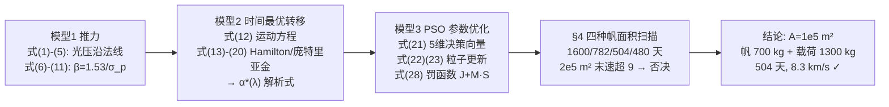

# 2017-GM-A-699（2017 题A · 队伍 699 · 28 页）

## 来自赏析

### 论文速览

国防科技大学队伍的典型"三模型递进"结构：太阳帆推力模型（含日面有限角修正的光压公式）→ 理想太阳帆时间最优转移轨道模型（极坐标运动方程 + Hamiltonian +庞特里亚金极小值原理，把最优控制问题化为协态初值参数优化）→ 基于 PSO（粒子群）的轨道转移优化模型（动态罚函数处理终端约束）。对 $A=10^4, 5\times10^4, 10^5, 2\times10^5\ \mathrm{m^2}$ 四种帆面积各给出一组轨迹/帆角/速度曲线，最终选定 $A=100000\ \mathrm{m^2}$（帆质量 700 kg）：载荷 1300 kg、转移 504 天、末速 8.3 km/s < 9 km/s，并宣称比文献 [8]（McInnes）方案省 116 天。

### 获奖密码

1. **方法学层次感强**：光压→运动方程→最优控制→智能优化的链条完整，每层都有明确数学对象（式 1→12→14→20→22）。
2. **把抽象最优控制落到可算**：庞特里亚金原理给出 $\alpha^*(\lambda)$ 解析式，把无穷维控制问题化为 5 维参数优化，这正是太阳帆轨迹研究的正规做法（引用 Dachwald、Gong 等专业文献）。
3. **约束处理工程化**：动态罚函数 + 参数范围讨论，显示队伍真正跑通了数值实验。
4. **参数扫描呈现决策过程**：四种面积给出"更快但不可行 / 可行且较优"的对比（$2\times10^5\,\mathrm{m^2}$ 因无法安全着陆被否），结论不是拍脑袋。
5. **与文献基准对标**：504 天 vs 文献 [8] 的 620 天，量化了自身方案的改进。
6. **诚实列弱点**：镜面反射理想化、忽略帆形变、圆轨道假设对真实太阳光压模型的影响，均有自查。

### 可借鉴清单

1. "物理模型 + 最优控制必要条件 + 群智能算法"三段式是连续控制类赛题的黄金模板。
2. 摘要里嵌入 1–2 个核心公式与最终数值，能在 30 秒内让评委抓住方法与结论。
3. 用 $\beta$（光压因子）这类与距离无关的无量纲参数做无量纲化，可显著简化方程与编程。
4. 对约束优化：罚函数 + 动态罚因子递增是简单可靠的实现，务必给出参数取值。
5. 对关键设计参数（帆面积）做 3–4 点扫描并逐一给图，展示"为什么选这个值"。
6. 附完整可运行代码（含注释参数），提升可复现性印象分。

## 来自精读

### 全文骨架

题目同 670 队：2000 kg 总质量、帆面密度 7 g/m²、末速 ≤9 km/s，求最优帆面积与航迹。699 队没有停留在启发式，而是把"怎么打帆角"上升为**最优控制问题**，用变分必要条件把无穷维控制降为 5 维参数，再交给 PSO：



**为什么这个骨架好**：三个模型是**严格的依赖链**——模型 1 给出动力学右端项，模型 2 证明"最优帆角可写成协态变量的函数"（于是控制变量从无穷维消失），模型 3 只需搜 5 个数。每层的输出恰好是下层的输入，没有一步是"跳到黑箱"。这就是间接法（indirect method）求解轨迹优化的标准姿势，参考文献直指 Dachwald、McInnes 等太阳帆轨迹研究的专业文献——方法谱系可溯源。

---

### 建模决策链

| 决策 | 作者的选择 | 被放弃的替代 | 为什么 |
|---|---|---|---|
| 光压模型 | 镜面反射 + 日面有限张角式(1) | 经验光压系数 | 切向严格为零 ⇒ 力沿法线 ⇒ α* 有解析解 |
| 参数化 | β=1.53/σ_p 无量纲化 | 直接用 A、m | 光压引力同 ∝1/r² ⇒ β 与距离无关，方程只留一个参数 |
| 控制求解 | 庞特里亚金间接法 + PSO 搜协态初值 | 直接参数化 α(t)（670 队做法） | 最优性有理论保证；无穷维→5 维 |
| 优化器 | PSO（n=200，T=1000） | 梯度法/遗传算法 | 目标来自 ODE 积分、噪声大、无梯度；PSO 群体搜索抗多峰 |
| 约束处理 | 动态递增罚函数 J+MS | 可行方向/修补算子 | 实现最简单；递增 M 兼顾探索与收紧 |
| 方案筛选 | 四面积全流程扫描+9 km/s 红线 | 只算单点 | 时间-载荷-末速三方权衡需要谱系；最大帆被红线否决展示判据优先 |
| 轨道简化 | 共面圆轨道、两端截断 | 全历表/含行星引力 | 主导力是太阳引力与光压；地球火星引力 <1% 量级 |
| 基准对标 | 504 d vs 文献[8] 620 d | 无对比 | 量化改进幅度，锚定可信度 |

**总规律**：**方法分层，每层选择都为下一层减负**——镜面假设为解析 α* 铺路、β 参数化为方程减维、间接法为 PSO 减维到 5 维、罚函数为 PSO 免去约束算子。整篇论文是一部"降维机器"。

---

### 可复用模板

**结构模板**：

```
Abstract       三模型报名+核心公式内嵌+结论数字链
1 Introduction 两难三支点(面积→时间↓载荷↓末速↑) → 为什么要平衡
2 Assumptions  假设+后果+理由; 符号表带数值
3 Model ×3
  3.1 物理层: 力的推导(两冲量显式相消) + 参数四件套(β 无量纲化)
  3.2 控制层: 状态方程→指标→Hamilton→协态→极小值原理→α* 解析解
  3.3 算法层: 群智能原理+参数逐项含义+罚函数方案+最终参数表
4 Results      参数扫描(每点同构三图: 轨迹/控制/速度) + 红线裁决
5 S&W          优缺点与假设一一对应
6 Conclusion   复述两力模型+流程+最终方案
Appendix       代码(必须与正文方法一致!)
```

**句式库（原文摘录）**：
- "adding the area of the sail means reducing the payload and increasing the final speed. So to optimize the flight plan, we find it necessary to obtain a balance between..."（两难→平衡必要性）
- "specular reflection ensures that the value of the tangential acceleration of light pressure is always zero"（假设+数学后果一并交代）
- "the pressure factor has nothing to do with the distance but only relates to..."（无量纲参数的距离无关性声明）
- "Optimal control input can be completely determined by the initial value of co-variant. Therefore..."（间接法核心思想的转折句）
- "When the condition meets its constraints, S=0... However, when it doesn't satisfy the condition, S>0"（罚函数机理的对称表述）
- "So, though the time spent is least, it is infeasible."（红线裁决的最短句式）
- "After repeated debugging, the running time and convergence of the algorithm are balanced."（算法参数的经验性诚实）

**图表配方**：连续控制类 → "示意图钉符号（坐标/力学/算法各一）+ 参数扫描每点同构三联图（轨迹/控制量/被约束量）+ 每图图注必含趋势判断与判据核对"；决策谱系可再浓缩为一张"扫描值×红线"双轴柱线图。

---

*精读完这篇后，建议对照 `05_论文赏析/2017/2017-GM-A-699.md`（宏观赏析）与 `07_题目解读/2017_题A_太阳帆.md`（题目全解）形成三位一体。同题对照：`2017-GM-A-670_精读.md`（极简启发式派）、`2017-GM-A-744_精读.md`（数值检验派）。*
