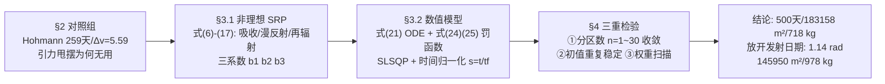

# 2017-GM-A-744（2017 题A · 队伍 744 · 35 页）

## 来自赏析

### 论文速览

巴塞罗那自治大学队伍是本批次篇幅最长、物理最"重"的一篇。以对数螺旋轨迹为解析骨架，用完整非理想太阳帆 SRP 模型（含吸收、漫反射、再辐射系数）建立极坐标运动方程，RK4 数值积分 + SciPy 的 SLSQP 非线性规划求解"最小帆面积 × 最短时间"双目标 NLP；帆角 $\alpha(t)$ 离散为 $n$ 段常值并做分区收敛检验。主线结果：500 天、最小帆面积 183158 m²、最大载荷 718 kg（ARV 8.31 km/s）；进一步放开"发射日期"约束得火星应超前地球 1.14 rad（65.38°）发射，帆面积降至 145950 m²、载荷 978 kg；还把模型推广到火星→地球反向转移（0.24 km²、499.98 天）。

### 获奖密码

1. **物理保真度最高**：非理想 SRP 三系数模型 + 逐项推导（式 7–17），并向评委证明数据来源（文献 [9]），模型可信度上一个档次。
2. **双目标优化框架干净**：罚函数 + 权重的设计让"可行性"与"最优性"解耦，且对权重做了量纲解释。
3. **收敛性与稳定性检验成体系**：分区数扫描 + 初值重复 + 权重扫描，这正是评委眼中"数值结果可信"的黄金证据链。
4. **超越题设的增值**：最优发射相位角 1.14 rad、反向轨迹，展示模型是通用工具而非一次性拟合。
5. **诚实披露失败**：Jupiter 算例溢出、无法保证全局最优、需手动初值，弱点段写得具体。
6. **排版信息密度高**：摘要即全文缩影，表格即决策依据，评委无需翻代码即可复核。

### 可借鉴清单

1. 引入非理想帆系数 $b_1,b_2,b_3$ 成本低（三个常数），却显著提升物理档次。
2. 把"到达条件"写成 $\max(\cdot,0)$ 罚项 + 权重目标，是处理多约束终端问题的万能套路。
3. 对分段控制量做 1–30 段的收敛性扫描，一张表就能证明解稳定。
4. 数值实验用固定单位制（如全部换 AU/天）避免浮点溢出——这是 744 用失败换来的教训。
5. 在题设之外做"如果放开某约束会怎样"的扩展分析，是金牌论文的常见加分项。
6. 目标函数权重本身也做灵敏度（Table 4），防止"最优解依赖人为权重"的质疑。

## 来自精读

### 全文骨架

同题（2000 kg、帆 7 g/m²、末速 ≤9 km/s、地火最近点出发），744 队的解法与 699 队互为镜像：**不用最优控制理论，用"非理想物理 + 非线性规划"硬算**，然后用三重数值检验证明结果可信：



**为什么这个骨架好**：§2 的对照组（Hohmann 更快但需要 5.59 km/s 的 Δv——帆给不了）一句话立住"为什么必须用帆"；§3.1 是全文的深度所在——**唯一一支建模"非理想帆"的队伍**（多花三页推导，换来三个常数 b₁b₂b₃ 与一个物理档次）；§4 的三重检验是数值论文的"可信度证据链"标准配置。与 670（532 天）、699（504 天）互相印证：三支队独立收敛到 500 天量级，这本身就是对题目答案的强交叉验证。

---

### 建模决策链

| 决策 | 作者的选择 | 被放弃的替代 | 为什么 |
|---|---|---|---|
| 帆模型 | 非理想三系数（吸收/漫反/再辐射） | 理想镜面（670/699 的选择） | 修正 ~18% 推力；三个常数成本低、文献可查、评委识货 |
| 控制参数化 | 分段常值 α + 时间归一化 | 光滑控制/最优控制理论 | SLSQP 直接可用；分区扫描证明 1–3 段已接近收敛 |
| 优化器 | SciPy SLSQP（含盒约束） | PSO（699）/网格（670） | 梯度法收敛快；约束（面积≤上限、t_f≤1.8 yr）天然支持 |
| 到达判据 | 距行星中心 < 行星半径 | 精确交点/距离极小化 | 把不可能的"过质心"操作化为可实现判据（假设清单第 6 条） |
| 目标结构 | max(·,0) 罚项 + 加权双目标 | 硬约束/多目标 Pareto 前沿 | 现成求解器可用；权重扫描（Table 4）部分替代 Pareto |
| 初值 | 允许 ≤逃逸速度的发射脉冲 | 纯零初速 | 发现最优解天然是"帆+微脉冲"混合（V≈0.1 km/s ≪ Hohmann 的 2.49） |
| 检验体系 | 分区扫描+初值重复+权重扫描 | 单次最优解 | 数值结果可信度的三重证据链 |
| 失败处理 | 木星算例溢出→改单位制/换语言建议 | 隐藏失败 | 工程诚实；浮点溢出的教训（统一 AU/天单位制）对读者有普适价值 |

**总规律**：**每个数值结论都配一个"为什么可信"的检验**；每个不可测的量（到达？）都配一个可操作化的定义。对照 670 的"收益递减论证"与 699 的"多起点 PSO"，三篇金牌对同一问题（分段数取多少）给出了同一答案：**证明够了，而不是真用满**。

---

### 可复用模板

**结构模板**：

```
Abstract      双目标+方法链+数字链前置+稳定性结论进摘要
1 Introduction 任务史一笔带过; 目标参数化(输入=出发/到达/速度限/相位角)
2 对照组       Hohmann(为何不可行:脉冲vs连续推力)+甩摆(对帆无意义) 引文献表
3 Model
  3.1 理论层: 解析特解(对数螺旋,作初值与定性) → 非理想力逐项推导 → 三系数合成 → 全ODE
  3.2 数值层: 假设清单(9条各配理由) → 罚函数化到达判据 → 加权目标(量纲配平)
              → 分段常值+时间归一化 → SLSQP+盒约束
4 Results     三重检验(分区收敛/初值稳定/权重扫描) 每表配机理解读
5 Further     放开约束(发射相位1.14 rad)+反向轨迹+失败案例
6-8 S&W/FW/Conclusions
Appendix      对照组推导 + 全部代码(13页)
```

**句式库（原文摘录）**：
- "Compared with different number of partitions of α, the optimum stays stable. This gives a solid optimal trajectory..."（稳定性结论进摘要）
- "the non interested reader skip this section and go straight to section 3"（为背景节提供的读者分流句）
- "in Solar Sails this fuel saving doesn't bring any new advantage, as our fuel resource is..."（对照组否定的物理理由）
- "the logarithmic spiral often provides a good first guess for a more advanced control law"（解析层为数值层服务的定位句）
- "It is clear that this function is always positive and only equals 0 for those values of... Thus the solutions of the NLP...are exactly the same solutions of our initial problem"（罚函数等价性声明——黑箱优化的合法性证明）
- "Therefore, even if the values of k1 and k2 are, in fact, smaller than k3 and k4, this difference is only apparent, since if we were to scale..."（权重矛盾的主动量纲辩护）
- "having a bigger area does not mean arriving faster, because if the area is too big, we may change the trajectory for a longer one in order to arrive under the required ARV"（反直觉发现的机理解释）
- "it is not necessary to perform many steering maneuvers in order to achieve a good approximation of the optimal trajectory"（数值发现的工程翻译）

**图表配方**：收敛性证据 → "多组解的曲线族叠绘一张图（α(t) 族/轨迹族）"；权衡分析 → "扫描表+反直觉点标注"；相位结论 → "直接把角度标在行星位置图上"。

---

*精读完这篇后，建议对照 `05_论文赏析/2017/2017-GM-A-744.md`（宏观赏析）与 `07_题目解读/2017_题A_太阳帆.md`（题目全解）形成三位一体。同题对照：`2017-GM-A-670_精读.md`（极简派，532 天）、`2017-GM-A-699_精读.md`（最优控制派，504 天）——三队独立收敛于 500 天量级，互为交叉验证。*
