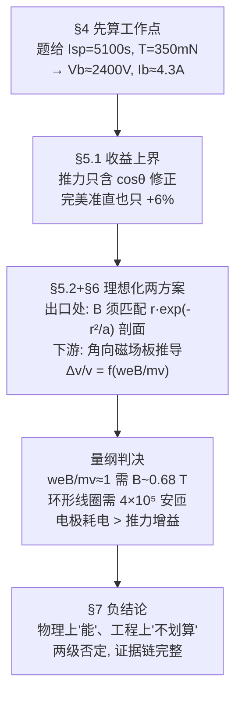

# 2017-GM-B-609（2017 题B · 队伍 609 · 18 页）

## 来自赏析

### 论文速览

一篇"负结果"金牌论文。Colorado College 队伍从推力方程出发，先算出题给推进器的工作点（栅间电压 $V_b\approx2400$ V、束流 $I_b\approx4.3$ A），再论证：因推力只含 $\cos\theta$ 修正，即使完美准直也只能提升约 6% 推力；随后分别评估"贴装在推进器出口"与"置于下游远处"两类磁场方案——前者需要磁场剖面精确匹配色散力分布且存在物理遮挡与腐蚀，后者受"磁场不做功"的根本限制，需要特斯拉量级磁场才能明显折转 50 km/s 的氙离子。最终结论：用磁场准直离子束不实用。物理上滴水不漏地否定了题中队员的提议。

### 获奖密码

1. **先定量再定性**：用题给 $I_{sp}=5100$ s、350 mN 反推 $V_b$、$I_b$，把"评估可行性"落在具体工作点上，而非空谈。
2. **抓住 $\cos\theta$ 的上界**：完美准直也只能提升约 6% 推力，一开场就框定了收益上限——这是全文最有力的物理判断。
3. **"磁场不做功"用到底**：最大化 $\Delta v_{axial}$ 的最优场方位（角向）被显式构造后仍证明不够，负结论因此无懈可击。
4. **量纲分析定位失配**：$weB/mv$ 的单一无量纲组合直接暴露"需要特斯拉场"的结论，比任何数值模拟都干净。
5. **两处方案都给建设性细节**：环型线圈场 $B=\frac{\mu_0NI}{2\pi r}\hat\varphi$（式 29）可与力剖面拟合，再指出遮挡/腐蚀/热损；等离子体透镜指出三个工程缺陷，否定得有理有据。
6. **负结果也有完整结论链**：摘要、讨论、弱点段一致收束于"不实用"，评委最欣赏这种自洽。

### 可借鉴清单

1. 评估类题目先由题给参数反推系统工作点（电压、电流、功率），建立讨论基准。
2. 寻找单一无量纲组合（如 $weB/mv$）判断可行性，一击致命且优雅。
3. 给"最优情形"构造显式上界（理想角向场、完美准直的 6%），再证明上界也不划算。
4. 负结论论文同样需要结构完整：假设→上界→两方案→讨论，缺一不可。
5. 把"设计剖面"画出来（力剖面 vs 可实现的场剖面）用图说话。
6. 结论要分清"物理不可行"与"工程不划算"两个层次，本文对两者都给了证据。

## 来自精读

### 全文骨架

题目背景：离子推进器羽流发散（半角 ~20°），既浪费推力又轰击航天器部件。队员提议用磁场"箍住"羽流——行不行？论文的回答分四步，每一步都在收窄"可行"的生存空间：



**为什么这个骨架好**：评估"XX 可不可行"的题目，最忌讳要么空谈要么只算一个方案。这篇的杀伤顺序是：**先算上界（6%）→ 再算理想化方案的需求（特斯拉级磁场）→ 再代入两个工程实现（环形线圈/等离子体透镜）逐条否定 → 最后区分"物理不可行"与"工程不划算"两个层次**。每一步都让"磁场方案"的死因更精确。负结论不是"我们没做出来"，而是"这条路的天花板我们已经量出来了"。

---

### 建模决策链

| 决策 | 作者的选择 | 被放弃的替代 | 为什么 |
|---|---|---|---|
| 评估优先级 | 推力/推进剂效率优先 | 溅射防护优先 | 溅射依赖具体航天器构型（摘要明示），先解可通用化的 |
| 收益口径 | cosθ 修正（上限 6%） | 末速分布全模拟 | 上界一行算出、对一切方案普适——先封顶再评估 |
| 理想化策略 | 逐离子定制最优角向场 | 直接分析某个具体磁体 | 理想极限的否定覆盖一切真实设计（真实≤理想） |
| 核心变量 | 无量纲组合 weB/mv | 多参数分别讨论 | 一个数判生死；两个极限锚点自检 |
| 出口方案 | 匹配色散力剖面反解 B | 给定磁体算轨迹 | "需要什么"先于"有什么"；剖面匹配度成为方案筛 |
| 工程方案 | toroid（出口）+ plasma lens（下游）各一 | 更多花哨设计 | 覆盖"羽流内/外"两个位置极值，每方案给 3 条失效模式 |
| 数据策略 | 全部关键参数引文献（20°、90%、0.1、力剖面） | 自造参数 | 无实验条件下的最大可信化；每条假设标影响量级 |
| 结论层次 | 区分"物理上能/工程上不划算" | 一句"不可行" | 两级否定各有证据；为后续研究留路线图 |

**总规律**：**负结论的说服力=否定的层级数**。这篇论文没有做任何大型计算，却让"磁场准直"在收益上界、物理极限、量纲需求、工程实现四个层级上逐一熄灯——每层只用了几行物理。

---

### 可复用模板

**结构模板**：

```
Abstract      两级优先级声明 + 保守方法论声明 + 负结论
Nomenclature  整页符号表(仿 AIAA)
2 Introduction 痛点的物理因果句式 + 调查路线
3 Assumptions 假设+理由+影响量级+文献
4 Fundamentals 题给规格 → 反解工作点(电压/电流) → 效率链
5 Criterion
  5.1 收益上界(6%) → 出口方案: 反解"需要的场剖面"
  5.2 理想最优场构造 → 几何推导 → 无量纲组合 → 量级判决 → 放置策略
6 Engineering  每个位置极值一个方案, 各配 2–3 条失效模式(引文献)
7 Discussion   死因总结 + 翻案所需实验路线图 + 负结论的正出口(溅射)
8 Appendix     全部推导 + 绘图代码
```

**句式库（原文摘录）**：
- "Our theoretical work follows a conservative line of thought; given the ideal magnetic field, what is the best job we could possibly do..., and is it good enough."（保守方法论纲领——理想上界策略的自白）
- "Only the velocity component that is parallel to the thruster axis contributes to the net momentum gained by the spacecraft."（物理事实句式：分量→后果）
- "we rule out apparatuses that only reduce the half angle slightly"（先立否决门槛）
- "Note that we are not saying that we should actually try to make an azimuthal B... Merely, we are saying that if we could define a different B for each ion... this is what it would be."（理想化极限的免责声明——用理想极限否定更强）
- "Note that the velocity of an ion is not changed by the magnetic field, since magnetic fields perform no work on particles."（把守恒律用作设计约束）
- "This is due to the fact that... Therefore, we cannot accurately determine..."（承认数据缺口并解释原因）
- "Power losses outweigh thrust increase."（五字死刑判决）

**图表配方**：可行性判决 → "增益–工程量曲线族（参数=入射角/工况），峰值与门槛线标注"；需求匹配 → "需要的剖面 vs 可实现的剖面同图叠绘"；负结果论文 → 每个被否方案配一张"装置示意+失效点标注"，且判决图必须附可复现代码。

---

*精读完这篇后，建议对照 `05_论文赏析/2017/2017-GM-B-609.md`（宏观赏析）与 `07_题目解读/2017_题B_离子推进器磁场导向.md`（题目全解）形成三位一体。*
