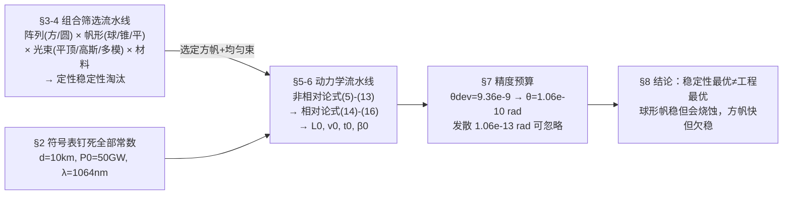

# 2018-GM-A-158（2018 题A · 队伍 158 · 19 页）

## 来自赏析

### 论文速览

IIT Delhi 队伍把 2018 题A 拆成三个子问题：帆形状 × 材料 × 光束形态的稳定组合筛选、均匀光束下的（相对论）加速动力学、激光指向精度预算。稳定性结论：不计功率效率与材料限制时，球形帆 + 多模高斯光束最稳；而在均匀光束的动力学对比中方帆最优。动力学上取总质量 2 g 时极限速度达 0.2c，并给出 $L_0=1.49\times10^7$ km、$t_0=9.97$ min、$\beta_0=0.166$ 等特征量。精度结论：飞掠比邻星 b 需指向半偏差角 $\theta_{dev}=9.364\times10^{-9}$ rad（式 17），若要求光斑中心始终罩住帆则需 $1.06\times10^{-10}$ rad（式 18），激光自身衍射发散 $\lambda/d=1.064\times10^{-13}$ rad（式 19）可忽略。

### 获奖密码

1. **问题覆盖完整**：题面三问（精度、制造容差、均匀性）逐一作答，且每问都有数字落点。
2. **设计空间组合筛选**：形状 × 光束 × 材料的组合矩阵配文献证据（Popova、Manchester & Loeb、Benford 实验），展示了对 Starshot 研究现状的把握。
3. **相对论处理不敷衍**：用双多普勒因子推导 $\dot\beta$（式 15），再用 Table 1 量化"何时必须相对论"，物理判断与数值互证。
4. **精度预算分两级**：先给任务级判据（式 17，9.4 nrad），再给更严的"光斑罩帆"判据（式 18，0.106 nrad），层次分明并说明取严者即可保证成功。
5. **忽略项全部定量辩护**：太阳引力差 7 个量级、衍射发散 $10^{-13}$ rad，无一处拍脑袋。
6. **诚实区分"稳定性最优"与"动力学最优"**：球形帆稳但工程难、方帆快但不稳，结论写成条件式而非一刀切。

### 可借鉴清单

1. 对开放式设计题，先列"形状 × 光束 × 材料"组合矩阵再逐一淘汰，结构清晰。
2. 引用最新文献（2016–2018 的 Starshot 系列）为假设背书，评委认可度高。
3. 相对论修正别只说"很小"，给出对比表（本文附录 Table 1 形式）。
4. 精度/容差预算采用多级判据：任务级（命中行星）+ 系统级（光斑不出帆），取最严者。
5. 每个被忽略的力都给"与主力量级对比"的一句话辩护。
6. 符号表直接附数值（d=10 km、P₀=50 GW……），便于评委复算。

## 来自精读

### 全文骨架

论文回答题面三问的方式是**两条并行流水线 + 一个汇合点**：



**为什么这个骨架好？** 稳定性（§4，定性+文献证据）与动力学（§5–6，定量+数值）被明确解耦——§4 末尾一句 "the stability is approached independently of the subsequent analysis"，先把"哪类组合原则上能活"筛掉，再对"能算的那一个"算到底。开放设计题最怕搅在一起：既没算清动力学，又没说服稳定性。此外 §2 的符号表带数值列（d=10 km、P₀=50 GW……），评委复算零成本。

---

### 建模决策链

| 决策 | 作者的选择 | 被放弃的替代 | 为什么 |
|---|---|---|---|
| 动力学载体 | 方帆+均匀束 | 球帆+多模高斯束（稳定性最优） | 均匀束下方帆"simplest case to computationally analyze"，两框架（NR/R）可横比 |
| 反射率 | ε_r=1 | 按实测 99.995% 折算 | 多层膜已"两个 9"，误差 <0.01% 远小于其他不确定度，且明示假设 |
| 材料参数域 | 介于现有 1–10 µm 与未证实 10 nm 之间 | 直接采用 Lubin 的 1000 nm/1400 g/m³ | "do not go near these limits"——优化结果不押注未证实技术 |
| 相对论处理 | 式(15) 数值积分 + Table 1 对比 | 只做 NR 或只做 R | 用对比表量化"2 g 载荷时偏差 3.4 个百分点"，修正必要性有数 |
| 载荷上限 | 2 g | 更大载荷 | 图 3 曲线在 2 g 处 β 触 0.2c，是任务约束下的最大可用质量 |
| 引力 | 忽略 | 加入日/地引力 | 0.00002 N vs 333.33 N 差 7 个量级，一句话排除 |
| 未建模项 | 地球自转致激光偏力矩 | — | 结论段明列，留给后续工作 |

**总规律**：每个"不做"都配一个量级或一条文献；每个"做"都给出它所在的比较组（单因素结果无意义，成组才有意义）。

---

### 可复用模板

**结构模板**：

```
Abstract        评价标准三件套 → 条件式双结论 → 一个精度数字
2 Notations     符号+数值列（评委可复算）
3 系统输入      阵列/波长/发散角（式 1）
4 组合淘汰      一般理论(式2-4) → 逐候选：文献证据+量级淘汰理由
5 动力学        5.1 NR 闭式链(式5-13)
                5.2 R 修正链(式14-16)
                5.3 横比图组
6 参数兑现      4 个特征数 + 量级排除段
7 精度预算      两级判据取严者 + 自检
8 结论          重申条件式 + 未做项清单
Appendix       对比表（数值底座）
```

**句式库（原文摘录）**：
- "The best configuration is taken to be one that allows for stability, directional precision and maximum speed for a given mass."（开篇即钉评价标准——多目标设计题第一句）
- "This has not yet been achieved, though there exist fabricated materials that have close to this value."（亮假设+诚实边界+证据，三合一）
- "...have not been established as feasible at this point in time, and so we do not go near these limits while varying our parameters"（划定参数域，防止被质疑押注黑科技）
- "It can be shown that the maximum speed occurs when..."（引证明结论入正文，省篇幅不省信息）
- "However, in reality the spherical sail, whose thickness is in the order of microns, would become ablated at high relativistic speeds."（用物理机理否决理论最优）
- "Thus, an equilibrium is established and a terminal velocity is reached."（一句话解释数值现象的物理来源）

**图表配方**：设计空间题 → "淘汰矩阵表 + 基准图 + 横比图 + 并排悬念图"四件套；数值对比 → 附录逐行表（NR vs R 双列），正文图只画结论。

---

*精读完这篇后，建议对照 `05_论文赏析/2018/2018-GM-A-158.md`（宏观赏析）与 `07_题目解读/2018_题A_光帆纳米飞行器.md`（题目全解）形成三位一体。同题对照精读：`2018-GM-A-258_精读.md`（球帆微扰模型）、`2018-GM-A-295_精读.md`（四子模型）。*
