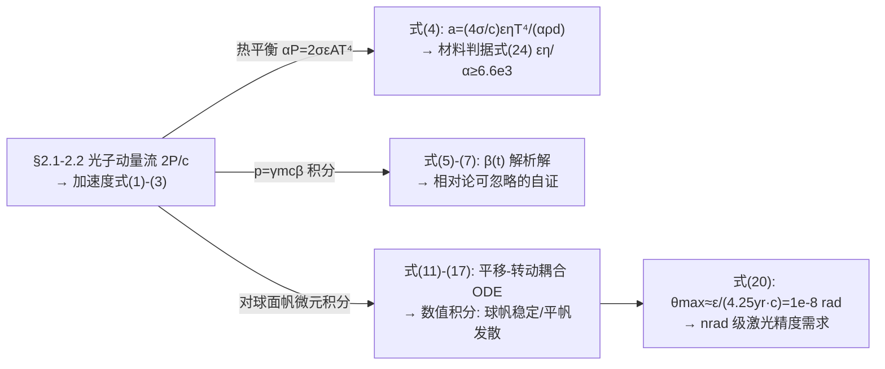

# 2018-GM-A-258（2018 题A · 队伍 258 · 13 页）

## 来自赏析

### 论文速览

UCSB 队伍（数学背景浓厚）用"一个刚性球面帆的微扰动力学模型"贯穿全文：先由动量流给出加速度与材料判据，再解析推导小扰动下帆的横移—转动耦合微分方程组，数值积分检验稳定性，最后换算成激光指向精度。核心结果三条：(1) 材料须满足 $\epsilon\eta/\alpha\ge6.6\times10^3$（式 24，铝以 $\epsilon=0.06$ 被否，加速度仅 1.32 m/s²）；(2) 球面帆对初扰动 $\delta_x\sim10^{-4}\!-\!10^{-3}$ cm、$\theta_y\sim10^{-4}\!-\!10^{-3}$ 度稳定，振幅 0.2–2 cm，对应角扰动稳定裕度 $2\times10^{-6}$ rad、最大初始横向扰动 10 µm；(3) 要在 Earth–Moon 距离内飞掠比邻星 b，激光须满足 $\theta_{max}\approx\epsilon/(4.25\,\mathrm{yr}\cdot c)\approx1\times10^{-8}$ rad（式 20），且模型保守——未利用激光束本身的自稳定能力。

### 获奖密码

1. **一个模型贯穿所有子问题**：材料（式 4/24）、加速（式 7）、稳定（式 16/17）、精度（式 20）全部由同一动力学框架派生，体系性极强。
2. **热平衡—加速度联立**（式 4）把"材料容差"翻译成可查表的无量纲判据，直接回答题面的 fabrication margin 之问。
3. **微扰方程解析可积**：平顶光束近似让力/力矩积分闭式可解，评委可以逐步验算，可信度高。
4. **极限行为自检**：$R\to\infty$ 恢复平面帆不稳定、$\beta\ll1$ 恢复常加速度，两处极限都验证了模型。
5. **保守模型的明确定位**：摘要与结论都强调"不允许激光束参与稳定"，因此所有精度要求是上界，弱化点变成严谨性卖点。
6. **弱点段有硬核量化**：尘埃撞击角加速度 $10^{-5}$ rad/s、一天自转一圈的推算，说明作者真正想过工程可行性。

### 可借鉴清单

1. 用"吸收 = 辐射"热平衡把动力学上限与材料属性挂钩，一步得到判据式 (4)。
2. 选可解析积分的光束剖面（平顶），换取闭式微扰方程；高斯修正放弱点讨论。
3. 模型检验优先做两个极限：几何极限（R→∞）与速度极限（β→0）。
4. 稳定性用"初扰动—振幅"标度实验呈现，两张图即可定量给出容差。
5. 数值实验的能耗自洽（振荡功率 vs 光束功率）是常被忽略但极易做的好检验。
6. 摘要放 3–4 个带量纲的关键数，评委扫一眼即可确认全文完成度。

## 来自精读

### 全文骨架

论文只建**一个模型**，让它回答**所有子问题**：



**为什么这个骨架好？** 与 158 队"组合筛选+分段计算"相反，258 队把全部赌注押在**一个可解析的微扰模型**上：选平顶光束（式 13）换取闭式力/力矩（式 14/15），选球面帆（有限曲率 R）让 R→∞ 自动退化为平帆（式 18/19）——**两个极限行为（R→∞、β→0）各做一次自检**，模型可信度由内而生。评委看到的不是"很多计算"，而是"一个自洽的物理学"。

---

### 建模决策链

| 决策 | 作者的选择 | 被放弃的替代 | 为什么 |
|---|---|---|---|
| 帆形 | 球面（有限 R） | 平/锥/抛物面 | R 是连续参数：R→∞ 退化为平帆，一个参数统一两类已知结论 |
| 光束剖面 | 平顶（式 13） | 高斯（真实衍射束） | "This allows the solution of the integrals analitically"——可积性换闭式方程；高斯的差异放 Weakness |
| 稳定性机制 | 纯几何恢复（保守） | 光束整形主动稳定 | 明确定位"conservative"，所有精度是上界 |
| 质量分布 | 两质点哑铃 + 刚性连接件 | 分布质量/连接件惯量 | 转动惯量有闭式（式 10）；连接件误差入 Weakness |
| 相对论 | 解析解画图证明可忽略 | 全程相对论 ODE | β≤0.2 时 γ 修正 ≤2%，小于其他假设误差 |
| z 轴运动 | 恒加速度式 (2) | 全耦合 3D | 振荡功率 7 kW ≪ 50 GW，能量自洽检验背书 |
| 引力 | 忽略 | 加引力项 | 发射于大气层外、逃逸速度不需考虑（假设 4 的一部分） |
| 铝材料 | 用反例否决 | 微调参数接受 | a 差 5 个量级，无调参余地——用判据否决而非用偏好 |

---

### 可复用模板

**结构模板**：

```
Abstract        3-4 个带量纲数字 + 一句模型定位（保守/乐观）
1 Introduction  问题改写为初值问题 + 编号假设（每条一句理由）
2 Physics       2.1 动量流 → 加速度（拆两步）
                2.2 平衡律消功率 → 材料判据
                2.3 相对论解析解（自证可忽略）
                2.4 微扰 ODE（闭式力/力矩 + R→∞ 极限自检）
                2.5 任务精度（几何一行式）
3 Results       3.1 量纲三连算 + 反例材料
                3.2 极限行为图（β-t）
                3.3 平帆发散（数值证据）+ 球帆振荡（线性标度）+ 能量自洽
                3.4 容差闭环（需求↔仿真↔指标）
4 Conclusions   弱点全量化（尘埃撞击链）+ 强度含裕度 + Future work 指向光束整形
Appendix       可运行代码
```

**句式库（原文摘录）**：
- "Approximations and assumptions are made to simplify the issue of sail stability, which is the most difficult part of the analysis."（摘要即承认最难处的处理策略）
- "If a smaller width than the FWHM value actually hits the sail, then this is not a bad approximation"（近似与适用条件同句给出）
- "The issue with aluminum is its low emissivity, causing it to heat up — and therefore reach its temperature limit — too quickly."（反例的物理解释一句话）
- "the velocities in the x-axis exceed the relativistic limit. Therefore, the derivations made are not valid anymore. Regardless, ..."（数值溢出的诚实处理）
- "the model proposed is conservative, in the sense that it does not allow the laser beam to stabilize the sail."（模型定位句）
- "If it is not counteracted, it will lead to approximately a complete rotation in just one day."（把微小扰动翻译成可感知后果）

**图表配方**：稳定性论证 → "两组初扰动同图叠放 + 线性标度写进图注"；解析解 → "全景图 + 局部放大图双联"（Fig 4 式）；几何定义 → 一张坐标系示意图（Fig 2 式）放在公式群之前。

---

*精读完这篇后，建议对照 `05_论文赏析/2018/2018-GM-A-258.md`（宏观赏析）与 `07_题目解读/2018_题A_光帆纳米飞行器.md`（题目全解）形成三位一体。同题对照精读：`2018-GM-A-158_精读.md`（组合筛选+精度预算）、`2018-GM-A-295_精读.md`（四子模型）。*
