# 2018-GM-A-295（2018 题A · 队伍 295 · 25 页）

## 来自赏析

### 论文速览

论文回答"光帆加速过程中激光束精度、帆面制造误差、光束均匀性三个因素需要控制在什么量级，才能使纳米飞行器最终在小于地月距离处飞掠比邻星 b"。技术路线是：把帆离散为 $100\times100$ 个面积元，建立含相对论质量修正的刚体姿态动力学（欧拉方程），将三类扰动以高斯随机过程注入动力学模型，用梯度下降法标定"扰动—偏转角"关系，再以轨道模型给出的最大允许偏转角 $\alpha_{max}=1.9842\times10^{-7}\,\mathrm{rad}$ 为约束反解三个容差，得到 $\delta P/P=10^{-8.306}$、$\delta m=10^{-5.391}$、$\delta d=10^{-4.314}$；最后用粒子群算法（PSO）在三因素联合约束下搜出最优解 $10^{-8.769}$、$10^{-6.032}$、$10^{-4.938}$。

### 获奖密码

1. **把模糊的问题陈述翻译成可计算的指标**：题目问"精度、制造误差、均匀性"，论文将其逐一操作化为 $\delta P/P$、$\delta m$、$\delta d$ 三个无量纲/有量纲指标，并全部接到同一个动力学方程上，形成统一闭环。
2. **物理链条完整**：从激光穿过大气（衰减到 0.723）到光压、相对论质量修正、姿态偏转，再到 4.2 光年的轨道几何，端到端无断点，且每一步都有文献支撑（大气衰减、光压公式均引文献）。
3. **反向设计与临界条件**：不是正向"算一个轨迹"，而是先算出 $\alpha_{max}=1.9842\times10^{-7}$ rad 这个"门槛"，再反推工程容差——这正是评委问的"necessary accuracy and precision"。
4. **自检与灵敏度分析**：对离散元数 $N$ 的三个独立收敛实验（45/35/40）为数值结果背书，直接回应"结果是否依赖计算参数"的评委质疑。
5. **诚实的模型评价 + 二次提升**：承认单因素法给出的是保守上限，再用 PSO 求三因素权衡的最优解，"初步解→优化解"的递进展示了完整的工程思维。

### 可借鉴清单

1. 用"思维导图（Figure 1/2）"在摘要后与模型节前各放一张全流程图，评委 30 秒内即可抓住建模逻辑。
2. 把题目中每个模糊名词先"操作化"为带符号、带单位的物理量（定义一节 Notations 表），再建模，避免答非所问。
3. 遇到随机扰动无解析解时，先论证单调性，再用梯度下降/二分法反解临界值，比盲目蒙特卡洛更快且结论更硬。
4. 对网格/离散规模做收敛性扫描（如本文 $N=10\to100$ 的三组实验），并给出"再加密无收益"的结论以证明计算资源分配合理。
5. 单因素分析给保守解 + 智能优化算法（PSO）给联合最优解，两套结果并列呈现，既完整又显深度。
6. 摘要中直接给带指数的全部数值结论（$10^{-8.306}$ 等），让评委第一页就看到可核查的数字。

## 来自精读

### 全文骨架

论文把"三个误差因素要控制在什么量级"翻译成一个**反问题**：先算门槛（最大允许偏转角），再数值标定"扰动→偏转角"曲线，最后反解容差，并用 PSO 做三因素联合优化：

```mermaid
flowchart LR
    A["子模型1 激光传输<br/>消光系数+指数大气<br/>→ P/P0=0.723"] --> D["子模型2 加速动力学<br/>100×100 微元 + 欧拉方程<br/>含相对论质量与 F=2P/(c+v)"]
    D --> E["子模型3 稳定性<br/>δP/P, δm, δd 三扰动<br/>高斯随机注入 → Δα 单调<br/>→ 梯度下降反解容差"]
    B["子模型4 轨道<br/>两策略几何 → αmax<br/>=1.9842e-7 rad（门槛）"] --> E
    E --> F["初步解: 1e-8.306, 1e-5.391, 1e-4.314<br/>PSO 联合最优: 1e-8.769, 1e-6.032, 1e-4.938"]
    C["§6 灵敏度: N=10→100 扫描<br/>N>45/35/40 后收敛<br/>→ N=100 取值有据"] --> E
```



**为什么这个骨架好？** 四个子模型**单向依赖、各答一问**：传输模型给动力学供输入功率，轨道模型给稳定性供判定门槛，稳定性模型产出最终容差——抽象图（Figure 1/2 两张思维导图）把这张依赖图直接印在评委脑子里。**"先定门槛再反解"**是本篇的灵魂：不正向算一条轨迹，而是先算出 α_max=1.9842×10⁻⁷ rad 这个硬约束，工程容差全部由它反推——正对题面"necessary accuracy and precision"的问法。

---

### 建模决策链

| 决策 | 作者的选择 | 被放弃的替代 | 为什么 |
|---|---|---|---|
| 帆的离散 | 100×100 微元 | 连续体/少质点 | 微元法让 δm、δd 有注入接口；N 的合理性由 §6 三实验背书 |
| 光压公式 | F=2P/(c+v)（引中文文献） | 双多普勒完整式 | 一阶修正已覆盖主要效应；文献可得、推导短 |
| 引力 | 数值验证后忽略 | 积分完整轨道 | 0.2c 直线轨迹下偏折远小于 α_max，一步排除 |
| 瞄准策略 | 指向恒星（策略二） | 直指行星 | 周期对比（11.2 d vs 21 yr）→ 相位不可知，策略二容差大 20 倍 |
| 求解策略 | 单调性+梯度下降反解 | 蒙特卡洛全扫描 | 单调已证，反解一个交点即可，省算力且结论硬 |
| 扰动统计 | 独立高斯 | 相关/系统偏置 | 假设 7；系统偏置另行处理会更完整（未做） |
| 联合优化 | PSO | 网格搜索/拉格朗日 | 三维非线性约束曲面，PSO 实现快、无需梯度 |
| 大气模型 | 垂直单程消光 | 斜程/多次散射 | 自曝于 §7.1（"multi-directional... only vertical one-way"） |

---

### 可复用模板

**结构模板**：

```
Abstract        四子模型各一句 + 两套数值（单因素/联合最优）
1-2 Introduction/Restatement  三阶段分解 + 三个模糊词的可计算翻译
3 Assumptions   编号假设（每条对应后文某个步骤）
4 Model         4.1 传输模型（物理第一性：消光+标准大气）
                4.2 动力学（微元+双坐标系+欧拉方程+相对论）
                4.3 稳定性（三扰动注入，配示意小图）
                4.4 轨道（引力排除+两策略门槛）
5 Results       门槛→三条对数曲线→三个容差
6 Sensitivity   N 收敛三实验（每因素一组）
7 Improvement   自曝缺陷 + PSO 联合优化（含伪代码）
8-9 S/W + Conclusion
Appendix       MATLAB 全代码
```

**句式库（原文摘录，已修正常见 Word 提取错漏）**：
- "The necessary accuracy and precision of the beam from the laser array can be understood as the deviation of laser power..."（模糊词操作化的标准句式）
- "Therefore, finding out the relationship between drift angle and three factors becomes the key to solving the problem."（一句话把全文问题压缩成一个函数关系）
- "Through the calculation, the effect of gravitation on track could be overlooked."（数值验证后的排除声明）
- "the angle of rotation and small disturbance had a monotonic positive correlation"（反解策略的合法性前提，先证后用）
- "the increase of N cannot help with the accuracy when N is larger than 50. Consequently, it is reasonable to assume N as 100"（收敛实验收尾：给阈值+给取值）
- "However, these three factors work together to influence drift angle in the real situation. So the results are the maximum errors of the three factors."（自曝单因素解的口径，为 PSO 铺垫）

**图表配方**：多因素容差题 → "思维导图×2（总览+模型节前）+ 每因素一条对数曲线 + N 收敛三连图"；几何门槛 → "两策略各一张示意图 + 一张数值验证图"；随机扰动 → 深浅色热图（Fig 4 式）比文字定义直观。

---

*精读完这篇后，建议对照 `05_论文赏析/2018/2018-GM-A-295.md`（宏观赏析）与 `07_题目解读/2018_题A_光帆纳米飞行器.md`（题目全解）形成三位一体。同题对照精读：`2018-GM-A-158_精读.md`（组合筛选+精度预算）、`2018-GM-A-258_精读.md`（球帆微扰模型）。*
