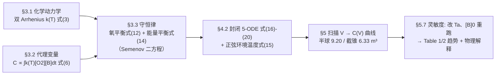

# 2018-GM-B-240（2018 题B · 队伍 240 · 17 页）

## 来自赏析

### 论文速览

论文把厨房厨余堆肥堆简化为基于 **Semenov 热量-质量输运方程**的热化学反应系统，以"已反应氧气的质量"作为堆肥效率的代理变量，通过数值积分求堆肥量 $C$ 随体积 $V$ 的变化并做优化，得到：半球形堆最优体积 $V_{max}=9.20\,\mathrm{m^3}$、四棱截锥（金字塔）堆 $V_{max}=6.33\,\mathrm{m^3}$；并进一步给出最优体积随环境温度升高而增大、随进料生物质浓度升高而减小的定量规律（Table 1、Table 2）。物理结论是：在此体积量级上，**氧气通量比保温更重要**。

### 获奖密码

1. **代理变量选得准**：用"已反应氧质量"统一表征微生物代谢强度，把"高效堆肥"这一生物学问题转译成可积分的物理量 $C\propto\int k(T)[O_2][B]dt$，一步消解了"效率如何定义"的评分风险。
2. **形状以 $S/V$ 入模**：不同堆形的差异被压缩进单一几何参数，使"半球 vs 截锥"的比较变成同一组 ODE 的两次参数扫描，模型通用且省力。
3. **敢于修数据**：发现文献 Arrhenius 参数与题给温区矛盾后，明确说明并重新标定（Discussion 首段），展现对参数物理意义的掌控而非照搬。
4. **多重自洽性检验**：$k(T)$ 峰位检查、$T$/$[H_2O]$ 是否落在题目给定区间、与已发表模型的曲线形态比对，三层验证环环相扣。
5. **结论有物理解释而非只报数**：解释了为何金字塔（更大 $S/V$）反而更优——氧通量优先于保温；并对 $[B]_0$ 的"非直觉反相关"给出保温性解释，评委最看重的 physical insight 正在于此。
6. **Future Work 给出可操作的升级路径**（3-D 模型 + Fourier 传热方程式 21–24），显示对模型局限的清醒认识。

### 可借鉴清单

1. 为模糊的"效率/效果"找一个与守恒律直接挂钩的守恒量或积分量作代理指标（本文的 $m_{O_2,r}$）。
2. 让几何形状只通过 $S/V$（或类似无量纲比）进入控制方程，可把"形状优化"降维成"参数优化"。
3. 用文献参数前先做相干性检查（如 $k(T)$ 峰位、特征时间尺度），发现矛盾要明说并重标定，切忌静默改数。
4. 把题目给定的"正常工作区间"（40–60 °C、湿度 50–60%）用作模型输出的验收标准，是最便宜也最有说服力的验证。
5. 附录提供"符号—含义—数值—单位"四列参数总表，评委可逐项核查。
6. 优化曲线在图内直接标注最优点数值（$V_{max}=9.20\,\mathrm{m^3}$），正文、摘要、图表三处数字保持一致。

## 来自精读

### 全文骨架

论文是经典的三层流水线：**理论（守恒律）→ 模型（5 个 ODE）→ 扫描优化**：



**为什么这个骨架好？** 全文只有一个可调输入（V，连同形状给的 S/V），一个可观测输出（C）——**单变量单目标的优化**，中间用守恒律焊接。三个"该不该建模"的诱惑（湿度动力学、微生物种群、3D 温场）全部被挡在假设层或推给 Future Work，48 小时内只算能算清的。评委看到的每一个方程都在最终数字里留了痕迹。

---

### 建模决策链

| 决策 | 作者的选择 | 被放弃的替代 | 为什么 |
|---|---|---|---|
| 效率度量 | 已反应氧质量（式 5–6） | 腐熟度/发芽率等生物指标 | 与守恒律同变量、可直接积分；α 未知用归一化绕开 |
| 形状参数化 | 只以 S/V 入方程 | 每种形状单独建模 | "形状优化"降维成同一 ODE 的两次扫描 |
| 温度场 | 0-D 均匀（Semenov） | 3-D Fourier（式 21） | 48 小时算不完 3-D 参数扫描；0-D 的误差在最优体积较小时可控 |
| 动力学参数 | 文献参数重标定到 40–60 °C | 照搬文献值 | 原参数高效温区 80–100 °C 与题面矛盾；重标定引文献先例 |
| 生物质消耗 | 加式 (19)（Semenov 原版无） | 视 [B] 常数 | 100 天尺度生物质耗尽驱动第三相；"Unlike the Semenov's formulation" 明示修改 |
| 湿度 | 只做验收指标（50–60%） | 全湿度动力学 | 湿度主要由化学变化决定（同题 285 队的判断），物理模型不必闭合 |
| 环境温度 | 24 h 正弦 | 阶梯/常数 | 题面给 5–20 °C 日循环；正弦最平滑且代码一行；正文还做了常数对照 |
| 优化变量 | 连续扫 V（100 点） | 梯度法/遗传算法 | 单峰一维问题，扫描曲线本身可当图用 |

---

### 可复用模板

**结构模板**：

```
Abstract        双形状双数字 + 趋势结论 + 验证声明
1-2 Background  全因素列举 → 聚焦两主因（给"不做什么"铺理由）
3 Theory        3.1 动力学（定性现象对齐的 k(T)）
                3.2 代理变量（与方程共享变量的目标函数）
                3.3 守恒律（形状压成 S/V）
4 Method        假设+理由 → n-ODE 系统 → 验收标准（题面区间）
5 Results       相干性检查图 → 演化曲线组 → 优化曲线（图内三件套）→ 趋势表
6 Discussion    参数重标定坦白 + 文献形态比对 + 每条趋势配机理
7 Future Work   下一级方程已列出
8 Conclusions   trade-off 双面陈述 + 非直觉结果的解释
Appendix       参数四列表 + 全代码
```

**句式库（原文摘录）**：
- "the metabolism can be described as the consumption of biomass or oxygen. In consequence, the composting is proportional to..."（代理变量的合法性一句话）
- "This definition is coherent as the mass transfer coefficient will increase with v_air and will decrease with V because..."（定义即辩护：每个新系数都说明单调性方向）
- "Unlike the Semenov's formulation, we have taken into account that..."（对经典框架的修改声明）
- "It has been found that the factors regarding the kinetic constant where not suited for this problem as... The kinetic was reescalated to..."（发现参数矛盾→明说→重标定，绝不静默改数）
- "An increase of volume leads to... A decrease of the volume diminishes..."（trade-off 的双面对照句式）
- "These variables are the first validation of the model."（把题面约束升格为验收标准的宣告句）

**图表配方**：ODE 系统类论文 → "相干性检查图开路（k(T) 峰位/特征时间）→ 每状态量一条演化曲线 → 目标函数-参数扫描图（图内标初条件与最优点）→ 灵敏度用表格"；所有数值结论在摘要/图题/讨论三处强制一致（本篇的摘要对调是反面教材）。

---

*精读完这篇后，建议对照 `05_论文赏析/2018/2018-GM-B-240.md`（宏观赏析）与 `07_题目解读/2018_题B_堆肥堆尺寸.md`（题目全解）形成三位一体。同题对照精读：`2018-GM-B-285_精读.md`（圆柱场分布+自重压实模型）。*
