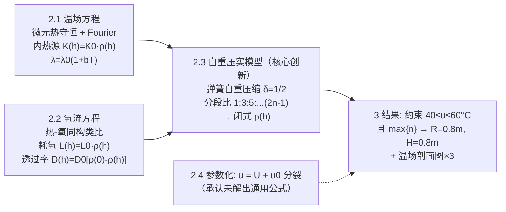

# 2018-GM-B-285（2018 题B · 队伍 285 · 11 页）

## 来自赏析

### 论文速览

论文与 240 队同题异构：不走"整体 ODE + 优化"路线，而是从**场分布**出发，把圆柱形堆肥堆对称切出扇形薄片，用热量守恒 + Fourier 定律建立带内热源的温场方程，再按"氧扩散与热传导同构"写出氧含量方程；其独特之处是引入**自重压实模型**（把堆料理想化为自重不可忽略的"弹簧"），推出密度随高度的分 布 $\rho(h)$ 并作为两个场方程的耦合系数。最终在约束 $40\le u\le60\,^\circ\mathrm{C}$ 与氧含量最大化下，解得最优尺寸 $R=0.8\,$m、$H=0.8\,$m。

### 获奖密码

1. **把题目最难的物理点做成核心模型**：大多数队伍会回避"压实抑制供氧"这条定性提示，285 队却把它升级为弹簧自重压缩模型并解出闭式 $\rho(h)$，再让它进入热/氧两个方程——这正是评委眼中"对问题物理本质的洞察"。
2. **同构类比降维打击**：热传导与氧扩散的类比论证（方向相反、源项同源）使模型自洽且省篇幅，展示物理直觉。
3. **推导过程全透明**：从 $Q_{left/right/up/down}$ 逐项写出、到弹簧分段 Hooke 方程逐行列出（$1:3:5:\cdots$），评委可逐步复算。
4. **结果直答题目**：给出明确尺寸 $R=0.8$ m、$H=0.8$ m，并用温场剖面图说明"中心 ≤60 °C、边缘近环境温度"的取舍逻辑。
5. **诚实的边界**：明确承认未能导出尺寸随环境的通用公式，只交付框架与特例解；评委通常对"自曝局限且已尽力"的队伍更宽容。
6. 篇幅紧凑（11 页）、无冗余，符合 48 小时竞赛"少而精"的完成度美学。

### 可借鉴清单

1. 遇到题目中的定性提示（"大堆会被压实"）时，为其单独建一个子模型并解出闭式表达，往往就是金牌差异化卖点。
2. 两个输运过程结构相同时，用类比论证直接迁移方程，再用一句话说明方向/符号差异，可节省一半推导且不易出错。
3. 用守恒律写微元平衡（先差分后取极限）推导 PDE，比直接抄标准方程更能展示物理功底。
4. 场分布类问题务必给"一图三线"：3D 曲面 + 两个正交剖面，用剖面图直接论证设计参数的选取。
5. 环境温度日循环可用分段阶梯近似（本文 5/10/15/20 °C）或正弦（240 队），两者取其一即可，但要说明选择依据。
6. 若通用解无法在赛程内完成，明确写出"已完成部分 + 未竟部分的原因"，比含糊带过更能保住分数。

## 来自精读

### 全文骨架

论文是"**两个场 + 一个分布 + 一个判据**"的四件套：



**为什么这个骨架好？** 两个场方程的系数（热源、耗氧、透过率）**全部挂在同一个 ρ(h) 上**——压实模型是全文的枢纽，一个子模型同时喂饱三个方程。这种"单枢纽多下游"结构让 11 页的短论文有了体系感。同时 §3.2 坦诚"equation is too complicated to be solved"——通用公式没解出来，只交付框架与特例解，**诚实边界本身就是加分项**。

---

### 建模决策链

| 决策 | 作者的选择 | 被放弃的替代 | 为什么 |
|---|---|---|---|
| 学科范围 | 剥离化学/生物，只留温度+氧 | 全耦合生化模型 | "independent of the physical model"——物理赛只考物理 |
| 形状 | 圆柱（两参数 R、H） | 半球/锥（240 队） | "the simplest shape... only needs to consider the two variables"——参数最少且切片方便 |
| 维度 | 圆周对称 → 2-D 扇形薄片 | 全 3-D | 各切片相同，一片代表全部——对称性降维零成本 |
| 氧过程 | 与热传导同构类比 | 独立推一套扩散方程 | "The amount of heat generated by the same amount of microorganisms is the same as the amount of oxygen consumed"——同源同构，省一页推导 |
| 压实建模 | 弹簧自重压缩（弹性唯象） | 经验压实公式/多孔弹性理论 | 一步得闭式 ρ(h)；弹性极限内自洽，代价是颗粒物理被抹平 |
| 环境温度 | 5/10/15/20 °C 分段阶梯 | 正弦（240 队）/常数 | 每 6 h 一段定解问题，配合 24 h 约束检查直接 |
| 判据 | 中心≤60 °C 且全场尽量在窗内 + max n | 体积平均温度 | "贴边即最优"：约束上界由中心顶住，剖面图直接读出合法性 |
| 通用公式 | 尝试 u=U+u₀ 分裂，失败并如实报告 | 只报特例 | 诚实边界："although we have established a reasonable and effective physical model, we have not been able to obtain a general formula" |

---

### 可复用模板

**结构模板**：

```
Abstract        建模动作连播（剥离→抽象→离散→压实），无数字也可成立
1 Problem Analysis  变量筛选 + 指标操作化 + 类比预埋
2 Model         2.1 微元守恒推 PDE（先差分后极限）
                2.2 同构迁移第二方程（映射表+方向差）
                2.3 枢纽子模型（压实→闭式 ρ(h)，奇数比逐行列出）
                2.4 参数化尝试（成则赚、败则报）
3 Results       参数表 → 约束 → 尺寸 → 一图三线（3D 曲面+两剖面）
References      两条关键引文：δ=1/2 的弹簧文献 + 数值方法参考
```

**句式库（原文摘录，Word 提取错漏已修）**：
- "Since a series of chemical reactions and biological changes... are independent of the physical model, only the effects of temperature and oxygen content can be considered."（学科剥离的合法性一句话）
- "The difference is that heat is transmitted from the inside to the outside, and the oxygen content is diffused from the outside to the inside."（同构+方向差，类比迁移的标准句式）
- "In order to study the oxygen content, it is particularly important to study the density distribution of compost under self-weight."（枢纽子模型的动机句）
- "the spring degree compression is equal to half the amount of compression after the spring mass is concentrated under self-weight"（δ=1/2 结论的口语化重述——重要结论换个说法再说一遍）
- "the temperature at the center... is as close as possible but not exceeding 60 degrees Celsius, and the temperature near the edge is inevitably close to the ambient temperature"（"贴边即最优"的设计论证句式）
- "Unfortunately, although we have established a reasonable and effective physical model, we have not been able to obtain a general formula... because the equation is too complicated to be solved."（诚实的失败报告）

**图表配方**：场分布类问题 → "几何示意（微元定义）+ 3D 曲面全景 + 两个正交剖面"，剖面横轴单位务必统一（本篇 Fig 3 用 m、Fig 4 用 cm 是反面教材）；闭式新物理量 → 无量纲化后单参数族曲线 + 一条自检曲线（如质量守恒）。

---

*精读完这篇后，建议对照 `05_论文赏析/2018/2018-GM-B-285.md`（宏观赏析）与 `07_题目解读/2018_题B_堆肥堆尺寸.md`（题目全解）形成三位一体。同题对照精读：`2018-GM-B-240_精读.md`（Semenov 集总参数+形状降维）。*
