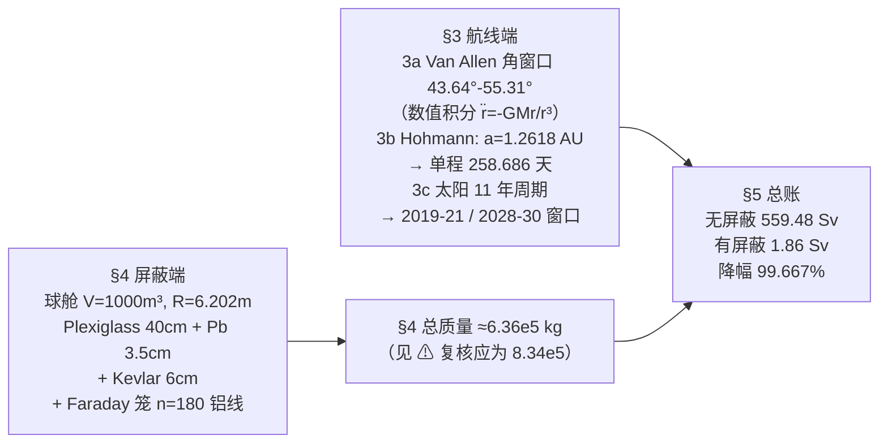

# 2019-GM-A-105（2019 题A · 队伍 105 · 17 页）

## 来自赏析

### 论文速览

单人队伍（University of Delhi 的 Alankit Dey）的方案由两大板块构成：**航线端**——数值积分地心惯性系引力微分方程确定避开 Van Allen 带核心的发射角窗口（相对地磁轴 $43.64°\sim55.31°$），用 Hohmann 转移 + 开普勒第三定律算出 258.686 天（约 259 天）的单程最短飞行时间，并按 11 年太阳活动周期给出 2019–2021 与 2028–2030 两类发射窗口；**屏蔽端**——1000 m³ 球形居住舱（内半径 6.202 m）叠加 Plexiglass(40 cm)+铅(3.5 cm)+Kevlar(6 cm) 三层被动屏蔽与铝线 Faraday 笼（n≈180 根、半径 0.1 m），算得附加总质量约 $6.36\times10^5$ kg，剂量从无屏蔽的 559.48 Sv 降到 1.86 Sv（降幅 99.667%）。

### 获奖密码

1. **把"防护"拆成时空两个维度**：先在"何时/何路"上降剂量（避开辐射带核心 + 太阳极小期发射 + 最短 259 天），再在"用什么挡"上兜底（三层材料 + Faraday 笼），问题分解完整，正对题目"plan + mass + practicality"三问。
2. **每个设计选择都有物理理由**：球形（最小面容比、无接缝）、材料排序（先 Plexiglass 挡 β 抑制韧致辐射、再铅挡 γ、Kevlar 耐热）、铝线 Faraday 笼（比铜轻），处处见 trade-off 意识。
3. **量纲/标度分析用于工程决策**：用 $|\nabla\phi(0)|\approx-2\log r/(n|z_s|)$ 判断"网 vs 连续壳"，把抽象的拉普拉斯边值问题变成可数根数的工程参数。
4. **结果以倍数呈现**：剂量降低 99.667%、1.86 Sv"低于年限值"，给出可判定的安全结论而非只报厚度。
5. **假设显式且自洽**：点源、最大恒定曝光率是保守假设，论文在结论中说明其保守方向，降低了被质疑"低估风险"的空间。
6. 单人成队仍覆盖轨道力学、核辐射物理、电磁学三个领域，完成度高、交叉面广，符合 UPC "应用物理全景" 的评审口味。

### 可借鉴清单

1. 辐射/曝露类题目按"时间 × 路径 × 屏蔽"三因子分解，分别建模后乘性合成总剂量，结构即完整。
2. 屏蔽计算记熟两条主力公式：指数衰减 $I=I_0e^{-\mu_m\rho x}$（配质量衰减系数表）与点源曝光率 $ER=6CE_n/d^2$，可快速给出厚度量级。
3. 多层屏蔽按"低穿透先挡"排序（β 先于 γ），并用"抑制韧致辐射"作为选择低 Z 材料的理由，一句话提升专业感。
4. 面积/体积敏感的设计用"最小面容比"论证选球形，配合 $V\Rightarrow R\Rightarrow S$ 三步算清几何量。
5. 关键结论给"无措施 vs 有措施"对照（559.48 Sv → 1.86 Sv），用降幅百分比冲击评委。
6. 摘要数值必须与正文最终数严格一致（本文 $6.33\times10^5$ vs $6.36\times10^5$ 的不一致是前车之鉴）。

## 来自精读

### 全文骨架

论文是**两条独立防线 + 一本总账**的结构：



**为什么这个骨架好？** "时间 × 路径 × 屏蔽"是辐射防护的三因子（正文 §4 原文即列 time / distance / shielding 三法），论文结构与之严格同构——**方法论地图就是目录**。两条防线独立可检，最后 §5 用一个乘法（曝光率 × 时长 × 换算）把两条线合成一个可判定结论（1.86 Sv"低于年限值"）。单人队伍能覆盖轨道力学、核辐射物理、电磁学三个领域并各出数字，正是 UPC 评审偏爱的"应用物理全景"。

---

### 建模决策链

| 决策 | 作者的选择 | 被放弃的替代 | 为什么 |
|---|---|---|---|
| 防护分解 | 时间×路径×屏蔽三因子分别建模 | 只做屏蔽 | 剂量=率×时长，航线端减时长/避带、屏蔽端降率，乘法合成 |
| 转移轨道 | Hohmann（最省能量的近最短时） | 快速转移/引力助推 | "the flight time and path should be as minimum as possible"且无推进约束——Hohmann 是无胁迫下基准 |
| 发射时机 | 太阳活动周期首末（GCR 极大但 SPE 极小） | 周期中段 | GCR 升、SPE 降的取舍——论文选 SPE 主导端（暴发致命），方向与 NASA 常规建议一致 |
| 舱形 | 球 | 圆柱/立方 | 最小面容比+无棱角泄漏+Bernal Sphere 先例 |
| 屏蔽材料 | Plexiglass→Pb→Kevlar 三层 + 铝笼 | 单一厚铅/水层 | 按穿透性排序挡 β→γ，低 Z 在内抑韧致；Kevlar 管热/撞；笼管电磁 |
| 剂量估算口径 | 点源、恒定最大曝光率 | 各向异性 GCR 谱+几何因子 | 保守上界假设，结论段声明方向 |
| Faraday 笼参数 | n=180、r=0.1 m 铝线 | 连续铝壳 | 标度律显示 n>40 已近似连续壳；线笼省质量，铝比铜轻 |
| 未建模项 | 次级辐射、小行星、结构刚度 | — | 结论段明列并给升级方向 |

---

### 可复用模板

**结构模板**：

```
Abstract        两条防线各给 1-2 个数 + 总质量（务必与正文一致）
1 Introduction  三重威胁定性 + 材料选择原则清单（后文决策全部回溯于此）
2 Notations     短表 + "defined alongside"
3 航线端        3a 数值积分+角度窗口（坐标系定义段）
                3b Hohmann 全数字链（单位制捷径：yr/AU）
                3c 周期定性  3d 窗口日期
4 屏蔽端        三法 → 指数律 → 材料排序 → ln 定厚 → 剖面图 → 笼（含边值问题）
                → 逐层质量编号 (1)-(4) → 合计
5 总账          无/有措施并排 + 降幅百分比
6 Conclusions   假设清单（含保守方向声明）+ 局限 + 升级方向
```

**句式库（原文摘录）**：
- "The three basic methods used to reduce the external radiation hazard are time, distance, and shielding."（领域公理开场，为结构背书）
- "By shielding the less penetrable radiation type first then proceed to shield the more penetrable type would decrease both scattering and the total amount of shielding material required."（排序原则一句话——多层屏蔽设计的专业信号）
- "For completeness that form is re-derived below."（自足推导的宣告句）
- "We therefore launch when Mars in its orbit is 135.5550 away from point A."（把计算直接翻译成操作指令）
- "It should be noted that..."（前置提醒句，用于口径/边界声明）
- "We have assumed that most radiations are... constant at their maximum value."（保守假设的方向声明）

**图表配方**：防护类问题 → "几何示意（带域/轨道/舱剖面各一）+ 数值图组集中在最难的一节（本文 Faraday 笼）+ 总账用对照数字"；质量合要用编号式 (1)–(4) 逐层给出再相加——每层可单独复核，错误可定位（本文的铅层滑误正是靠这种可定位性才被发现）。

---

*精读完这篇后，建议对照 `05_论文赏析/2019/2019-GM-A-105.md`（宏观赏析）与 `07_题目解读/2019_题A_火星辐射防护.md`（题目全解）形成三位一体。*
