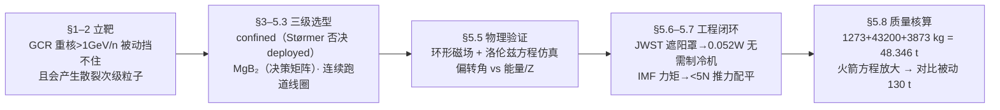

# 2019-GM-A-289（2019 题A · 队伍 289 · 28 页）

## 来自赏析

### 论文速览

与 105 队的"被动屏蔽"路线不同，289 队（BUET）押注**主动磁屏蔽**：以高温超导 MgB₂ 绕制的连续跑道（race-track）线圈环向环绕 1000 m³ 圆柱居住舱（半径 5 m、长 13 m），用洛伦兹力偏转 2–4 GeV/n 的高能带电粒子。论文先用 Størmer 理论否定 deployed（展开式）线圈方案，再对比 YBCO/MgB₂ 与三种线圈构型（Pumpkin、双螺旋、连续跑道）完成选型，用简化环形磁场做粒子轨道仿真（Euler 法解洛伦兹运动方程），配套 JWST 式遮阳罩热设计与 IMF 扰动力矩分析，最终算得附加质量 48.346 吨，并对比被动聚乙烯方案约 130 吨，论证主动方案的质量优势。

### 获奖密码

1. **立场鲜明 + 反方论证**：不是罗列方案，而是用 Størmer 定理主动否掉 deployed 路线、用散裂辐射论证被动屏蔽对 GCR 无效，先立靶再打靶，展现批判性思维。
2. **选型全部落到可查证数据**：$T_c$、密度、相干长度、载流能力、场积分 4.9 T·m、"Atlas 实验/Columbus 舱已验证"，把天马行空的磁屏蔽拉回工程现实，回应题目 "careful and thorough evaluation of practicality"。
3. **系统级闭环**：从粒子物理（偏转角）到热控（0.052 W）到姿控（IMF 扰动力矩、<5 N 推进即可配平）到质量与燃料代价（火箭方程），覆盖了真实任务设计的全部关键约束，完整性远超单点模型。
4. **与被动方案定量对比**：14.7 g/cm² 面密度 → 130 吨 vs 主动 48.5 吨，给出"为什么这个方案更好"的量化答案，而非自说自话。
5. **诚实暴露弱点**：承认 0.5 T 低于理想值、MgB₂ 有 flux jump 风险、通信受磁场干扰、未计次级辐射——评委对自知的模型更信任。
6. 摘要直给 48.346 tons，正文各分项质量可复算，数字链条闭合。

### 可借鉴清单

1. 方案类题目先写"否决论证"：用定理或标度律排除主要竞争方案，自己方案的合理性便不证自明。
2. 关键部件选型做成"决策矩阵表"（行=候选、列=判据），一页表格胜千言。
3. 引用有大工程背书的设计（ISS、LHC/Atlas、JWST）作为可行性锚点，把"practicality"从口号变成证据。
4. 附加质量算完后用火箭方程补一刀，量化质量→燃料的放大效应，展示系统级视野。
5. 辐射热负载用 $Q=F A e^*\sigma(T_1^4-T_2^4)$ 对三种发射率扫描，为"要不要制冷机"这类工程决策提供定量依据。
6. 附录放可运行的仿真代码并注明参数初值，正文声明简化假设（非相对论）与代码实际处理的差异要自查一致性。

## 来自精读

### 全文骨架

论文只回答一个问题：**给 1000 m³ 的火星居住舱做辐射防护，"主动磁屏蔽"到底比"被动材料屏蔽"划算多少？** 答案是 48.346 吨 vs 约 130 吨。



**为什么这个骨架好？** 它是标准的"选型型"四层结构：**物理依据 → 部件选型 → 物理验证 → 工程闭环 → 定量对比**。注意每一层都在给最后一层的质量数字供弹：热控层算出 0.052 W，质量清单里才敢不放制冷机；IMF 层算出 <5 N，姿控燃料才可忽略。多数队伍写"磁屏蔽"只写到第三层（轨迹图好看就收工），这篇一直推到"和被动方案差 80 吨"——评委要的 practicality 就落在这最后一格。

---

### 建模决策链

| 决策 | 作者的选择 | 被放弃的替代 | 为什么 |
|---|---|---|---|
| 主动 vs 被动 | 主动磁屏蔽 | 纯材料被动 | >1 GeV/n 重核被动挡不住且产生散裂次级粒子（§5.1）；被动质量 130 吨 vs 主动 48.3 吨 |
| confined vs deployed | 封闭式环形场 | 展开式大半径线圈 | Størmer 定理：磁矩恒定时屏蔽能力随线圈半径急剧衰减；且线圈半径须远小于屏蔽区，1000 m³ 舱无法满足 |
| LTS vs HTSC | HTSC（25–77 K） | NbTi/Nb₃Sn（4.2 K） | LTS 微米级形变即失超，需绝对刚性支撑；HTS 材料焓值高几个量级，超轻线圈可行 |
| MgB₂ vs YBCO | MgB₂ | YBCO | 密度 2.57 vs 6.3 g/cm³（2.4 倍差距）；ξ=5 nm 长相干长度利好制备；成本低。代价：Tc=39 K < 70 K，需更深低温（遮阳罩解决） |
| 线圈构型 | 连续跑道 ×120 | Pumpkin / 双螺旋 | Atlas 实验（LHC）与 ESA Columbus 舱有工程实证；多线圈分力→支撑质量小；BL=4.9 T·m 有文献定量锚点 |
| 磁场模型 | 理想 toroid（安培环路） | 全线圈 Biot–Savart 数值场 | 解析闭式、代码 20 行；代价：端部场、跑道直段不均匀性全被抹平 |
| 动力学 | 非相对论方程 + 相对论初速 | 完整相对论动量方程 | 省去非线性 γ(v)；偏转角误差 O(1/γ)，对趋势结论可接受（但论文未声明此误差） |
| 数值方法 | 一阶 Euler | RK45 等 | 简单透明；⚠ 未做步长收敛检验（对比 2010-A-160 的步长减半法，这是本篇短板） |
| 热控 | JWST 型被动遮阳罩 | 低温制冷机 | 三档 e* 扫描显示 10⁻⁶ 时仅 0.052 W，可忽略；制冷机"far less developed and reliable" |
| 出发时机 | 太阳极大期 | 太阳极小期 | GCR 反相关太阳活动；SPE 虽多但 <1 GeV 可被本系统处理——可控风险置换不可控风险 |
| 目标能段 | 2–4 GeV/n | 全谱 | <1 GeV/n 可被动安全吸收；>4 GeV/n 能损恒定（~120 MeV/人体）不致命——两个边界都有物理依据 |

**总规律**：这张表的每一行都是"否决式选型"——先写淘汰谁、为什么淘汰（定理/数据/工程实证），幸存者自然胜出。加上每行都有可查证的数字锚点（ξ、密度、4.9 T·m、14.7 g/cm²），这就是评委说的 well-motivated。

---

### 可复用模板

**结构模板（选型型论文，可直接映射 LaTeX 章节）**：

```
Abstract        历史对比开场 → 两难 → 预告方法 → 一句话给结论数（48.346 tons）
1 Introduction  driving question（把价值判断改写成可计算判据）+ 4 条假设（每条带理由）
2 Background    辐射类型/剂量数据/现有概念——每条知识对应后文一个决策
3 Justification 两级否决（定理否决 + 量级否决）
4 次级决策      发射窗口（风险置换逻辑）
5 Proposed Plan 5.1 物理原理与目标能段 → 5.2 材料决策矩阵 → 5.3 构型决策矩阵
                5.4 结构 → 5.5 简化模型仿真（轨迹图 + 规律图）→ 5.6 热控扫描
                5.7 扰动分析 → 5.8 质量清单 + 火箭方程放大
6 Critical Analysis  Strength（含被动对照定量）+ Weakness（每条真实）
Conclusion      回扣创新点 → 一句话总数 → 自我限定
Appendix       完整仿真代码（参数初值注明）
```

**句式库（原文摘录，括号内为使用场景）**：
- "The driving question we addressed ... is whether the total mass of X needed to provide some specified level of protection ... actually less than the mass of Y needed to afford the same level of protection."（把开放题化成单一可判定判据）
- "Most deadly ... is comparatively less abundant ... But the major inspiration to ... was ... since they cannot be blocked with ..."（先自曝短板再反转立论）
- "From Størmer's theorem, it can be shown that ..."（引定理否决竞争方案）
- "Even superconductor movements on the order of microns ... generate enough energy to ..."（用具体量级的反例否决）
- "Though this strength is below desirable value, mass constraint doesn't permit us to ... But the simulation result shows promising result."（参数不达标时的三段式：承认→归因→系统补偿）
- "Since magnetic field does no work on charged particles, reflection does not alter the composition of the radiation ... it just diverts them."（用最基础原理支撑最大论点）
- "cryocooler technology is far less developed and reliable than heat shield technology, so we avoid this technology."（技术成熟度对比做工程取舍）
- "It is noteworthy that, as the energy of the particle is increased, the variation in deflection angle saturates ..."（把仿真观察升华为规律陈述）
- "An additional mass of 48.346 tons would need to be brought on the journey to protect the habitat of 1000 cubic meters."（结论一句话给全关键数）

**图表配方**：选型型论文 → "决策矩阵表 ×2（材料/构型）+ 引用文献定量锚点"；仿真型章节 → "先 setup 图后规律图：同一模型变初条件的轨迹图组（控制变量），最后一张指标-参数规律图收口（对数横轴扫 2+ 个量级）"；系统级 → "质量清单表 + 火箭方程放大 + 与替代方案的吨位对比"，每张图结论写进图题。

---

*精读完这篇后，建议对照 `05_论文赏析/2019/2019-GM-A-289.md`（宏观赏析）与 `07_题目解读/2019_题A_火星辐射防护.md`（题目全解）形成三位一体。同题对照：精读 09（队伍 105，被动屏蔽路线）；下一篇精读 11：同题的八构型混合屏蔽（队伍 343）。*
