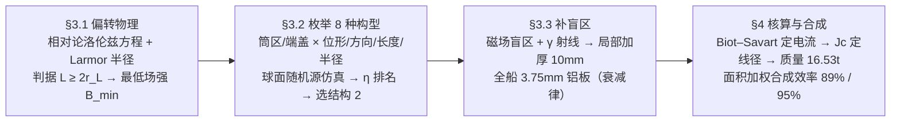

# 2019-GM-A-343（2019 题A · 队伍 343 · 25 页）

## 来自赏析

### 论文速览

343 队（国防科大）给出三篇同题论文中**唯一"主动+被动混合"**的方案：以 Hoffman 双同心圆柱结构为骨架，圆柱居住舱（半径 5.42 m、高 10.84 m，恰容 1000 m³）筒区布线形磁场、端盖区布环形磁场，共设计 8 种组合磁场构型并用蒙特卡洛式粒子仿真逐一比较，选出最优的结构 2（$B=10$ T、$L=2$ m 时屏蔽约 81%–87% 的高能粒子）；再针对磁场"盲区"在顶部加装半径 2 m、厚 10 mm 的加厚铝板，全舱覆盖 3.75 mm 铝板吸收 γ 射线。超导材料选 BSCCO-2212（密度 1.8954 g/cm³，77 K 下临界电流密度 $J=7100\,\mathrm{A/mm^2}$），总附加质量 16.53 吨，粒子偏转效率 89%、γ 防护效率约 95%。

### 获奖密码

1. **组合设计 + 系统比较**：不满足于单一磁场构型，而是把筒区/端盖区两个"插槽"与两种基本磁场做 8 种组合并全部仿真排名，这种"设计空间搜索"的思路直接回应题目 "various options"，是三篇同题论文中方法论最完整者。
2. **主动-被动混合的物理洞察**：明确指出磁场挡不住 γ 射线、且存在盲区与负效应区（η<0），用局部加厚铝板补盲区，机制互补、职责清晰。
3. **步长与物理尺度挂钩**（$\Delta t=T/100$）、用代表粒子（H、He）代表全体 GCR（$m_0/q$ 相似性论证），数值方案的每一步都有物理依据。
4. **质量核算从第一性原理出发**：Biot–Savart 定电流 → 临界电流密度定线径 → 密度定质量，与 289 队的查文献估算法相比更"从零开始"，可核查性极强。
5. **结果分级量化**：粒子 89%、γ 95%，且把摘要数字与正文推导一一对应（尽管存在少量不一致），总体仍做到"结论可判".
6. **可行性专节（4.4）**：地火平均温度 153 K + 制冷剂可达 77 K 满足 BSCCO 工作温区、舱内磁场对消、SCR 爆发时临时加流——把评委可能追问的三个"what if"提前作答。

### 可借鉴清单

1. 设计类题目先定义少量"离散可枚举"的设计参数（位形、方向、长度、厚度），枚举全部组合逐一仿真，用统一指标（η）排名，比拍脑袋选一个方案有说服力。
2. 轨道积分步长取回旋周期的百分之一这类"物理量挂钩"做法，写明后可免评委追问收敛性。
3. 遇到多机制防护（磁偏转 + 材料吸收）时，用面积加权公式合成总效率，展示机制间无重复计数的自洽性。
4. 对场强/厚度做参数扫描并寻找"饱和拐点"（本文 B=10 T 后 η 不再上升），据此选点可同时满足效能与质量。
5. 材料选择做"多指标对比表"（衰减系数 × 密度），一句"衰减够用且最轻"完成选型论证。
6. 设可行性专节回答极端工况（SCR 爆发、温度、人体安全），并在模型优劣一节自我列出致命短板（临界电流不足）——自曝短板反而加分。

## 来自精读

### 全文骨架

论文只回答一个问题：**1000 m³ 圆柱居住舱（半径 5.42 m、高 10.84 m）的辐射防护，磁场怎么布、材料怎么配，总质量最小？** 答案是"结构 2"混合方案：筒区线形场 + 端盖环形场（B=10 T、L=2 m）+ 全船 3.75 mm 铝板 + 顶部 10 mm 加厚铝板，总重 **16.53 吨**。



**为什么这个骨架好？** 它把"设计题"变成了"搜索题"：§3.1 先给出物理判据（什么样的场能挡住粒子），§3.2 把设计空间离散成 8 个可枚举的组合、用统一指标 η 排名，§3.3 承认最优解仍有盲区并用被动手段打补丁，§4 收口到质量与总效率。**"物理判据 → 枚举搜索 → 承认缺陷 → 打补丁 → 总账"**——这个五步流程可以直接搬到任何工程设计类题目上。与 289 队（精读 10）的"文献选型"路线对比：289 靠 Størmer 定理与工程实证淘汰方案，343 靠仿真排名淘汰方案，前者论证快、后者覆盖全。

---

### 建模决策链

| 决策 | 作者的选择 | 被放弃的替代 | 为什么 |
|---|---|---|---|
| 总体路线 | 主动磁场（粒子）+ 被动铝板（γ、盲区）混合 | 纯主动 / 纯被动 | γ 不带电磁场无效；纯被动挡不住 GeV 级粒子（§1.3）——**按物理机制分工** |
| 代表粒子 | H、He 两种 | 全核素逐一仿真 | r_L 只依赖 m₀/q，Z≥2 核素 m₀/q 近似相等（§3.1.1 相似性论证） |
| 居住舱形状 | 正圆柱 H=D=10.84 m | 任意长径比 | 容 1000 m³ 且端盖/筒区两向入射权重相当，利于加权合成 |
| 设计空间 | 4 槽位 × 8 枚举 | 单构型优化 | "various options"题面要求比较；枚举+统一指标 η 排名最有说服力 |
| 场强 B | 10 T | 更高场强 | η–B 曲线 10 T 后饱和，再加场只加质量（拐点选点） |
| 场厚 L | 2 m | 更厚 | η 随 L 增长缓慢，取小值省质量 |
| 磁场模型 | 台阶场（区内均匀、区外为零） | Biot–Savart 连续场 | 假设 4 明示；仿真快且判据解析可用；质量核算时才用 Biot–Savart |
| 数值方法 | 步长 Δt = T/100 锁回旋周期 | 固定步长 | 物理尺度定步长，免收敛性追问 |
| 被动材料 | 铝 | 铁/铜/钽 | Table 2：μ 够用（0.8/mm）且密度最轻（2.7 g/cm³）——"够用且最轻" |
| 超导材料 | BSCCO-2212（ρ=1.8954 g/cm³, J=7100 A/mm²@77K） | MgB₂/YBCO 等 | 密度低 + 临界电流密度高；代价：工作温度 77 K 需制冷剂 |
| 盲区处理 | 顶部 2 m 半径 10 mm 加厚板 | 全船加厚 | 只补效率近零的盲点，质量最小 |
| 次级辐射 | 忽略（假设 5） | 蒙卡级联 | 48 小时算力约束，明示假设 |

**总规律**：这张表里没有一条"经验参数"——B 由判据反解、厚度由目标效率反解、材料由对比表选出、质量由 Biot–Savart 链推得。**"每个数都有一条物理来路"** 是这篇论文最值得模仿的地方；它的几处算术笔误则是"链条虽对、抄写要查"的警示。

---

### 可复用模板

**结构模板（设计搜索型论文）**：

```
Abstract        船型/材料/场强/厚度全参数钉死 → 效率两个百分数
1 Introduction  辐射分类（带电98% + γ）→ 分类即架构
2 Assumptions   5条假设（每条注明省掉什么）+ 符号表（含自造量 T_C/O）
3 Model         3.1 物理判据（相对论Larmor + L≥2r_L + B_min 反解）
                3.2 设计空间离散枚举 → 统一指标 η 仿真排名 → 拐点选参
                3.3 缺陷补强（盲区 + γ → 目标效率反解厚度）
4 Solving       线圈实现图 → Biot–Savart→I→S→质量四项 → 面积加权合成效率
                可行性专节（温度/人体安全/爆发工况）
5 Adv/Disadv    优点量化 + 命门自曝（BSCCO 可能达不到 10 T）
6 Conclusions   全参数 + 总质量 + 总效率复述
```

**句式库（原文摘录，括号内为使用场景）**：
- "In previously research [4], X had already studied this problem... However, ... was not considered in this structure. Besides, ..."（站在文献上，两点缺口即两点创新）
- "because of the high energy..., it is necessary to consider the relativistic effect."（先声明适用域再写方程）
- "the deflection effect ... is similar for elements with atomic number Z ≥ 2 which have the approximately equal ratio m₀/q. Therefore, ... are selected as typical particles."（找不变量做降维）
- "we apply the different structures in two different areas ... respectively and design the eight combined structures."（设计空间离散化宣言）
- "When B is relatively low (B = 2T), the reduction rate η can be negative in some structures, which proves that the magnetic field may have negative effect on..."（报告反直觉的负结果）
- "It rises rapidly after B = 4T, until B = 10T. Then the shielding effect remains almost unchanged."（把曲线行为翻译成三段式规律）
- "the critical current density of BSCCO is not large enough... Therefore, the magnetic field B ... may not reach 10T."（缺点栏自曝方案物理上限）

**图表配方**：设计搜索型 → "参数矩阵表（Table 1）+ 每构型弱区着色图（Figure 7）+ 全构型 η–B 曲线族同图排名（Figure 9）"，曲线上用竖直参考线标出判据值（B_min）与选点；机制合成 → "面积加权公式 + 分区结构图"；材料选型 → "判据并列对比表（μ × ρ）"。

---

*精读完这篇后，建议对照 `05_论文赏析/2019/2019-GM-A-343.md`（宏观赏析）与 `07_题目解读/2019_题A_火星辐射防护.md`（题目全解）形成三位一体。同题对照：精读 09（队伍 105，被动路线）、精读 10（队伍 289，MgB₂ 主动路线）；下一篇精读 12：2019 题B 过山车（队伍 190）。*
