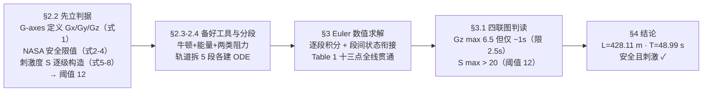

# 2019-GM-B-190（2019 题B · 队伍 190 · 30 页）

## 来自赏析

### 论文速览

该论文为 30 m 高、仅靠重力驱动的闭合过山车轨道做了一个完整设计：用 SolidWorks 与游戏引擎 Planet Coaster 构建轨道概念图，把全线拆为五段（斜坡、三连半圆、上爬斜坡、双螺旋、下斜坡+水平圆弧），对每段建立牛顿运动学 ODE，用欧拉法在 MATLAB 中递归求解，最终给出轨道总长 $L = 428.1104\,\mathrm{m}$、全程时长 $T = 48.9892\,\mathrm{s}$（另有提升段 33.3597 m / 16.6798 s）。安全性与刺激性均以自定义量化指标判定：最大 $G_z=6.5$ 超标但持续仅 1 s（小于 NASA 标准 2.5 s），刺激度 $S$ 峰值超过 20（阈值 12），论证"安全且刺激"。

### 获奖密码

1. **把"安全/刺激"两个模糊词翻译成可计算的标量判据**，且安全阈值有 NASA 文献背书、刺激阈值有独立标定（$S=12$），评委最认这种"定义—文献—标定"三步走。
2. **完整的工程设计闭环**：几何设计（SolidWorks 图）→ 动力学方程 → 数值求解 → 指标验证 → 参数讨论，题面要求的"精确描述路径、给时长、论证安全与刺激"逐条落实。
3. **分段建模 + 段间初末状态衔接**：表 1 把 13 个关键点的 $s,v,t$ 全线贯通，显示出对全局自洽性的控制。
4. **细节物理到位**：平方阻力论证、螺旋段螺距修正、圆环段法向力与摩擦耦合，超出一般队伍的"理想无阻力"处理。
5. **诚实的局限讨论**：承认质点假设、给出自旋转修正项（式 45–46，用角动量守恒估计 $\omega$），并发现圆轨道摩擦耗散过大而改用 $\mu=0.001$ 并说明原因——暴露调参痕迹但体现了模型反馈意识。

### 可借鉴清单

1. 遇到"体验类"软指标（刺激、舒适、安全），先建无量纲标量指标并用文献/常识点标定阈值，再全文围绕 $S$ 展开。
2. 引用 NASA 人体加速度耐受数据（Kumar & Norfleet 1992）处理 $G$ 过载问题，比自设阈值更有说服力。
3. 曲线轨道通用技巧：以弧角 $\theta=\int v/R\,\mathrm{d}t$ 为状态变量写 ODE，螺旋段用 $\rho/\sqrt{\rho^2+k^2}$ 修正坡度。
4. 附录公开全部代码（递归欧拉法，约百行），评委可复现，成本低收益高。
5. 用能量总账 $Mgh$（式 17）交叉校验数值结果的量级。
6. 善用现成工具（SolidWorks 画轨道、Planet Coaster 做概念验证）增强"设计感"，这是题 B 类设计题的加分项。

## 来自精读

### 全文骨架

论文只回答一个问题：**一条 30 m 高、纯重力驱动的闭合轨道，怎样同时证明它"安全"且"刺激"？**



**为什么这个骨架好？** 它是"**先立法、后行车**"的结构：§2.2 在写任何方程之前先把"什么叫安全、什么叫刺激"钉成带文献出处的数值判据，后文所有计算都只是"对着判据打分"。多数队伍的顺序恰恰相反——先算轨道再想标准，于是安全/刺激只能靠形容词收场。另外注意判据链的层次：G 限值有 NASA 报告背书 [2]、S 阈值有"汽车急加速 3g"的独立标定——**每个阈值都有来路**。

---

### 建模决策链

| 决策 | 作者的选择 | 被放弃的替代 | 为什么 |
|---|---|---|---|
| 判据体系 | G-axes 三轴 + 时长条件（式 2–4） | 单一"总加速度"限值 | 人体对三方向耐受差异巨大；峰值判据无时长会误杀 |
| 刺激量化 | 加权标量 S + 锚点标定（式 5–9） | 只用速度/高度 | 体感主体是加速度；纯速度判据会把高速巡行误判为刺激 |
| 轨道几何 | 五段直线/圆弧/螺旋组合 | 任意样条曲线 | 每段 ODE 可手写、可查、可复现；无急弯避免曲率突变冲击 |
| 阻力 | 库仑摩擦 + 平方气动（式 13–15） | 无阻力 / 线性阻力 | 定量论证：两项同量级（~200 N vs ~490 N @23 m/s）都必须保留 |
| 圆轨摩擦 | μ=0.001（直轨 0.05） | 统一 μ=0.05 | 离心使 N 巨大、μ=0.05 时螺旋段无法通过（§4.1 自曝调参理由） |
| 数值方法 | Euler，Δt=10⁻⁴ s（爬升/螺旋 10⁻³） | RK45 / 解析解 | 全线统一；部分段其实有解析解但圆弧 θ 积分项不可解析 |
| 判定口径 | Gz 用 v²/(gR)（式 26） | 惯性系加速度 | 乘客体感=比力；与 NASA 限值同口径 |
| 提升段 | 电机 2 m/s 匀速、t=0 从顶点起算 | 计入电机动力学 | 提升段无刺激无风险，一段话排除 |
| 自旋扩展 | 给出修正项公式（式 45–46）不做数值 | 直接忽略 | "未做也给形式"——展示能力边界而非留白 |

**总规律**：这张表的每一条都能在正文找到一句"为什么"——包括调参（μ 改小）都有物理解释。**决策透明比决策高级更重要**：Euler 法并不先进，但配上 Δt、递归代码、Table 1 可验账，可信度反而超过用黑箱求解器的队伍。

---

### 可复用模板

**结构模板（体验量化型论文）**：

```
Abstract        卖点一句话（量化判据）+ 工具链 + 结论
2 Model         2.2 先立法：坐标系(G-axes) → 安全限值(文献) → 刺激指标(逐级构造+锚点标定)
                2.3 工具箱：定律集中列（能量/牛顿/阻力/圆周），方法(Euler)给推导
                2.4 分段模型：概念图 → 三维图 → 每段几何参数
3 Results       全线总账表(关键点 s,v,t) → 四联时间序列图 → 逐轴对照判据下结论
                3.2 每段：牛顿方程 → 单变量 ODE → 数据表 + 曲线（重复段显式跳过）
4 Discussion    结论 → 局限(含未做扩展的公式形式) → 优点(含设计意图)
Appendix       全部代码 + 分段放大图
```

**句式库（原文摘录，括号内为使用场景）**：
- "To simplify the model, in this project, it is assumed that if: ... the safety requirement is satisfied."（把文献耐受数据压缩成简明判据组）
- "Since in this project, there's no other forward accelerating force except gravity, so ... is always satisfied."（排除法证明某维度自动达标）
- "Moreover, we notice that the degree of excitement also has some relation to ... Hence another item ... should be added."（指标逐级构造的连接句）
- "Consequently, finally we choose the coefficients k1 = 1, k2 = 0.05, k3 = 0.1."（系数给出后立刻用锚点标定阈值）
- "But value of Gz larger than 4.8 only lasting for 1 second, much smaller than the maximal lasting time 2.5s, hence it is also safe according to NASA's study."（超标但合法：峰值×时长联合判读）
- "we find that the most significant limiting factor of safety is the upward acceleration."（把结果升华为设计洞察）
- "The calculation ... is similar to ..., so we directly list results here."（显式跳过重复推导）
- "we replace the origin µ with a smaller one for circular track."（调参留痕：附物理理由）

**图表配方**：体验/指标类 → "判据线画进每张指标图（红线=限值）+ 四联图共享时间轴"；全线结果 → "关键点账目表（s/v/t）+ 总量收口（L、T）"；设计感 → "概念图 + CAD 三维图双呈现，游戏引擎当概念验证"。

---

*精读完这篇后，建议对照 `05_论文赏析/2019/2019-GM-B-190.md`（宏观赏析）与 `07_题目解读/2019_题B_过山车设计.md`（题目全解）形成三位一体。同题对照：下一篇精读 13（队伍 389，九分段能量法）——两篇同题金牌放到一起读，比较"指标法"与"能量法"两条路线的取舍。*
