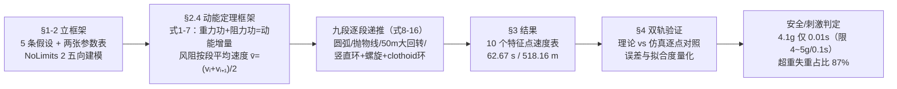

# 2019-GM-B-389（2019 题B · 队伍 389 · 29 页）

## 来自赏析

### 论文速览

该队把轨道拆成 9 个分段（含圆弧过渡、抛物线山丘、半径 50 m 的大半圆、竖直圆环、螺旋段与回旋线环 clothoid loop），对每段用动能定理列式（式 1–16），以段间平均速度递推求解各特征点速度（$v_1=4.486$ m/s 至 $v_{10}=10.37$ m/s，表 3）；再用过山车专用仿真软件 NoLimits 2 做运动学仿真交叉验证，得到全长 518.16 m、总时长 1 分 02.67 秒（表 4）。安全/刺激判据为：最大竖直加速度 4.1 g 且仅持续 0.01 s、其余 < 4 g（均值 0.4132 g）、最大横向 0.7 g，超重失重时间占比 87%，理论–仿真速度平均误差 2.1 m/s、拟合度 94.26%。

### 获奖密码

1. **理论–仿真双轨互验**：多数队伍只有一个模型，该队用 NoLimits 2 独立复算并给出 94.26% 拟合度的定量对照，"模型验证"一章正是评委最看重的自洽性检验。
2. **轨道元素选型有工程依据**：clothoid 环、50 m 大半径回转、圆弧过渡都是从真实过山车工程借来的降过载手段，呼应其引用的游乐园 G 加速度判据文献[5]与 EN13814 标准。
3. **摘要写法典范**：三任务、每任务一句方法+一句数字结论（4.1 g/0.01 s、87%、62.67 s），评委读摘要即可判断完成度。
4. **安全判据落到"幅值+持续时间"二维**：4~5 g 仅容忍 0.1 s 的文献阈值，比单点幅值判断更严谨。
5. **诚实的误差与改进讨论**：主动指出算术平均速度的偏差来源，给出改进方向。

### 可借鉴清单

1. 用动能定理做分段递推（$v_j=(v_i+v_{i+1})/2$ 近似）是 48 小时内性价比最高的动力学解法，先保闭环再谈精化。
2. 找一款领域专用仿真器（NoLimits 2 之于过山车）做独立验证，把"拟合度 94.26%"这类数字写进正文，是最有力的自洽性证据。
3. 设计类题目把"设计选型"讲出物理理由：clothoid 环压平环顶过载、大半径弧降低横向 g 值，都有明确因果链。
4. 摘要采用"任务分解 + 每任务一个量化结论"模板，数字直接来自结果章节。
5. 安全判据引用正式标准（EN13814、G 加速度耐受文献），幅值与持续时间双门限。
6. 参数用两张表分开列"查表经验值"与"设计变量"，方便评委核对与复现。

## 来自精读

### 全文骨架

论文只回答一个问题：**一条 30 m 高、纯重力驱动的九段式轨道，能否用"手算的能量链 + 仿真器的独立复算"双重证明安全且刺激？**



**为什么这个骨架好？** 它是**"理论–仿真双轨互验"**的完整示范：B–C 是手算轨道（每步可验账），D 是黑箱仿真（NoLimits 2 是过山车行业级仿真器），E 把两条轨道放到同一张图上量化差距。评委对任何单轨结果都能质疑，但对**两条独立来源吻合 94%** 的结果无从下手。与 190 队"单轨道数值仿真"相比，389 牺牲了时间序列的精细（只有 10 个特征点），换来了解析透明与独立验证——这正是两篇金牌的路线差异。

---

### 建模决策链

| 决策 | 作者的选择 | 被放弃的替代 | 为什么 |
|---|---|---|---|
| 主方程 | 动能定理（标量代数递推） | 牛顿 ODE + 数值积分 | 题目只要特征点速度与总时长，不要 v(t) 剖面——问题决定工具 |
| 时间信息 | 仿真器补（NoLimits 2） | 解析积分 t=∫ds/v | 分段可解析但风阻下无闭式；专用仿真器顺带产出加速度曲线 |
| 验证方式 | 理论-仿真双轨对照（10 点） | 只交一条轨道 | 两条独立来源吻合是最强自洽证据；误差量化（误差+拟合度） |
| 竖直环形状 | clothoid 回旋线 | 正圆环 | 曲率随弧长线性 → v²/r 沿环近似恒定，压平峰值过载（真实工程标准做法） |
| 回转半径 | r₄=50 m 大半圆 | 小半径急转 | a = v²/r：20 m/s 下要压横向 g 值只有加大 R |
| 坡底过渡 | 30°/3 m 圆弧 | 折线直连 | 避免曲率突变的冲击加速度（190 队"no sharp turns"同款理由） |
| 滚阻处理 | f=KN 取最大力矩（保守） | 载荷变化精细模型 | 简化偏向安全侧；K=0.05 偏大一个量级（刻意保守） |
| 小弧段 | 免阻（假设④） | 全段计阻 | 让递推可闭式；代价 v₇=v₈=v₉ 平顶与理论系统性偏高（已被仿真对照暴露） |
| 段平均速度 | 算术平均 (vᵢ+vᵢ₊₁)/2 | 段内积分平均 | 封闭 ∫v²ds；误差 O((Δv/v̄)²)，§5 自我点名 |
| 判据口径 | 4~5g/0.1s + 横向 3g（EN13814/行业文献） | NASA 航天口径 | 游乐设施题用行业标准更贴切（对照 190 队用 NASA——两篇都自洽） |

**总规律**：这张表几乎所有行都指向同一个词——**可行性与验证**：每处简化（保守滚阻、免阻小弧、算术平均）都牺牲一点精度换取手算闭环，然后**用仿真器把牺牲掉的精度买回来**（对照表暴露的系统性偏高正是这些近似的签名）。"手算保透明、仿真保精度、对照保可信"是这套方法论的三位一体。

---

### 可复用模板

**结构模板（理论-仿真双轨型论文）**：

```
Abstract        按题目分任务，每任务一句方法+一句硬数字（幅值×时长成对）
1 Analysis      机制分析（刺激=过载，伤害=过载）→ 唯一调控对象=加速度区间
2 Model         2.1 假设（每条注明省掉什么） 2.2 参数双表（已知/未知分开）
                2.3 先建"看得见"的轨道（五向视图） 2.4 框架式(1)-(7) + 分段式(8)-(16)
3 Results       判据判定（max/duration/其余上界三连报）→ 特征点表 → 总账表 → 轨迹分步描述
4 Verification  仿真重建 → 逐点对照图 → 误差+拟合度量化
5-7             改进（核心近似自我点名第一条）→ 优劣 → 结论
Appendix       对照数据表 + 66点加速度表 + 引用标准全文出处
```

**句式库（原文摘录，括号内为使用场景）**：
- "Normal adults can withstand 4~5g vertical acceleration with a duration of no more than 0.1s."（判据句：幅值+时长成对）
- "Through the calculation of the theoretical model, we modify the design scheme, so as to obtain final design scheme."（理论→设计反馈环的宣告）
- "These velocities correspond well with results of simulation."（双轨一致的一句声明，正文随后给数字）
- "The calculated average error is 2.1m/s, and the fitting degree ... is as high as 94.26%."（验证节报告统计量——口径要写清，见 ⚠）
- "The average velocity in this paper is approximated as the arithmetic mean. However, ... so we'll use other ways to calculate the average velocity."（改进节自我点名核心近似）
- "In some sections of its track, the situations are simplified so greatly, that the results could have relatively much deviation from reality."（劣势节诚实承认）

**图表配方**：双轨验证型 → "对照散点 + y=x 对角线 + ±10% 带，统计量写进图题"；轨道设计型 → "五向视图（正交完备投影）+ 每段一图对一式 + 关键选型（clothoid）单独配图"；结果收口 → "特征点速度表 + 时长/长度总账表 + 分步文字轨迹（题目第 3 问的最小完备答案）"。

---

*精读完这篇后，建议对照 `05_论文赏析/2019/2019-GM-B-389.md`（宏观赏析）与 `07_题目解读/2019_题B_过山车设计.md`（题目全解）形成三位一体。同题对照：精读 12（队伍 190）——把两篇的判据口径（NASA vs EN13814）、求解工具（ODE 数值 vs 能量递推）、验证方式（自查能量账 vs 独立仿真器）逐项列表比较，是 2019 题B 最有效的读法。下一篇精读 14：2020 题A 离子推进去土星（队伍 340）。*
