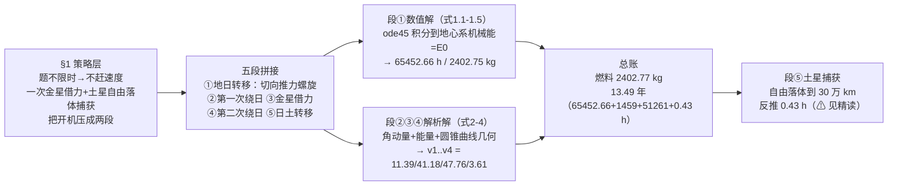

# 2020-GM-A-340（2020 题A · 队伍 340 · 12 页）

## 来自赏析

### 论文速览

该队建立"圆锥曲线拼接模型"（Conic Section Splicing Model），把全程分为五段：地日转移（低推力螺旋逃逸）、第一次绕日、金星借力、第二次绕日、日土转移与土星捕获。核心策略是"少开机、多滑行"：在地球参考系中以切向推力螺旋爬升 65452.66 h（约 7.47 年）至逃逸能量，随后靠角动量与机械能守恒经金星引力弹弓甩向土星；到达土星后先自由下落至半径 300 000 km 再反向开机 0.43 h 刹车。最终答案：最少燃料 2402.77 kg，全程 4923.89 天（13.49 年）。

### 获奖密码

1. **物理策略正确且省钱**：抓住"题不限时、只省燃料"的题眼——不赶时间，用一次金星借力 + 土星引力自由落体捕获，把开机时间压到两段（7.47 年加速 + 0.43 h 刹车），结论自洽。
2. **圆锥曲线拼接框架干净**：每段一个二体问题，段间用角动量/能量/几何三种守恒衔接，评委易逐行验证。
3. **低推力螺旋是正面硬解**：与"假装能用霍曼转移"的队伍不同，该队用连续推力极坐标方程真实算出 65452.66 h 螺旋，并用 $E=E_0$ 关机判据给出明确物理解释。
4. **数值细节可信**：$v_0=7.7368$ km/s、$r_E=6649$ km、$v_5=11.829$ km/s 均可由题给周期反推复核；燃料 2402.77 kg 与 $F/(g_0I_{sp})$ 流量率×开机时长精确吻合。
5. **诚实列缺点**：承认借力偏转角未算、几何拼接是粗估、土星卫星摄动未考虑，并配卡西尼实测轨迹图佐证现实复杂性。

### 可借鉴清单

1. 低推力逃逸的标准打开方式：极坐标下切向常推力 + $m=m_0-Ft/(g_0I_{sp})$，以"机械能达到逃逸能"为关机判据数值积分。
2. 多天体航线用"圆锥曲线拼接"分治：每段二体、段间守恒律缝合，把借力段几何化可大幅降复杂度（但要在缺点节声明其近似性）。
3. 滑行时间优先写解析式（如半椭圆周期 $\pi\sqrt{a^3/GM}$），比纯数值更让评委信服。
4. 关键速度（$v_0$、$v_5$）从题给周期反推，全文数字形成闭环，方便交叉检验。
5. 摘要按阶段分段陈述，每段一句方法一句数字，最后三行给答案与开机策略。
6. 引用真实任务（卡西尼轨迹图）作背景与佐证，建立"方案与现实对得上"的印象。

## 来自精读

### 全文骨架

论文只回答一个问题：**离子推进器（0.4 N、比冲 4000 s）从地球 90 分钟停泊轨道出发到土星 40 小时目标轨道，最少烧多少燃料？** 答案：2402.77 kg、13.49 年。



**为什么这个骨架好？** 三层结构异常清晰：**策略层**（§1 先回答"怎么才能省油"——把最贵的加减速交给引力，推力只用在逃逸与最后一刹）、**框架层**（五段拼接，每段一个二体问题）、**执行层**（数值段+解析段各司其职）。最值得学的是"策略先于方程"：多数队伍拿到题就建方程，这篇先用两段话论证"为什么只需要两次开机"，方程只是策略的展开。

---

### 建模决策链

| 决策 | 作者的选择 | 被放弃的替代 | 为什么 |
|---|---|---|---|
| 目标函数取向 | 不赶时间、极省燃料 | 快速直达 | 题面明示不限时——目标函数决定一切后续 |
| 借力次数 | 一次（金星） | 多次（VVEJGA 式）/不借力 | 不借力则能量不够；多次则模型复杂度陡增（⚠ 单次被证明不够，见 §3.4） |
| 框架 | 圆锥曲线拼接五段 | 全程数值积分 | 每段二体、解析可验，评委可逐行核查 |
| 段①推进策略 | 恒切向推力至能量判据 | 变推力方向最优控制 | 切向即准最优（dε/dt=F·v 最大）；最优控制 48 小时不可行 |
| 段③借力处理 | 几何速度跳变 | 借力动力学（SOI 内双曲线） | 省掉整个三体段；代价是越过能量上限（⚠ 本篇最大伤） |
| 捕获策略 | 自由落体到 30 万 km 再反推 | 直接反推/气动捕获 | 把减速尽量交给引力——方向正确但预算算错（⚠ §3.7） |
| 行星相位 | "理想位置"假设 | 发射窗口搜索 | 冻结相位复杂度；Weaknesses 已承认 |
| 数值方法 | ode45/ode113（RelTol 1e-5） | 自写方法 | 标准工具+公开代码；段⑤步长/收敛未讨论 |

**总规律**：这份论文的每个"省"（几何化借力、忽略相位、小时级捕获）都让模型短了一截——前两个省有申报、第三个是**无意的漏**。对比 2010-A-160 的经验（每个简化配量级论证）：**简化申报是姿态，简化核验才是保险**。

---

### 可复用模板

**结构模板（拼接式轨道设计论文）**：

```
Abstract        按阶段陈述：每段一句方法+一句数字；末尾三行总答案（燃料/时长/开机策略）
1 Introduction  真实任务立靶（Cassini）→ 题眼翻译（不限时⇒不赶速度⇒省燃料）→ 定策
2 Assumptions   把整类复杂度打包成假设（行星理想位置=冻结相位问题）
3 Model         按段组织：数值段（方程组+关机判据）与解析段（守恒律三件套）交替
4 Results       分段总账（燃料/时间两列）+ 三行答案
5 S/W           弱点配真实任务图佐证（卡西尼线团）
Appendix       完整 MATLAB 代码（RelTol 标明）
```

**句式库（原文摘录，括号内为使用场景）**：
- "since this voyage doesn't impose time restrictions but only considers fuel consumption, we don't have to ..."（题眼翻译：把约束条件直接变成设计原则）
- "Since it is a higher order nonlinear non-homogeneous equation with no analytic solution, we could only derive the numerical solution using MATLAB."（解析走不通时给数值方案的理由句）
- "instead of studying ... in dynamics, we chose to easily calculate ... directly from the geometric relationships"（申报简化——但要配核验！）
- "the total mechanical energy of the spacecraft is equal to E0 ... At this moment, close the ion thrusters"（给数值终点一个物理判据）
- "Since its velocity in this process is very fast (>40km/s) and its trajectory is relatively short, we ignore the time it takes."（忽略项的量级论证）
- "the acceleration deflection angles during the interaction with planets are not included in the calculations"（弱点节预告模型软肋）

**图表配方**：轨道类论文 → "全程示意导航图（给段命名）+ 数值段轨迹双尺度图（整体+极坐标放大）+ 速度-时间图（判据线标注）"；证据图用真实任务影像（卡西尼轨迹/线团）撑背景；**建议补一张"五段×(Δv/燃料/时间/起末速度)"总表**——本篇用行文报数是短板。

---

*精读完这篇后，建议对照 `05_论文赏析/2020/2020-GM-A-340.md`（宏观赏析）与 `07_题目解读/2020_题A_离子推进器去土星.md`（题目全解）形成三位一体。同题对照：下一篇精读 15（队伍 354，月球借力+双地球借力的多借力路线）——它对借力动力学的处理更完整，恰好补上本篇 §3.4 的那道缺口。*
