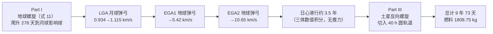

# 2020-GM-A-354（2020 题A · 队伍 354 · 23 页）

## 来自赏析

### 论文速览

该队设计了一条"离子推进 + 多重引力弹弓"混合航线：低推力螺旋从 6650 km 地球轨道爬升至月球影响球，依次借月球（LGA）与两次地球（EGA1、EGA2）引力加速，把相对地球速度从 0.934 km/s 抬到 10.65 km/s，再日心滑行约 3.5 年抵达土星影响球，最后反向螺旋切入 271 033 km、40 h 周期的目标圆轨道。全部轨道段用 Euler-Richardson 中点法数值积分，总耗时 9 年 73 天，燃料消耗 1808.75 kg（$5000\to3191.25$ kg），是四篇 2020-A 金牌论文中报告燃料最少的一篇。

### 获奖密码

1. **借力链条设计最接近真实任务**：LGA + 双 EGA 的"月球甩+地球反复甩"结构明显借鉴卡西尼/STEVE 类 VEGA 航线，并用式 12–13 逐一量化增速（0.934→1.115→5.42→10.65 km/s），比单次金星借力的方案更能体现"如何用弹弓省燃料"。
2. **全程数值积分 + 变质量方程**：式 11 显含 $m_s(t)$，行星际段直接三体积分，模型保真度高，且附录代码可复现。
3. **明确声明的误差方向**：指出垂直径向推力是最简转向律、给出的是燃料上界——评委看到的是"知道自己模型保守在哪"的成熟态度。
4. **表 2 任务时间线**：把 9 年 73 天拆成 9 个阶段节点，质量从 5000 一路递减到 3191.25 kg，全链条自洽可查。
5. **物理机制解释到位**：对螺旋圈间距、速度振荡、行星际段均匀减速等现象都给出机理性解释，显示"算了而且看懂了"。
6. **Limitations 写得像研究计划**：点名 Sims & Flanagan 直接优化法、发射窗口（土地会合周期 1.1 年）、土卫借力改进等，展示了超出比赛要求的领域视野。

### 可借鉴清单

1. 低推力问题的标准数值方案：直角坐标 + 中点法（Euler-Richardson），行星级 6 h 步长即可，附上代码以证可复现。
2. 引力弹弓用"理想公式 + 有限半径转折角修正"两件套（式 12–13），快速且比纯几何拼接更严谨。
3. 把任务拆成"螺旋段—弹弓段—滑行段—捕获段"的流程图 + 阶段时间表，评委一眼看清全局。
4. 主动声明模型给出的燃料是上界还是下界，把转向律选择的保守性写明，可防御"未证明最优"的质疑。
5. 用图像对比做定性检验（螺旋间距、速度振荡的成因解释），低成本高回报。
6. Limitations 节引真实文献方法（如 Sims & Flanagan 多重打靶），显示知道"更好的做法是什么"。

## 来自精读

### 全文骨架

论文回答一个问题：**5000 kg 的飞船、0.4 N 的离子推力器，如何用"低推力螺旋 + 引力弹弓"从地球 90 分钟圆轨道爬到土星 40 小时圆轨道，最省燃料？**



**为什么这个骨架好？** 它把"离子推进"与"引力弹弓"按任务段分工：螺旋段出力（低推力干细活）、弹弓段提速（免费拿动能）、滑行段关机（省燃料）。三段式流程图 + 表 2 的"阶段-时间-质量-速度"时间线，让评委 10 秒钟看清 9 年任务的全链条——**多借力任务必须给这种全局图**，否则读者会在第 5 页迷路。

---

### 建模决策链

| 决策 | 作者的选择 | 被放弃的替代 | 为什么 |
|---|---|---|---|
| 任务架构 | 螺旋 + LGA + 双 EGA + 滑行 + 反向螺旋 | 纯螺旋直飞 / 单次 GA | 低推力直接升轨要十几年（426 队验证：20.9 年）；弹弓链把日心段提速到 3.5 年 |
| 转向律 | 推力恒垂直径向 | 沿速度方向 / 最优摆动律 | 无需速度信息、实现最简；明确声明为燃料上界 |
| 日心段推进 | 关机纯滑行（三体引力积分） | 全程开机 | 表 2 中 5y208d→4451.95 kg 恒定即滑行证据；省下的燃料给土星捕获 |
| 弹弓建模 | 式(12)解析 + 式(13)转折角修正 | 全数值飞掠仿真 | 快速且比纯几何拼接严谨 |
| 数值方法 | Euler-Richardson 中点法，地球段 200 s | RK45 变步长 | 实现简单；⚠ 但 200 s 步长欠采样致 278 天应为 ~890 天（见 §2） |
| ṁ 处理 | 方程中忽略 ṁ_s 项，质量线性递减 | 全变质量方程 | 量级论证支持（§1.3） |
| 影响球切换 | 地月系/日心系分区积分 | 全程 N 体 | 分区是任务设计惯例；但相位匹配只靠"occasional engine burns"描述，未定量化（论文自己承认） |

**总规律**：架构决策（借力链）有横向对比意识，控制决策（转向律）有保守性声明；唯独**数值参数（步长）没有做收敛性论证**——这正是本篇最值得吸取的反面教训。

---

### 可复用模板

**结构模板**：

```
Abstract        硬数字收尾 + 承诺回答"如何控制"
1 Notations     符号表带数值列，区分 given/calculated
3 Theory        3.1 轨道力学基础(现场推导)
                3.2 推进器账本(比冲→流量率)
                3.3 分段运动方程(含量级删除)
                3.4 借力公式(理想式+修正)
4 Method        一张流程图切分任务段
5 Results       每段一组"轨迹图+速度图" + 阶段时间表
6 Discussion    机理解释(图对比) + Limitations(引文献给改进)
Appendix        全部代码
```

**句式库**：
- "The simplest model carried out in this paper keeps the thrust applied normal to radius vector, giving the upper bound for fuel consumption."（声明简化策略及其保守方向）
- "Neglecting the effect of ṁs in equation 9, we can write..."（量级删除，一句话带过）
- "the larger body was assumed to be a point, which may effect the θ..."（主动指出模型缺陷引出修正）
- "This is to be expected. Since..."（解释图像现象的因果句式）
- "However, may not be the most efficient way, and several steering laws can be applied..."（Limitations 中指出路）

**图表配方**：多段任务 → 流程图 + 阶段时间表双锚点；轨迹图 → 三色语义（蓝/红=行星轨道、黑虚线=飞船）+ 细线宽 + 等比例；每段配"轨迹 + 速度"成对图。

**最重要的负面清单**：① 数百圈以上的长螺旋必须做步长收敛检验（每圈至少几百步）；② 表 2 各列要能独立加总自洽；③ 图题、单位（km/h vs km/s）在交卷前逐图核对——本篇三处小错都在"最后一小时"可消灭的范围。

---

*精读完本篇，建议对照 `05_论文赏析/2020/2020-GM-A-354.md` 与 `07_题目解读/2020_题A_离子推进器去土星.md`，并横向比较同题的 426（三区模型）、447（推力角扫描）两篇精读，体会同一道题的三种解法配速。*
