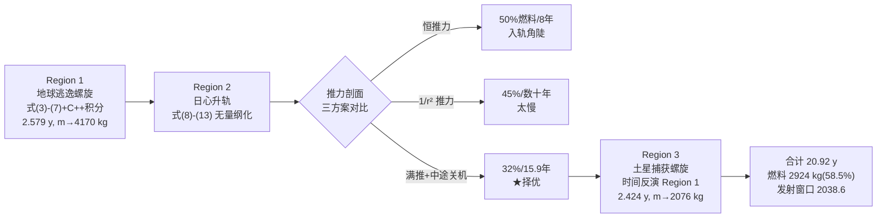

# 2020-GM-A-426（2020 题A · 队伍 426 · 16 页）

## 来自赏析

### 论文速览

该队把任务切成三个"微推力二体问题"区域——地球逃逸螺旋、日心升轨、土星捕获螺旋，逐区数值积分运动方程。其最大特色是**把"推进策略"本身作为研究对象**：在日心段对比三种推力剖面（恒定连续推力、按 $1/r^2$ 衰减推力、满推力+中途关机的 partial-coast），以燃料为指标选出 partial-coast 方案（转移段仅耗 32% 初质量、15.9 年）。最终答案：燃料约占总质量 58.5%（2924 kg，末质量 2076 kg），总时长 20.92 年；并用 JPL HORIZONS 星历给出 2038 年 6 月下旬起的发射窗口。

### 获奖密码

1. **直面"如何控制推进器"这一题眼**：别的队伍给一条航线，该队把推力剖面做成三方案 trade study（§3.4–3.6），以燃料和时间为双指标择优，直接回答了题目的第三问"thrusters should be controlled"。
2. **每个简化假设都有价格标签**：满推力合理性和沿速度推力假设分别用解析式与文献罚金（0.13–0.39%）量化辩护，展示了"假设—误差—接受"的完整论证链。
3. **时间反演解捕获**：Region 3 把"刹车入轨"反演成"逃逸问题倒放"，避免另推一套方程，方法优雅且自动保证与 Region 2 的质量/能量衔接。
4. **发射窗口落地**：用 HORIZONS 星历证明方案在 2038 年 6 月可行，把抽象轨迹变成可执行的任务设计，评委对这种"现实感"非常买账。
5. **文献功底**：8 条参考文献覆盖低推力优化的主流方法（Sims 多重打靶、Vadali 燃料最优、Wang 凸优化），并明确说自己的解"not optimal, for illustrative purposes"——诚实划定结果边界反而加分。

### 可借鉴清单

1. "How to control" 类问题的标准答法：列出 2–3 种控制策略，同口径对比燃料/时间，选优并说明理由（占空比脉冲实现变推力是廉价而实用的技巧）。
2. 捕获/刹车段用时间反演积分，与逃逸段共用同一套代码，天然保证边界匹配。
3. 为关键简化假设找文献罚金数据（如沿速度推力仅损 0.13–0.39%），把"粗糙假设"变成"有据简化"。
4. 无量纲化（AU、$m_0$、地球公转速度）后再积分，数值稳定且代码可读性高。
5. 用真实星历（JPL HORIZONS）验证发射窗口，成本低但极大增强任务可信度。
6. 摘要以"58.5% 燃料 + 20.92 年"两个百分位/年限数字收束，方便评委秒抓结论。

## 来自精读

### 全文骨架

论文回答：**不用任何引力弹弓，纯靠 0.4 N 离子推力从近地轨道到土星轨道，最少烧多少燃料、飞多少年？**



**为什么这个骨架好？** 三个区域各自是干净的二体问题（误差可控、代码可复用），而**区域之间靠"边界条件"缝合**——Region 1 的出口状态即 Region 2 的入口，Region 3 用时间反演自动匹配 Region 2 的出口。更妙的是 Region 2 内部又嵌套一层"策略对比"：同一个方程组，只换推力剖面 T(r)，三张同风格图并排——**把"控制"从参数做成了实验变量**。

---

### 建模决策链

| 决策 | 作者的选择 | 被放弃的替代 | 为什么 |
|---|---|---|---|
| 借力与否 | **不用 GA**，纯推力 | 354/447 队的 LGA/EGA/木星弹弓 | 换取问题简化为三段二体；代价是 20.92 年——论文在结论中明确"gravity assists could further decrease" |
| 分区 | 三区各自二体 | 全程 N 体积分 | 每区解析可控、代码可复用；分区误差小于推力策略差异 |
| 推力剖面 | 三方案对比择 partial-coast | 单一策略 | 直接回答题目第三问；三方案共用一套代码，边际成本极低 |
| 变推力实现 | 占空比脉冲 | 真变推力发动机 | 现实发动机恒推力，脉冲等效即可（一句话论证） |
| 推力方向 | 沿速度（切向） | 径向/最优摆动律 | 文献罚金 0.13–0.39%，有定价的简化 |
| Region 3 方法 | 时间反演复用 Region 1 代码 | 另推捕获方程 | 对称性 + 边界自动匹配 |
| 数值工具 | C++ 自写（R1/R3，dt=0.1 s）+ MATLAB ode45（R2） | 全部一种工具 | 各取所长；⚠ 两种工具两种步长，未做系统收敛性对比 |
| 窗口验证 | HORIZONS 真实星历 | 纯相位算术 | 把模型输出落成可执行日期 |

**总规律**：每个"放弃"（不借力、切向推力、ballpark estimate）都有明确的**代价声明**（20.92 年、0.13–0.39% 罚金、"not optimal, for illustrative purposes"）——这是本文与普通论文拉开差距的核心气质。

---

### 可复用模板

**结构模板**：

```
Abstract        分区方法 + 策略对比预告 + 两个总结数字
2 Background    理想(脉冲)vs现实(低推力)对照图 → 分区声明
3 Analysis      3.1 区1方程+两个假设辩护(引文献定价)
                3.2 区2无量纲状态方程(引标准形)
                3.3-3.6 策略对比(恒推/1r²/关机) 各配一图
                3.7 区3时间反演
                3.8 发射窗口(相位算术+真实星历)
4 Conclusions   总数字 + 明确的未做清单
5 Appendix      三段代码(C++/MATLAB) + 8条正经文献
```

**句式库**：
- "we can no longer make the assumption that..."（否定旧假设，立新模型的合法性）
- "we instead aimed for a ballpark estimate of minimum fuel by considering classes of trajectories that can be obtained by only varying..."（划定解空间的边界——诚实且专业）
- "These trajectories are not optimal solutions, and are included for illustrative purposes."（给结果定性，防过度解读）
- "Varying the duty cycle would approximate an engine with variable thrust."（理想控制律的工程落地句式）
- "we are justified in assuming that..."（假设辩护的收束句）
- "...could further decrease the minimum required fuel and total trip time."（结论中指出未走的路）

**图表配方**：策略对比 → 同尺度极坐标 + 参照圆（出发/到达轨道）+ 图例内嵌指标数字 + 关键事件（关机点）打标记；理论铺垫 → 一张"理想 vs 现实"并置图（图 1 vs 图 2）。

**数字卫生清单**：每个反解常数复算到末位（r₀=6.65257×10⁶ m）；每个总量守恒核对（2.579+15.92+2.424=20.923≈20.92 ✓；5000−2076=2924=58.48%≈58.5% ✓）；⚠ 数量级排版（2.71098 m、1182.9 m/s 两处）交卷前必须自查。

---

*精读完本篇，建议对照 `05_论文赏析/2020/2020-GM-A-426.md` 与 `07_题目解读/2020_题A_离子推进器去土星.md`；并与 354（借力链最短时间）、447（推力角扫描+木星弹弓）两篇精读横向比较：同一道题，"省时间"与"省复杂度"是两条不同的金牌路线。*
