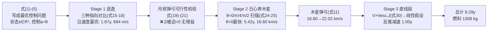

# 2020-GM-A-447（2020 题A · 队伍 447 · 16 页）

## 来自赏析

### 论文速览

该队把问题显式写成**最优控制**形式：状态 $s=[r,\dot r,M_{th}(t)]\in\mathbb R^5$、控制变量为推力方向角 $a=\theta$（式 4–5），通过自建太阳系仿真器穷举不同推力指向的后果。路线为：地球螺旋逃逸（对比沿速度/径向/合成三种指向，1.87 年）→ 尝试月球弹弓并**证明其不可行** → 日心段飞向木星（$\theta=0$ 最快，5.42 年）→ 木星引力弹弓把日心速度从 16.60 km/s 提至 22.02 km/s → 因超过木星逃逸速度 $\sqrt2V_J$，木土段按直线处理并反推减速（1.00 年）。总计 8.29 年、耗燃料 1308 kg（约四分之一质量），直接回答了"推力应如何控制"。

### 获奖密码

1. **"控制"贯穿全文**：从最优控制表述（式 4–5）到逃逸三方案、日心四角度的系统扫描，题目的第三问"How should the thrusters be controlled"得到了最直接的回答，图 6–7 的 $\theta$ 对比就是证据链。
2. **负结果同样有价值**：月球弹弓不可行不是略过而是算给你看（式 19–21），径向推力失败也保留图 4——评委非常欣赏"排除错误选项"的完整探索。
3. **阶段衔接有物理判据**：每段切换都有一条明确的物理准绳（150 $R_E$ 出地球、$V_{esc,J}$ 判直线段、夹角 33.22° 备圆化），不是拍脑袋分段。
4. **弹弓计算与仿真闭环**：接近角 28.68° 从仿真读出、代入动量守恒公式得 22.02 km/s，数值与公式互相印证。
5. **结果表极简可核**：三阶段 $\Delta t$/$\Delta m$ 一张表、纵横加总自洽，摘要数字（8 年/1.3 吨）与正文精确对应。
6. **敢于声明取舍**：流量率取半值、Strengths/Weaknesses 如实列出"未优化木土段、未算初始相位"，把模型边界摆在明处。

### 可借鉴清单

1. 把"如何控制"类题目显式写成状态-控制形式（$s$, $a=\theta$），再对小维度控制参数做穷举扫描，是 48 小时内可执行的"准最优控制"。
2. 对每个借力机会先做解析可行性检查（弹性碰撞公式 + 逃逸速度判据），不可行就果断换目标，避免无效仿真。
3. 保留失败案例的轨迹图并配一句失败机理（径向推力被困、$\theta=\pi/2$ 圆轨道困死），说服力远胜只放成功结果。
4. 推力方向用二维旋转矩阵 $R_\theta$ 参数化，代码里一个全局变量即可切换策略。
5. 结果用三阶段表格汇总并保证行列自洽（时间、质量分别可加），摘要只引用表中数字。
6. 引用领域专著（Goebel & Katz《Fundamentals of Electric Propulsion》）支撑推进器工程修正，哪怕结论有争议也有出处。

## 来自精读

### 全文骨架

论文回答：**推力方向角 θ 怎么选，飞船才能最快最省地到土星？** 路线是"螺旋逃逸 → （月球弹弓被证明不可行）→ 木星弹弓 → 直线冲刺"。



**为什么这个骨架好？** 每个"yes"都算过、每个"no"都证过：月球弹弓不可行不是被跳过，而是用公式 (19)–(21) **证明**根号内退化、β 只能取 0；径向推力策略失败保留成图 4 并解释失败机理。**控制问题的答案藏在这些"排除"里**——三选一、四选一逐个淘汰后，θ=0 的胜利才有说服力。

---

### 建模决策链

| 决策 | 作者的选择 | 被放弃的替代 | 为什么 |
|---|---|---|---|
| 问题表述 | 状态-控制形式 (4)(5) | 纯轨迹仿真 | 明确"控制"为变量，扫描有合法性 |
| 借力天体 | 木星（月球先被证死） | 月球（354 队用了）/地球双甩/不用 | 相对速度 16.6 km/s 增益空间大；月球经 (19)-(21) 证明零增益 |
| 逃逸推力指向 | 沿速度（三选一） | 径向（失败保图）/合成向量 | 能量增加最快；径向不做功被困 |
| 日心段控制 | θ 网格扫描（4 值） | 连续最优控制/变推力 | 穷举小维度控制是 48 h 内的"准最优" |
| 木土段 | 直线 + 反推 | 继续二体积分 | V>V_esc,J 判据支撑；省去相位匹配 |
| 流量率 | α=5×10⁻⁶（半值） | 题面 α=10⁻⁵ | 引专著的工程修正 ⚠ 但偏离题面且只一句带过 |
| 数值方法 | ode23t（刚性稳定）+ ode45 | 自写积分器 | 两种步长（1000 s / 10⁵ s）分段适配刚度 |
| 燃料账 | 三阶段 Δm 加总 1308 kg | 逐秒积分 | 与 α、Δt 两个口径都自洽 |

**总规律**：这篇的每个决策都伴随一次**小型实验或一条判据**——三指向实验、四角度实验、逃逸速度判据、同速退化证明。"控制类题目"的答案就该长这样。

---

### 可复用模板

**结构模板**：

```
Abstract        控制问题重述 + 方法预告 + 总数字
1 Introduction  假设(按任务段组织) + 符号表 + 状态/控制定义
2 Methods       2.1 推进器(含参数偏离声明)
                2.2 借力公式(推导+使用手册)
                2.3 分段: 每段=候选策略→方程→仿真→择优/证伪
3 Results       行列可加和的三阶段表
4 Conclusions   Strengths / Weaknesses 分点
5 Appendix      分段代码(全局变量切换策略)
```

**句式库**：
- "The problem is the optimum control of the thrust to..."（题目重述为控制问题）
- "We evaluate three options. The first way is... The second way is... The third way is to combine..."（策略枚举的排比句式）
- "Then this Gravity assist method is not applicable for us at this stage."（用公式枪毙方案后的干脆收束）
- "As it indicates Vthf is increasing with..."（对公式做符号分析给出使用条件）
- "We named the remaining part of the journey to Saturn as Stage 3"（分段命名，术语统一）
- "It means that we can increase velocity of spacecraft ... with a gravity assist maneuver."（数值结论的即时翻译）

**图表配方**：控制扫描 → **双联同规格对比图**（左成功右失败），颜色语义全篇固定；负结果配一句机理解释（"can not find enough propulsion"）；结果表三列可加总。

**负面清单**：① 偏离题面参数必须显式声明；② 自建天体参数（4.38 AU 的"木星"）要与真实值核对或说明；③ 图 7 中 θ=π/4 案例的 caption 与图内容不完全对应，交卷前逐图检查。

---

*精读完本篇，建议对照 `05_论文赏析/2020/2020-GM-A-447.md` 与 `07_题目解读/2020_题A_离子推进器去土星.md`，并与 354（多弹弓省时路线）、426（无弹弓省复杂度路线）两篇精读构成同题三角。*
