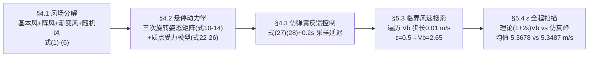

# 2020-GM-B-380（2020 题B · 队伍 380 · 39 页）

## 来自赏析

### 论文速览

同一道四旋翼抗风题，国防科技大学 380 队走了一条与"专业飞控"不同的路：先把真实风"分解"为基本风 + 阵风（gust）+ 渐变风（gradient）+ 随机风四分量叠加，再建立悬停动力学与水平面质点力模型，用仿弹簧的比例反馈机构模拟无人机纠偏，最后以风速变化因子 $\epsilon$ 扫描搜索临界风速。理论最大风速均值 5.3678 m/s、仿真均值 5.3487 m/s（摘要给出两数互相印证），例如 $\epsilon=0.5$ 时临界基本风 $V_b=2.65$ m/s、理论 $V_{\max}=(1+2\times0.5)\times2.65=5.30$ m/s，仿真峰值 5.2994 m/s。

### 获奖密码

1. **先回答"为什么不用标准模型"。** 明确论证 Dryden/Von Karman 适用于高空而非超低空，再自建四分量风——评委看到的是物理判断力而非模板套用。
2. **自创"风速变化因子"参数化不确定风。** 把"风怎么变"这个开放问题压缩为单参数 $\epsilon$，既得到闭式关系 $V_{\max}=(1+2\epsilon)V_b$，又把灵敏度分析变成一条曲线（Fig.19），一箭双雕。
3. **理论—仿真双轨互验。** 三个 $\epsilon$ 值逐一对照 + 全程扫描取均值（5.3678 vs 5.3487 m/s，相对偏差约 0.4%），自洽性检验做满了。
4. **对题目约束逐条落实。** 28 N 总推力上限（式(26)）、20 cm 偏移、60 s 时限、"风非定常"（采样 5 Hz + 0.2 s 响应延迟）全部转成模型中的显式约束或参数。
5. **39 页的信息管理。** 目录 + 连续公式号 + 附录代码，长而不乱，评委可快速定位任一结果。
6. **诚实的优缺点评估。** 6.2 节承认仅研究水平风、调整策略欠定量，并在 6.3 节给出正交分解、按位置切换策略等具体改进路径。

### 可借鉴清单

1. 遇到"真实环境不确定"类题目，可模仿"四分量分解 + 单一变化因子 $\epsilon$ 参数化"的手法，把开放的不确定性变成可扫描、可画曲线的维度。
2. 必做"理论极值公式 vs 数值仿真峰值"的双重校验，两数几乎重合时是最有力的正确性证据（如本文式(36)–(38)）。
3. 把执行机构的现实限制（推力上限、传感器采样率、响应延迟 0.2 s）显式写进模型，能显著提升真实感与评委信任度。
4. 临界值搜索后务必做"越界对照实验"：本文 Fig.12/14 用 2.65 与 2.66 m/s 两幅图证明临界值卡得准，这一步常被参赛者省略。
5. 长论文配目录与连续公式编号；附录放带固定随机种子的完整代码，承诺可复现。
6. 自建简化反馈律时可类比物理原型（本文的"弹簧"类比），让评委一眼看懂控制逻辑的物理含义。

## 来自精读

### 全文骨架

论文回答：**不稳定风（非常定、含阵风与随机分量）下，四旋翼悬停 60 s 不出 20 cm 圈的最大风速是多少？**



**为什么这个骨架好？** 开放题最大的敌人是"风怎么变"无法枚举。该队用单参数 ε（风速变化因子）把风的"不稳度"压缩成一个可扫描维度，于是答案从孤立数字升级为**一条曲线（图 19）+ 一个闭式关系 V_max=(1+2ε)V_b（式 35）**——理论线与仿真线全程贴行，互为校验。

---

### 建模决策链

| 决策 | 作者的选择 | 被放弃的替代 | 为什么 |
|---|---|---|---|
| 风模型 | 自建四分量 | Dryden / Von Karman（335 队用 Dryden） | 两者面向高空风场，超低空不适用——模型选择本身成了物理判断 |
| 不确定性参数化 | 单一变化因子 ε | 多参数随机风 / 实测风数据 | 一维参数可扫描、可画曲线、可导闭式 |
| 动力学 | 全三维推导 + 二维质点使用 | 只建玩具模型 / 只建全模型 | 推导证能力，简化保速度 |
| 控制律 | 仿弹簧比例反馈 + 前馈抵消 + 饱和 | PID / LQR / 反步法 | 物理原型直观；执行约束（28 N、20 cm）直接进控制律 |
| 时间离散 | 0.2 s 采样与调整延迟 | 连续控制 | 真实传感器 5 Hz；延迟正是题目叙述的物理 |
| 临界搜索 | Vb 遍历步长 0.01 m/s | 二分法 | 同效、代码直白、天然产出"上下对照图" |
| 验证 | 单点对照 + 越界对照 + 全程扫描均值 | 只报一个数 | 三层自洽，均值 5.3678 vs 5.3487 互证 |
| 可复现性 | 固定随机种子 `rand('seed',1)` | 默认随机 | 附录代码任何人重跑同图 |

**总规律**：每个自创（四分量风、ε、弹簧律）都配一个"可验证的闭式关系"或"可对照的仿真线"——**自创组件必须比现成组件多一层自证**，这是用非标准方法的税，他们交了。

---

### 可复用模板

**结构模板**：

```
1 Introduction  背景与研究意义
2 Restatement   复述+题眼分析(延迟!)
3 Assumptions   符号表
4 Model         4.1 环境(风)模型: 为什么不用现成的 -> 分量构造 -> 合成定义
                4.2 对象模型: 坐标系+变换 -> 全动力学 -> 简化使用模型
                4.3 控制: 定性策略图 -> 定量控制律(含饱和)
5 Solving       5.1 参数与判据(面积/采样/稳定性定义)
                5.2 不确定性参数化(ε)
                5.3 临界值搜索(遍历+上下对照图)
                5.4 参数全程扫描(理论线vs仿真线+均值)
6 Evaluation    优缺点+改进首尾咬合
7 Conclusion    附录: 固定种子完整代码
```

**句式库**：
- "...are commonly used to simulate atmospheric wind speed, but these two theories are more suitable for... It is not suitable to use..."（拒绝现成模型的论证句式）
- "In order to facilitate the study of..., the two random numbers... are set to be the same"（为可读性冻结随机性的声明）
- "From the results, we can see that V_max ≈ V_max^Sim, which indicates that the maximum wind speed model established in this paper accords with the reality."（理论-仿真互证的标准收束）
- "We can draw a conclusion that if Vb=2.65 m/s, the corresponding maximum velocity V_max is correct."（越界对照实验的结论句式）
- "For example, when the drone is at a location close to the target... when approaching the critical distance..."（用具体场景解释控制策略）

**图表配方**：不确定性问题 → "分量分色时序图 + 合成曲线"；临界值 → "临界内/外两幅对照图 + 判据横线"；灵敏度 → "理论线与仿真点同图 + 局部放大"；长文必备**目录 + 连续公式编号 + 附录固定种子代码**。

**数字卫生**：⚠ 本文 5.5 节 5.2795 与摘要 5.3678 打架、式 (2) 文/码两种阵风形、坐标轴标签误写 "time (m/s)"——39 页长文尤其要**统一"结论数字只出自一张表"的原则**，并在交卷前用脚本 grep 每个数字的出现处。

---

*精读完本篇，建议对照 `05_论文赏析/2020/2020-GM-B-380.md` 与 `07_题目解读/2020_题B_四旋翼抗风.md`，并与 335 队精读对比：Dryden+PID 的"专业路线"对四分量+弹簧律的"参数化路线"，两篇合计正好构成该题的完整解空间。*
