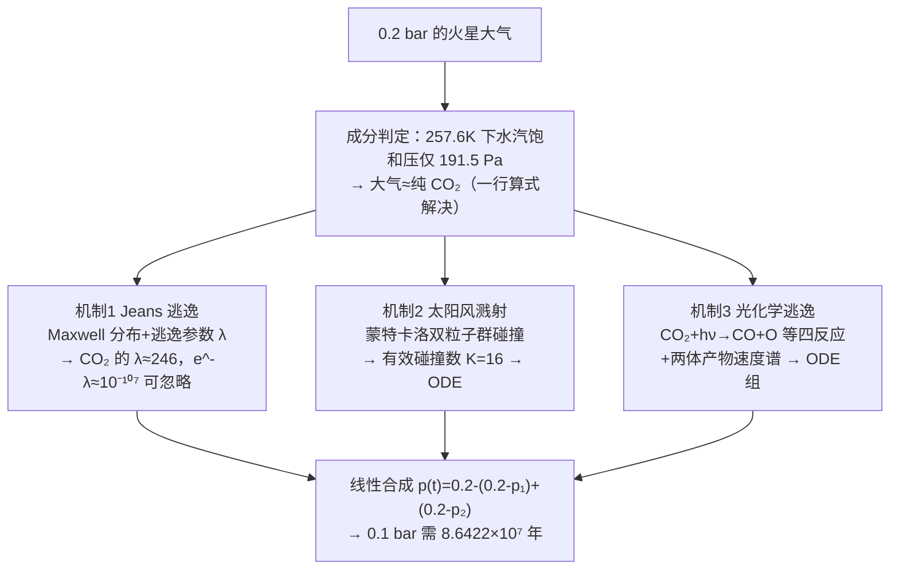

# 2021-GM-A-200（2021 题A · 队伍 200 · 30 页）

## 来自赏析

### 论文速览

题目问：人为把火星表面气压提升到 0.2 bar 后，气压如何随时间衰减、多久降到 0.1 bar。同济大学 200 队以"大气分层模型（exobase/exosphere）"为骨架，把逃逸拆成 Jeans 热逃逸、太阳风溅射（sputtering）、光化学逃逸三条并行通道，分别建立微分方程或蒙特卡洛模型再合成总压曲线 $p_{sum}(t)$。结论有明确排序：光化学逃逸贡献最大，溅射次之（约为前者十分之一），CO₂ 的 Jeans 逃逸几乎为零；气压从 0.2 bar 降到 0.1 bar 约需 $8.6422\times10^7$ 年（约 7000–9000 万年），摘要与正文结论一致。

### 获奖密码

1. **机制分解完整且有权重结论。** 不满足于"算出一个时间"，而是明确排出光化学 > 溅射（约 1/10）> Jeans（可忽略）的贡献序，直接回答了"哪种物理主导"这一评委最关心的洞察型问题。
2. **每条假设都有前置计算背书。** 温度用温室模型算（257.6 K）、组分用饱和蒸气压论证（水汽 191.5 Pa 可忽略）、太阳活动用时间尺度分离论证，假设列表不是拍脑袋。
3. **方法论多样且配合得当。** 解析（Jeans 公式推导）、数值 ODE（ode45）、蒙特卡洛（碰撞与光解散射）各司其职，摘要里也点明"Monte Carlo dynamics simulation and other calculation methods"。
4. **极限情形自检。** Jeans 参数 $\lambda\to0$ 与 $\lambda$ 很大两个极限的讨论（式(7)(8)）以及 H₂/CO₂ 对照实验，都是教科书级的模型自检动作。
5. **答案给出有效数字与区间感。** $8.6422\times10^7$ 年在摘要中表述为 70–90 million years，既精确又不假装超越模型精度。
6. **结论落到现实意义。** 7.2 节指出"在宇宙时间尺度上难以维持改造后的大气"，把数学结果翻译回"火星改造可行性"的判断，立意加分。

### 可借鉴清单

1. 天体大气类问题的通用骨架：分层（Knudsen 数定 exobase）→ 逐机制建通量 → 独立求解 → 压强降叠加合成，本文三层机制框架可整体移植。
2. 动手前先用零维能量平衡（单层温室模型 $T^4$ 关系）把环境温度"算"出来，再据相变/饱和蒸气压论证组分，两步计算撑起全部假设。
3. 用"换一种气体重跑同一模型"做方向性验证（H₂ vs CO₂），成本极低却能证明物理趋势正确。
4. 随机模拟与确定论方程的衔接套路：先用 MC 统计出等效参数（如有效碰撞数 K=16），再把参数喂给 ODE，避免全程暴力模拟。
5. 微分方程中让几何/物性随解演化（移动的逸散层半径），体现变系数意识，比常数化高一个档次。
6. 注意收尾质检：图题、引文编号、结论引用的图号必须逐一核对——本文三处小疏漏说明再好的论文也需要最后一小时的通读检查。

## 来自精读

### 全文骨架

任务：假设火星大气被增稠到 **0.2 bar**，它能维持多久（降到 0.1 bar）？

队伍 200 的答案：**约 8.64×10⁷ 年（7000–9000 万年）**，其中光化学逃逸是主凶，溅射其次（约 1/10），Jeans 逃逸对 CO₂ 完全可以忽略。



**为什么这个骨架好**：三机制天然并行、各自独立验证（Jeans 有解析直觉、溅射有蒙特卡洛、光化学有反应网络），最后合成时才引入唯一的近似（线性叠加）。**"分而治之+合成时声明近似"是处理多机制耦合问题的标准姿势**——评委可以在任何一支单独挑刺而不影响其他支。

---

### 建模决策链

| 决策 | 作者的选择 | 被放弃的替代 | 为什么 |
|---|---|---|---|
| 大气成分 | 饱和压论证→纯 CO₂ | H₂O/CO₂ 混合物模型 | 191.5 Pa ≪ 20 kPa，成分自由度被物理消灭 |
| 温度演化 | 等温 257K | 耦合气候模型 | 210→257K 对结论不敏感（粗模型+不敏感=安全） |
| 机制清单 | Jeans/溅射/光化学 | 冲击剥离、沉降 | 前三者可建模；后者进 Weakness 并标方向 |
| 产物速度谱 | 两体 MC 抽样 | 直接 Maxwell | 离解产物非热分布——方法学正确 |
| 数值工具 | ode45（自适应 RK） | 手写欧拉 | 变系数 ODE 现成解法；省下时间做 MC |
| 机制合成 | 线性叠加 | 耦合求解 | 量级悬殊，叠加误差受限于小项 |

**独立复现审计**：λ(CO₂)=GMm/(kT·rexo)=4.28e13×7.31e-26/(1.38e-23×257×3.59e6)≈**246** ✓（论文 Fig 6 平线的物理）；λ(H₂)≈11.2 ✓（Fig 7 缓慢流失）；水汽 257.6K 饱和压 191.5 Pa ✓（Clausius–Clapeyron 复算 ~190 Pa）。**⚠ 原文疑点**：① §5.3 "initial conditions are set to n(CO₂)=0, n(CO)=0"——按上下文应为 n(CO)=n(O)=n(C)=0 而 CO₂ 取柱密度，原文笔误；② 多处 "Kings escape"（Jeans 之误拼）；③ 式 (19) 分母两个积分写法含混（应为体积归一化因子），但不影响数值结构；④ 8.6422×10⁷ 年与同题队友 349 队的 ~7 亿年差近 10 倍——根源在光化学速率常数 k_i 的截面积分口径（见同题对照），这正说明开放题答案谱的宽度。

---

### 可复用模板

**结构模板**：
```
1 Introduction        背景现状+主流解释+问题价值
2 Theory Primer       外逸层物理零件采购（每个概念后文必用）
3 Assumptions         先估算后假设（饱和压/温度量级/时间尺度对比）
4 Theory(per mech)    每机制推到"可编程"深度为止
5 Simulation          每机制：方法+对照图+ODE；最后合成
6-8 Results+SW+Outlook  机制排序；Weakness 标偏差方向
```

**句式库**：
- "However, how long this man-made atmosphere can last ... will be a key assessment criterion for such a program."（把题面翻译成"评估判据"的引入句）
- "It should be noted that the saturated vapor pressure of water is about 191.5 Pa at the temperature of 257.6K, that is, ..."（用一行数据终结一个假设）
- "Because the time scale of the evolution ... is much longer than the cycle of solar activity (about 11 years), the influence ... can be ignored."（时间尺度对比句式）
- "Since ... contributes the most, ... is second, and ... contributes the least, almost negligible."（机制排序的结论句）
- "Sedimentation processes ... may **accelerate** the reduction, which is not considered in our model."（Weakness 带偏差方向）

**图表配方**：机制对照成对图（CO₂/H₂、前/后）；数据来源可视化（截面/光谱直接上图）；主结果曲线 caption 带数值；组分"演化→速率→因果"三连图。

---

*对照阅读：`05_论文赏析/2021/2021-GM-A-200.md`、`07_题目解读/2021_题A_火星大气演化.md`（含与 349 队答案谱对比）、队友精读 `2021-GM-A-349_精读.md`。*
