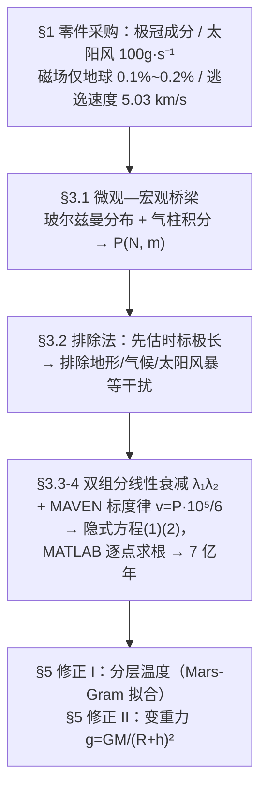

# 2021-GM-A-349（2021 题A · 队伍 349 · 17 页）

## 来自赏析

### 论文速览

同一道火星大气题，青岛大学 349 队选择了一条更"少而精"的路线：不逐一体制化各种逃逸机制，而是抓住 MAVEN 实测的太阳风剥蚀速率（约 100 g/s）作为唯一的物质损失通道，用统计物理的等温玻尔兹曼分布把"压强—分子总数—平均分子量"串成一个隐式演化方程，再以水/CO₂ 双组分线性衰减描述大气流失。核心结果：气压从 0.2 bar 降到 0.1 bar 约需 $3\times10^{15.863}$ 秒，即约 7 亿年；随后对温度随高度变化（Mars-Gram 拟合）和重力随高度变化各做一次模型修正。

### 获奖密码

1. **"排除法"论证简化合理性。** 3.2.1 节专门用一段把次要因素逐一排除并给出理由，评委能清楚看到模型边界在哪里、为什么这样切。
2. **锚定实测数据的标度律。** 把 MAVEN 的 100 g/s 单点观测，用 $p=nkT$ 的线性关系外推成 $v\propto P$ 的剥蚀标度律（0.2 bar 时 3333 g/s），让整个演化模型建立在真实观测之上，而非纯理论推演。
3. **双组分 + 变分子量的自洽处理。** 水与 CO₂ 按比例衰减、平均分子质量 $m(t)$ 是时间的函数，连带标高 $H$ 也随时间漂移，方程保持隐式自洽而不是图省事取常数 $m$。
4. **"基础模型 + 两级修正"的递进叙事。** 等温常数 $g$ → 分层温度 → 变重力，每一级修正都单独成节、公式重写，展示模型的可扩展性，这正是 UPC 评分中"model refinement"的得分点。
5. **参数来源全部可溯源。** $\omega=1/9$、$N=4.98\times10^{43}$（11 m 全球等效水层）都给出文献依据与换算路径，且附录代码参数与正文一致。

### 可借鉴清单

1. 建模前先写一节"Elimination of distractions"：用量级比较说明忽略什么、为什么敢忽略，这比假设列表更能体现物理判断。
2. 善用"单点观测 + 线性标度律"的组合：当无法机制建模时，把实测速率按某个守恒量（密度、压强）标度外推，是数据稀缺条件下的务实做法。
3. 组分随时间变化的系统，记得让平均分子量、标高等派生量同步演化（本文式(2)的做法），并坦承方程因此只能数值求解。
4. 采用"基础模型 → 修正 I → 修正 II"的分层递进结构，每级修正独立成节，方便评委给"模型深度"加分。
5. 对数间隔取点适合跨越十几个数量级的时间轴（本文 $t$ 从 $10^{-1}$ 到 $10^{17}$ s），比等间隔取点高效得多。
6. 需要吸取的教训：数值实现要与最新修正模型同步（本文代码仍是等温版）、结果应附灵敏度检验；同时尽量用 LaTeX 排版以避免 Word 公式兼容性问题。

## 来自精读

### 全文骨架

任务：极冠与地下冰蒸发把火星大气增稠到 0.2 bar，多久降到 0.1 bar？答案：**约 3×10^15.863 秒 ≈ 7 亿年**。



**为什么这个骨架好？** 与 200 队的"机制分解—并行建模—线性合成"相比，本队做减法：逃逸通道只留太阳风剥蚀一条（用实测数据锚定），把省下的篇幅全部投给"压强—分子数—平均分子量"这条统计物理主线，再用两级修正展示模型可扩展性。**当机制建模能力或时间不够时，"单一通道 + 实测标度律 + 递进修正"是性价比最高的骨架**——评委照样能给"模型深度"分。

---

### 建模决策链

| 决策 | 作者的选择 | 被放弃的替代 | 为什么 |
|---|---|---|---|
| 逃逸通道 | 仅太阳风剥蚀 + MAVEN 标度律 | 三机制分别建模（200 队路线） | 有实测锚定的通道最可信；省下精力打磨主线与修正 |
| 干扰因素 | 专节"排除法"集中处理 | 逐项建模 | 先证时标极长，短时标因素自动降格 |
| 成分 | 水+CO₂ 双组分、ω=1/9 | 纯 CO₂（200 队用饱和压论证） | 极冠/地下冰主体是水，双组分才能谈"平均分子量漂移" |
| 组分衰减 | 线性 λ₁t、λ₂t（λ 随 P 更新） | 耦合 ODE | 线性形式让式(1)(2) 保持封闭；λ 藏 P 依赖已够 |
| 方程形态 | 隐式方程逐点求根 | 化为 dN/dt = −(λ₁+λ₂) 的 ODE | 两者数学等价，作者选了 MATLAB 实现直观的求根路线（代价：审计发现的坑更难暴露） |
| 时间轴 | 对数间隔取点 t=3·10^{dt−1}−3 | 等间隔 | 跨 17 个数量级只有对数取点可见 |
| 修正策略 | 温度、重力各独立成节 | 一次性"高级模型" | 递进结构让每级修正单独可评 |

**总规律**：这支队伍的每个"减法"（砍机制、砍组分自由度）都配一个"数据锚点"（100 g/s、21.36%、11 m 水层）——**用实测数据换建模复杂度**，是本篇与 200 队互补的两种活法。

---

### 可复用模板

**结构模板**：
```
Abstract           方法一句 + 结果数字 + 修正预告
1 Introduction     零件采购式五小节（每小节后文必被引用）
2 Assumptions      每条假设配时间尺度/量级理由
3 Model            3.1 微观宏观桥梁 → 3.2 排除法 + 机制收敛
                   3.3 建模到隐式方程，参数逐个落地
4 Solving          数值口径 + 参数表 + 答案图（交点十字标注）
5 Modifications    修正 I（温度）/ 修正 II（重力）独立成节
6-7 Discussion     优点 + 缺点（点名遗漏机制）
8-9 Reference/Appendix  文献 + 全部代码
```

**句式库（原文摘录）**：
- "Through thermodynamics and statistical physics, we establish a model of ..."（方法定位句）
- "Since the dissipation time ... is longer than that of extreme conditions ..., we take the average value of ... and ignore the interference of extreme conditions."（时间尺度对比→取平均）
- "So we can rule out some short-term interference factors. ... the impact is relatively weak. We will not make special discussions here."（排除法收束句）
- "we temporarily assume that the particles dissipated ... are only related to ..."（标记临时假设）
- "It took us about 700 million years to go from 0.2bar to 0.1bar and in addition to that, we corrected for ..."（结论=数字+修正清单）
- "If we take these factors into account in our model, our model will be further modified to better fit ..."（缺点段的标准出口句）

**图表配方**：库存证据图（文献伪彩图）+ 机制示意图（主通道唯一配图）+ 推导微元受力图 + 答案曲线（**交点用红虚线十字 + 箭头注释**，坐标轴单位取"约 1 亿年"这种题设尺度）。

**反面教训清单**（比优点更值钱）：① 消元反解后必须做取值域自检（C<1）；② 代码 λ 公式要和正文逐字符一致；③ 修正模型必须落进代码，否则正文与附录自相矛盾；④ 隐式方程优先考虑等价 ODE 形式做交叉验证。

---

*精读完这篇后，建议对照 `05_论文赏析/2021/2021-GM-A-349.md`（宏观赏析）与 `07_题目解读/2021_题A_火星大气演化.md`（题目全解）形成三位一体；并与队友论文精读 `2021-GM-A-200_精读.md`（精读 36）对照两种建模哲学。下一篇：`2021-GM-B-216_精读.md`。*
