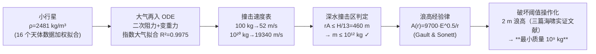

# 2021-GM-B-216（2021 题B · 队伍 216 · 20 页）

## 来自赏析

### 论文速览

题目问：小行星在距沿海城市 1000 km 的海面撞击，多大质量才能对城市造成"实质性破坏"？Harvey Mudd 学院 216 队（两人队伍）把问题切成两段物理链：小行星进入大气后的变速下落（阻力 + 重力 ODE，逐质量数值求解末速与气动损耗能量）→ 深水撞击空腔与波浪传播（经验空腔体积公式 + 实验室模拟得到的波幅定律），再引入"抵达城市波高 ≥ 2 m"这一由海啸灾害文献支撑的破坏阈值，扫描质量得到最小质量为 $10^9$ kg。摘要中三句话讲清方法、阈值与答案，信息密度极高。

### 获奖密码

1. **把模糊判据变成可计算的阈值。** "substantial damage"被三篇灾害文献交叉定义成"2 m 波高"，每条文献对应具体建筑类型与损毁程度——开放性题目的胜负手就在这一定义环节。
2. **全程数据驱动。** 小行星密度（16 颗实测加权拟合）、空气密度（标准大气拟合 $R^2=0.9975$）、入射速度（19.3 km/s 最概然值）、波幅定律（实验模拟）全部有数据或文献出处，模型没有自由飘动的参数。
3. **"账本式"自洽检验。** 用能量守恒算出无阻力末速 19340 m/s 作上限，数值解在大质量端收敛到同一数值，等于给 ODE 做了一次渐近校验；Figure 4 还明说用 $R^2=1$ 拟合外推，处理数据的自觉性远超同批。
4. **推导"零跳步"。** 式(3)–(8) 一步步从密度推出截面积，每步右侧标注操作，评委无须脑补任何代数环节。
5. **扫描区间有物理封顶。** 用 DWI 判据（$r_A\le$ 水深/13）把质量搜索上限定在 $10^{12}$ kg，扫描不是无脑遍历，而是先论证有效域再遍历。
6. **诚实的分段式讨论。** 逐段列优点/缺点，并给出 Green's law 这一具体可行的改进，展现对模型失效模式的清醒认知。

### 可借鉴清单

1. 开放判据类题目第一步先做"阈值工程"：查灾害/工程文献把定性词（严重破坏、安全）翻译成带出处的数值判据，并至少引两篇文献交叉支撑。
2. 每个输入参数都问一句"有没有数据"：能拟合实测数据（带误差棒、报 $R^2$）就不要取手算常数，Figure 1 的加权拟合是现成模板。
3. 用守恒律的极限情形为数值解"封顶校验"（本文能量守恒上限 = 大质量端数值解），一行推导就能证明 ODE 没解错方向。
4. 公式推导采用"每步右侧标注操作"的写法（plugging in / rearranging / solving for），可读性极高且几乎零成本。
5. 数值扫描前先用物理判据（如本文半径/水深比）限定参数有效域，避免把模型用到失效区还当真。
6. 讨论按模块分段写优缺点，并给出点名的方法级改进（Green's law、浅水坡度），比笼统的"未来可改进"更有说服力。

## 来自精读

### 全文骨架



**为什么这个骨架好**：全链只有两个"自建模型"（再入 ODE、大气拟合）+ 两个"文献模型"（空穴体积、浪高经验律），每个接口处（速度→能量→浪高→破坏）都有明确定义。**开放题的链式解法关键在接口**——链条任何一环换了更精细的模型，其余环节原样保留。

---

### 建模决策链

| 决策 | 作者的选择 | 被放弃的替代 | 为什么 |
|---|---|---|---|
| 破坏机制 | 只算海浪 | 热辐射/冲击风 | 三条量纲论证（能量分配/传热时标/体积耗散）排除 |
| 小行星密度 | 16 天体加权平均 | 典型值 3000 | 数据背书 |
| 再入模型 | 全 ODE 数值 | 假设 v_f=v_0 | 100 kg→52 m/s 证明减速不可忽略（虽然结论质量段影响小） |
| 大气模型 | 单指数拟合 | 分层标准大气 | 80 km 内 R²=0.9975，一参数搞定 |
| 波浪传播 | Gault & Sonett 经验式 | CFD/浅水方程 | 48h 不可行；经验式带 DWI 适用域检查 |
| 破坏阈值 | 2 m（三篇灾后调查） | 主观定义 | 文献实证，且对应"毁木屋+伤 RC"的"实质性"语义 |

**独立复现审计汇总**：式(13)系数 3.63e-3 ✓（含 1.256 吸收）；表格右端 19340 m/s = 无阻力上限 ✓；**终答案 10⁹ kg ↔ 1.96 m 浪高闭环 ✓**；⚠ 小质量段（100 kg→52.5 m/s）与自身系数的终端速度估计（~100 m/s）不符，疑事件判停偏早——不影响结论段；⚠ Fig 8 caption 的三个距离未直接包含 10⁶ m=1000 km？——含（10⁶ m 即答案距离），caption 阅读需细心。

---

### 可复用模板

**结构模板**：
```
1 Problem Statement   重述+排除论证（每条一个物理量纲）
2 Assumptions         ≤5条，每条一行理由
3 Impact              3.1 参数数据锚定（画数据图）
                     3.2 主 ODE（消元到一参数）+扫参表
                     3.3 能量审计（解析上限+损失）
4 Propagation         适用域判据→经验式→答案图（阈值线交点）
5 Discussion          按链条环节复盘：一优一劣一改进
```

**句式库**：
- "For this problem, X and Y are not considered for three reasons. 1. ... 2. ... 3. ..."（排除论证三段式）
- "This assumption is made due to ... leading to an over-complex model with likely insignificant changes in the final result."（假设=复杂度/精度交换句式）
- "Since the speed of the largest mass in this range is equal to the speed calculated from energy conservation, a curve of best fit ... is constructed for extrapolation."（数值端点如何反哺外推）
- "Thus, a wave height of 2m is set as the cutoff for substantial damage due to its potential to destroy ..."（阈值操作化+引用支撑）
- "To obtain more accurate wave heights in future work, Green's law can be used and ..."（改进方向具体到公式名）

**图表配方**：参数锚定画数据图（误差棒+均值线）；幂律一律 log-log；扫参结果用"每量级一行"的表；**答案图=模型曲线×阈值水平线的交点**。

---

*对照阅读：`05_论文赏析/2021/2021-GM-B-216.md`、`07_题目解读/2021_题B_小行星撞击沿海城市.md`（阈值选择如何造成 10⁹–10¹¹ kg 答案谱）、队友精读 385/442/445。*
