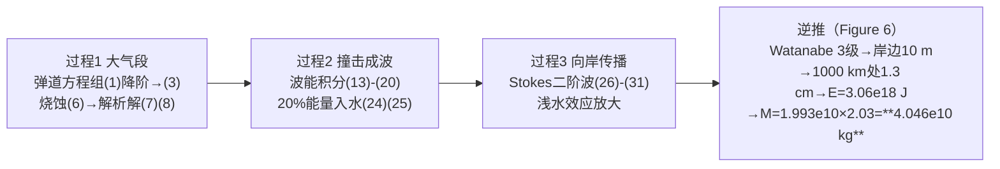

# 2021-GM-B-385（2021 题B · 队伍 385 · 17 页）

## 来自赏析

### 论文速览

国防科技大学 385 队把"小行星撞海"拆成三个串行过程——大气段减速烧蚀、撞击成波、海啸向岸传播（浅水效应放大），并对每个过程各建一个物理模型，最后**逆着因果链反解**：由渡部 (Watanabe) 海啸等级表定出"实质性破坏"对应 3 级（浪高 10 m），用 Stokes 二阶波公式倒推 1000 km 处波幅 1.3 cm，再经波浪能量积分反解小行星动能，最终给出最小质量 $4.046\times10^{10}$ kg（铁质小行星，直径 214.2 m，入大气速度 12.4 km/s；进入大气前质量是落海时的 2.03 倍）。"逆推链 + 流程图 (Figure 6)"是全文最鲜明的解题标识。

### 获奖密码

1. **逆推式解题主线可视化。** Figure 6 用流程图把"等级 → 岸边波幅 → 1000 km 波幅 → 动能 → 质量"的逆推链画成一目了然的六框图，评委 30 秒即可抓住解题逻辑——开放题里"解题路线图"本身就是得分点。
2. **三过程分解 + 每过程一个独立物理模型**（弹道烧蚀 ODE / 波能积分 / Stokes 二阶波），把复合问题模块化，每段都有教科书级推导，展现物理功底而非黑箱套公式。
3. **从完整到简化的显式降阶。** 式(1) 先写出含地球自转、球面坐标的六方程弹道组，再逐步假设化简到式(3)，让"丢了什么、为什么能丢"全程可见，自洽性论证充分。
4. **阈值有等级表背书。** Watanabe 等级表是海啸领域的通行标度，比自设"2 m 波高"更"国际化"，且 Figure 7 完整列出 -1 到 4 级的浪高与破坏对应。
5. **摘要五段式高信息量**：问题判断（海啸为主害）→ 三过程 → 逆推方法 → 数值答案，一段一个功能，末句落到具体数字。
6. **诚实的 Weaknesses**：点名椭圆余弦波理论、科里奥利力、斜入射三个具体改进方向，而非泛泛而谈。

### 可借鉴清单

1. 拿到复合过程题先画"正 process 图 + 逆求解流程图"（本文 Figure 1 + Figure 6 组合），把建模路线变成论文的视觉主轴。
2. 从最一般的控制方程（含所有力）出发再逐条假设化简并注明理由，比直接写简化方程更有说服力。
3. 阈值定义优先找领域通行标度/等级表（如 Watanabe 等级、Fujita 级数），一次引用即可同时获得"阈值数值 + 权威性"。
4. 能量传递比例类假设（本文 20% 入水、10% 动能占比）必须挂文献编号，并在灵敏度上补一条扫描曲线（本文 Figure 9 对初速做了，能量比例未做，可补）。
5. 附录代码逐行编号并注明每段实现哪条公式，方便评委复核数值来源。
6. 引用文献后自查编号连续性与作者拼写（本文重复 [2] 的失误在金奖论文中也不罕见，值得引以为戒）。

## 来自精读

### 全文骨架

论文只回答一个问题：**1000 km 外撞海的小行星，最小要多重才能让沿海城市"实质性破坏"？**



**为什么这个骨架好？** 正向建模（三过程）保证每个环节都有物理出处，逆向求解（Figure 6 流程图）保证答案是一条可回溯的链条——评委既看到"你会建"，也看到"你会解"。三过程之间接口清晰（速度/质量 → 能量 → 波幅），任何一段换更精细的模型（如椭圆余弦波替换 Stokes），其余不动。

---

### 建模决策链

| 决策 | 作者的选择 | 被放弃的替代 | 为什么 |
|---|---|---|---|
| 主害判定 | 海啸 | 热辐射/冲击波/地震 | 文献[1]定罪，一段话完成 |
| 小行星成分 | 纯铁球 ρ_M=7.8 | 岩石/冰 | "同强度海啸铁陨石质量最小"[6]——直接服务"最小质量"题眼 |
| 弹道模型 | 完整弹道组→显式降阶 | 直接写简化式 | 展示"丢了什么、为什么能丢" |
| 大气 | 指数 ρ₀e^{−h/H}，H=500 km | 分层大气 | 与解析积分 (7) 配套 |
| 波浪理论 | Stokes 二阶 | 椭圆余弦波/数值 | 有教科书出处[7]；浅水越界已在 Weaknesses 自认 |
| 阈值 | Watanabe 3 级 = 10 m | 自设浪高 | 国际通行等级表背书 |
| 能量耦合 | 20% 入水、10% 为动能 | 其他比例 | 均取文献区间中值[6] |
| 求解方向 | 逆向（阈值→质量） | 正向扫描 | "最小质量"天然适合逆推 |

**审计汇总**：✓ 12.396 km/s；✓ 1.993e10→4.046e10→214.2 m 闭环；⚠ 2.03 系数与式 (8)+σ=1e-7 矛盾（应≈1.005）；⚠ 1.3 cm 中间量与式 (31)/附录代码 3 输出脱节；⚠ 式 (21) 代码实现量纲异常；⚠ 附录代码 2（Fig 9）速度未乘 1000，纵轴质量偏大 10⁶ 倍（最终答案用的是代码 5，已乘）。

---

### 可复用模板

**结构模板**：
```
Abstract      定罪主害 → 三过程各一句 → 逆推预告 → 数值答案
3 Assumptions ≤5条，每条与题眼对齐（最小质量→选最密材料）
4 Model       4.1.1 过程1：一般方程→降阶→解析解
              4.1.2 过程2：教科书推导→指出不适用的地方→换用一般式
              4.1.3 过程3：专业理论（Stokes/Green/cnoidal）
4.2 Solving   逆推流程图（阈值→中间量→能量→质量）
5 Conclusion  "无变化"曲线也当灵敏度分析放正文
6 S&W         弱点点名替代理论（椭圆余弦波）
Appendix      代码逐行编号、注明对应式号
```

**句式库（原文摘录）**：
- "Among the plentiful effects caused by..., tsunami is probably the most devastating type of damage"（定罪句）
- "We divide the course of ... into three processes. Based on the processes, we build physical models to..."（分解句）
- "Finally, we solve the problem in reverse based on the physical models."（逆推宣言）
- "In the case of ..., 10-30% of the energy is transferred to the water. Therefore, we assume that 20%..."（区间引用取中值）
- "In shallow water, the error of ... is slightly larger, and the elliptic cosine wave theory is more adaptable."（弱点点名替代理论）

**图表配方**：过程题标配"正向过程图 + 逆向流程图"一对；阈值类引用等级表原图（如 Watanabe）；"四条重合的曲线"是最便宜的灵敏度分析；附录代码逐行对应式号。

---

*对照阅读：`05_论文赏析/2021/2021-GM-B-385.md`（宏观赏析）与 `07_题目解读/2021_题B_小行星撞击沿海城市.md`（本题 216/385/442/445 四篇金牌的答案谱对比）。*
