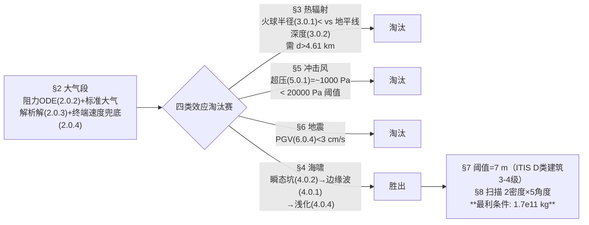

# 2021-GM-B-442（2021 题B · 队伍 442 · 16 页）

## 来自赏析

### 论文速览

华沙大学 442 队做的是一道"排除法"论文：不预设海啸是唯一威胁，而是把撞击的四类破坏效应——热辐射、冲击风（air burst）、地震震动、海啸——逐一量化并与破坏阈值比较，用数值证明前三种在 1000 km 处均可忽略，海啸才是决定最小质量的通道。模型主体采用 Collins–Melosh–Marcus 的 Earth Impact Effects Program 经验公式体系（[CMM05]），叠加大气阻力解析减速（式(2.0.2)–(2.0.5)）、边缘波/崩塌波双波幅定律（式(4.0.1)/(4.0.3)）与浅化系数 $K_s$（式(4.0.4)），在两种密度 × 五个入射角的参数网格上扫描直径，最终在最有利条件（$\theta=90°$、铁质 $\rho_a=8000\ \mathrm{kg/m^3}$、$v_0=17$ km/s）下给出最小质量 $1.7\times10^{11}$ kg，对应"7 m 波高使 D 类建筑达 3–4 级破坏"的阈值（[LAKK13]）。

### 获奖密码

1. **多害相权、逐一定量排除的论证架构。** 热辐射（$d>4.61$ km 才有效）、超压（1000 Pa < 20000 Pa 阈值）、地震（PGV < 3 cm/s）每项都给出"公式 → 数值 → 与阈值比较"的完整闭环，最后锁定海啸——这把"为什么只算海啸"从假设升级成了定理，是同题论文中最有说服力的框架。
2. **阈值-文献-建筑类型三对应。** 7 m 阈值精确到"D 类建筑、3–4 级破坏"，且解释了为什么选 D 类（沿海设防、城市建材），阈值工程做得细。
3. **每条经验公式都注明出处与适用范围**：$C_D$、$C_{Dw}$ 分介质取值（[LL59]），超压公式的 1 kt 外推失效区明说，评委可以放心引用其数字。
4. **参数网格呈现结论的稳健性**：两种密度 × 五个角度的扫描（Figure 5–7）让答案 $1.7\times10^{11}$ kg 显现为"最有利条件下的下界"，而非单点魔法数字。
5. **敏感性表格 + 不一致标注**（Table 2）：既做了灵敏度分析，又敢于指出数据不自洽，学术诚实度高。
6. **符号表自带数值与出处列**（Table 1），评委核对参数无需翻正文。

### 可借鉴清单

1. 开放题先建"效应清单"，对每种效应用"公式 → 数值 → 阈值比较"三步走排除或保留，把主模型的选择变成论证结果。
2. 阻力模型补一条终端速度取大者的截断（式(2.0.4)），一行公式堵住小质量端的模型失真。
3. 阈值选取落到"建筑类别 × 破坏等级"的颗粒度（如 ITIS 量表的 D 类/3–4 级），并写明选择理由。
4. 用双对数图并排比较两种机制的衰减速度（Figure 2 的 rim vs collapse wave），一张图顶一页论证。
5. 对关键经验系数做二维修正参数的敏感性表（坡度 × 宽度），发现不一致时如实报告。
6. 引用经验公式时同时记录其标定范围（1 kt 外推、$>10^4$ Mt 高估 2–5 倍），在结论中划清答案的置信边界。

## 来自精读

### 全文骨架

论文只回答一个问题：**1000 km 外撞海，哪种破坏效应决定最小质量、要多重？**



**为什么这个骨架好？** 每个效应小节都是同一套三步舞（公式→数值→与阈值比），读者到 §8 时已无悬念——"为什么只算海啸"不再需要辩解。对照 216 队把排除写在开头三段论、445 队用标度律两行带过，442 的排除最"重"，因为每个被排除项都给出了完整的定量闭环。

---

### 建模决策链

| 决策 | 作者的选择 | 被放弃的替代 | 为什么 |
|---|---|---|---|
| 论证架构 | 四效应逐一排除 | 开头假设只算海啸 | 排除从假设升级为定理 |
| 经验式来源 | EIEP 体系 [CMM05] 一贯到底 | 混合多来源公式 | 同一体系的参数标定自洽 |
| 大气密度 | 标准大气压高公式 | 指数近似 | Table 1 常数即可，无需拟合 |
| 速度兜底 | max(v_a, v_t) 终端速度 | 只用阻力解 | 堵住小质量端失真 |
| 阈值 | 7 m = D 类建筑 3–4 级 | Watanabe 等级/自设值 | 阈值-文献-建筑类型三对应 |
| 参数呈现 | 2 密度×5 角度网格 | 单点计算 | 答案显为"最利条件下界" |
| 敏感性 | Table 2 坡度×宽度扫描 + 标注不自洽 | 不做 | 学术诚实度 |
| 求解方向 | 正向扫参+读图交点 | 逆推解析 | 经验式链无闭式逆，图交点更直观 |

**审计汇总**：✓ 热辐射 d>4.61 km（复算 4608 m）；✓ 超压 ~10³ Pa；✓ 最终 1.7×10¹¹ kg 逐位复现（d=344.2 m，铁/90°/17 km/s）；⚠ K_s≈1.45 未乘入最终读图（保守约 1.9 倍，Fig 6/7 y 轴语义需对照 PDF）；⚠ Table 1 "r=1000 m" 单位笔误；⚠ Table 1 H=5000 m 与 §8 正文 H=4000 m 不一致；⚠ Fig 6 与 Fig 7 图注文字完全相同（一为 ρ₁ 一为 ρ₂，无法区分）。

---

### 可复用模板

**结构模板**：
```
1 Notations        符号+取值+出处三列表
2 Atmosphere       阻力ODE解析解 + 终端速度兜底
3/5/6 排除三连     每节：公式→数值→与阈值比→"即使×N 也不翻案"
4 主效应           分机制建模 + log-log 对比图选主导 + 近岸修正
7 阈值操作化       建筑类别×破坏等级颗粒度 + 选择理由
8 答案             参数网格扫描 + 阈值线交点
9 Conclusion       承认领域争议（Van Dorn）+ 未建模清单
```

**句式库（原文摘录）**：
- "We are also assuming the most favorable conditions, that is: ..."（答案条件声明）
- "Though many are too small..., there have been incidents which inspired researchers to create more accurate numerical and simulation models"（动机句）
- "For this reason we will treat the effect of ... as negligible and will be omitting them in further analysis."（排除收尾）
- "Thus, we assumed our minimal tsunami height goal to be 7 m."（阈值操作化）
- "they also ignore the curvature of the Earth, which at a distance of 1000 km begins to play a role"（经验式适用边界自白）
- "further research on this topic might prove interesting"（对自家数据不自洽的诚实标注）

**图表配方**：答案图=曲线族×阈值虚线交点；机制竞争=log-log 双线；二维敏感性=小表格（Table 2 式）；效应排除=每节一张 θ×E 曲面/热图（Fig 3/4）。

---

*对照阅读：`05_论文赏析/2021/2021-GM-B-442.md` 与 `07_题目解读/2021_题B_小行星撞击沿海城市.md`（四篇金牌的阈值选择与答案谱对比）；队友精读 216/385/445。*
