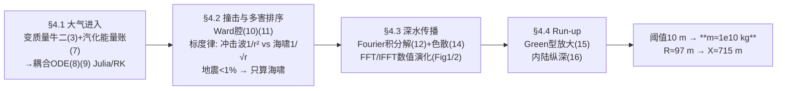

# 2021-GM-B-445（2021 题B · 队伍 445 · 16 页）

## 来自赏析

### 论文速览

同为华沙大学（与 442 队共享指导教师 Paweł Sidorczak）的 445 队走的是"理论推导 + 真实波动数值模拟"路线：以 Ward 的海啸灾害概率评估框架（[2] Icarus 2000）为主干——抛物面撞击空腔（式(10)(11)）给初条件，水面抬升的 Fourier 积分解（式(12)）配深水色散关系 $\omega^2=gk\tanh(kH)$（式(14)）用 FFT 数值演化波场，再以 Green 定律型 run-up 公式（式(15)）处理陆架放大。大气段从变质量牛顿第二定律出发自洽导出烧蚀耦合 ODE（式(8)(9)，并证明与 Chyba 1993 的经典结果一致）。最终结论：阈值取 10 m 波高，最小质量约 $10^{10}$ kg（半径约 97 m），并额外算出海啸内陆纵深约 715 m——五篇 2021B 论文中唯一给出"淹没距离"这一第三输出量的队伍。

### 获奖密码

1. **从第一性原理自推烧蚀律并对接经典文献。** 式(3)–(9) 的变质量推导链条完整，且明示与 Chyba 1993 结果一致并推广之——理论深度与文献自觉兼备，这在本科竞赛论文中稀缺。
2. **标度律排除法。** 用 $1/r^2$ vs $1/\sqrt r$ 与能量占比 <1% 两个量级论证就淘汰了冲击波与地震，物理洞察密度极高，省下篇幅投入海啸主模型。
3. **真实波动数值模拟 + 自家验证。** FFT 谱方法演化 Ward 积分解，并在 Figure 2 中数值复现 $1/\sqrt r$ 衰减律，让模型不仅"用了"而且"验了"。
4. **输出维度多一档。** 除最小质量外给出对应半径（97 m）与淹没纵深（715 m），把"实质性破坏"翻译成城市尺度的具体图像，结果呈现立体。
5. **模型选型有比较、有理由。** 对 shallow water 模型"知情但不用"的论证（缺初始振幅输入）显示调研广度；对空腔触底情形也给了处理方案。
6. **诚实的适用性声明。** Summary 直言精度所限并点名 hydrocodes 与多模型对比两条改进路径。

### 可借鉴清单

1. 变质量/烧蚀问题先写含 $\dot m\dot x$ 的完整牛顿第二定律与汽化能量平衡，再联立化简——两页推导即可建立远超"套公式"的理论印象。
2. 用标度律（维度不同的能量稀释 $1/r^2$ vs $1/\sqrt r$）做多威胁排序，比逐项精算省时且更显物理直觉。
3. 波动类问题用 FFT 谱方法：初始条件采样 → 各波数按色散关系独立演化 → IFFT 合成，代码量小且天然适配线性波方程。
4. 数值验证理论标度（在双对数图上核对斜率）是低成本高回报的自洽性检验。
5. 给答案增加"第二、第三输出量"（半径、淹没距离、到达时间），用同一模型多榨一层结论。
6. 排版红线：小数点用句点、不留"(ref)"占位符、阈值口径前后一致（本文 5 m/10 m 摇摆是可避免的扣分点）。

## 来自精读

### 全文骨架

论文只回答一个问题：**1000 km 外撞海的最小小行星质量是多少？**（附赠第二、第三输出：对应半径 97 m、内陆纵深 715 m）



**为什么这个骨架好？** 每一环都是"理论式 + 数值实现"成对出现：进入段 ODE 配 RK、传播段积分解配 FFT、run-up 配一行代数。对手 385 全解析、216 全链经验式，445 是三篇中唯一"模型跑起来"的——Figure 1/2 的波场快照就是可复现性的直接证据。

---

### 建模决策链

| 决策 | 作者的选择 | 被放弃的替代 | 为什么 |
|---|---|---|---|
| 烧蚀处理 | 自推变质量 ODE (8)(9) | 直接引 Bronshten/Chyba | 推导链完整，且能声明"推广了 [1]" |
| 多害排序 | 标度律两行排除 | 逐项精算（442 式） | 1/r² vs 1/√r 一比即知，省篇幅 |
| 波传播 | Ward 积分解 + FFT | 浅水波模型 [6] / CFD | [6] 缺初始振幅输入；CFD 48h 不可行 |
| 传播对称性 | 柱对称 → 2D | 全 3D | 线性叠加下等价，算力省 10³ |
| 近岸 | Green 型 (15) | Ward 式 (13) 续用 | Ward 式在陆架高估（正文明说） |
| 数值方法 | Julia RK + FFT/IFFT | 有限差分 | 谱方法对线性波天然精确 |
| 阈值 | 10 m | 5 m（正文曾提） | ⚠ 口径摇摆未解释，以计算采用值为准 |
| 输出维度 | 质量+半径+纵深 | 仅质量 | 同一模型多榨两层结论 |

**审计汇总**：✓ 质量-半径换算（R=97 m ↔ 1.00×10¹⁰ kg，ρ=2616）；✓ 式 (11) D_C≈1900 m；✓ 式 (15) 链条（3.4 m→9.2 m≈10 m）；✓ 式 (16) X=714 m 精确；✓ 大气段"变化可忽略"（我算 22.0→22.04 km/s，比论文更"可忽略"）；⚠ Figure 4 波幅（复算 5.76 m vs 图读 ~3.4 m，1.7×）；⚠ 撞击速度 20 km/s 未能复现；⚠ 阈值 5 m/10 m 前后不一。

---

### 可复用模板

**结构模板**：
```
2 Problem analysis  先给三类波的阈值草表（后文逐一对号）
3 Assumptions       14 条偏多，逐条在正文有回收
4 Theoretical model 4.1 进入段：受力→能量账→耦合ODE（自推+对接文献）
                   4.2 撞击：空腔闭式（能量守恒）+ 标度律排序
                   4.3 传播：积分解+色散关系（写明替代模型为何不用）
                   4.4 run-up：换模型+物理机制一段
5 Simulation        方法（RK/FFT）+边界条件自白+标度律数值验证
6 Results           多输出量（质量/半径/纵深）
7 Summary           用误差倍数说话，不用"quite inaccurate"
```

**句式库（原文摘录）**：
- "Now, notice that during ablation some vaporised mass detaches ... keeping its mechanical energy"（推导中的物理旁白）
- "Obtained formula agrees with results from [1] and generalises that result in case when ..."（自推结果对接文献）
- "In that way we minimise energy loss due to splashed water not contributing to ..."（几何假设的功能性理由）
- "Because energy which contributes to generation of both waves is similar, we can conclude that ..."（标度律排序收尾）
- "Because of that we decided not to use that model in our estimations."（知情但不用）
- "Notice that solution is assumed to be periodical, so in order to get proper result ..."（数值边界条件自白）

**图表配方**：波动类问题三件套——波场快照序列（过程）、物理量三联图（进入段）、结果-参数曲线+阈值线（答案）；数值验证理论标度写进正文；周期边界约束必须交代。

---

*对照阅读：`05_论文赏析/2021/2021-GM-B-445.md` 与 `07_题目解读/2021_题B_小行星撞击沿海城市.md`；队友精读 216/385/442（同一道题的四种浅水方案对比）。*
