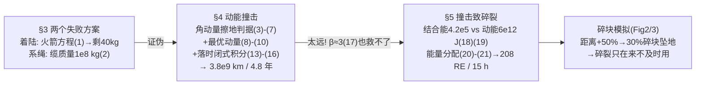

# 2022-GM-A-346（2022 题A · 队伍 346 · 19 页）

## 来自赏析

### 论文速览

多伦多大学 346 队（单人队伍 Andreas Constas）用一条"工程设计流程"主线解题：先提出着陆、系绳两个方案并用数量级估算证伪，再对动能撞击方案建立**角动量守恒判据**（式(5)(7)），配合火箭方程求最优撞击动量（式(8)–(10)）与落时积分（式(13)–(15)），得到最小提前量约 $3.8\times10^9$ km、4.8 年；随后指出该答案离地球过远，转入"撞击致碎裂"方案：用引力结合能（式(18)，$4.2\times10^5$ J）对比撞击动能（式(19)，$6.0\times10^{12}$ J）论证碎块互不束缚，对称分裂的能量分配给出 $r_{impact}=208\,R_E\approx1.3\times10^6$ km、约 14.6 小时——并用 200 碎块的蒙特卡洛模拟（Figure 2、3）给出该方案的代价：撞击点越近，碎块坠地概率越高（超出最小距离 50% 时 30% 碎块仍撞地球）。全文四种方案、两组答案、一条"越晚越危险"的物理权衡链，结构完整得像一篇小型行星防御综述。

### 获奖密码

1. **方案空间全覆盖 + 显式证伪。** 着陆（99% 质量损失）、系绳（缆绳 5000 倍于飞船质量）各用一行公式杀掉，评委会立刻确认该队考虑过所有显而易见的思路，主方案的选择因此可信。
2. **判据工程。** 把"miss Earth"写成角动量不等式(5)(7)，且$D=0$ 最坏情形的选取、$\phi=90°$ 的最优角、$u_{sat}=v_e$ 的动量极值都做了论证——判据的每个零件都被拧紧。
3. **两个答案之间的"桥"。** 纯动能解 4.8 年后主动指出"太远了"，用 $\beta\approx3$ 文献值检验仍不够，从而**逻辑必然地**引入碎裂方案——不是并列两题，而是一条递进的论证链。
4. **量级审计先行。** 碎裂模型动手前先算结合能 4.2×10⁵ J vs 动能 6.0×10¹² J，五个量级差换来一个干净模型，这是物理学家的"先验体检"习惯。
5. **理想解之外的代价定量。** 200 碎块模拟把"碎裂会误伤地球"从口头警告变成 30%/7% 的概率曲线（Figure 3），结论落在"仅在无时间时使用"的策略建议上，呈现了工程判断力。
6. **参考文献紧扣前沿。** 开篇即引 2022 年 DART 实测任务 [1]、动量增益引 AIDA 理论 [5]、并引用 Ahrens & Harris 1992 经典结论交叉验证"提前数年"的量级——时效与纵深兼备。

### 可借鉴清单

1. 赛题允许多方案时，先花一节把"显然但错误"的方案用数量级估算证伪，再展开主方案——破立结合的论证结构可直接复用。
2. "偏转成功"这类模糊目标应翻译成守恒量不等式（角动量判据式(5)），并把最坏情形（$D=0$）显式化为设计工况。
3. 遇到"质量变化 + 速度"的耦合，先对动量 $p=m(t)u(t)$ 求导找最优（式(9)），并给出一句话物理解释——极值条件的物理翻译是加分项。
4. 拆解类模型动手前先做"结合能 vs 注入能"的量级审计，差的量级足够大才允许忽略碎块间作用。
5. 理想模型（对称二分裂）之外补一个现实化模拟（多碎块、随机方向），把理想答案的风险量化成概率曲线。
6. 用 Maple/Mathematica 做符号推导并整屏截图入附录，逐式对应正文编号，让评委可逐条复核解析结果。

## 来自精读

### 全文骨架

题目：**100 m 小行星以 25 km/s 撞地，2 万 kg 飞船最早提前多久撞它能救地球？**



**为什么这个骨架好？** 四个方案不是并列的四道小题，而是一条递进链：每个方案被否决/被接受都**因为上一个方案的数值结果**（4.8 年太远 → 才需要碎裂；碎裂有风险 → 结论落成策略建议"仅在无时间时使用"）。这种"结构本身承载论证"的写法是工程类论文的满分形态。

---

### 建模决策链

| 决策 | 作者的选择 | 被放弃的替代 | 为什么 |
|---|---|---|---|
| 方案空间 | 4 方案递进（2 否决+2 量化） | 只算动能撞击 | 破立结合，主方案合法性来自比较 |
| 判据语言 | 角动量不等式 (5) | 几何位移计算 | 守恒量表达，右端与操作解耦 |
| 设计工况 | D=0 正对地心 | 平均入射 | 最坏情形 → 答案是保守下界 |
| 最优动量 | u=vₑ 的极值解 | "越快越好" | 反直觉结论有导数+物理解释 |
| 小行星类型 | C 型（最常见+最轻） | S/M 型 | 同尺寸质量最小最难偏转 → 保守 |
| β 修正 | 引文献 β≈3 并声明 r∝1/β | 细算 ejecta | 用文献上界封顶敏感性 |
| 碎块引力 | 结合能量级审计后忽略 | 计入 | 7 个量级差=干净化通行证 |
| 理想解风险 | 200 碎块模拟定价 | 只做理想二分裂 | 把"可能误伤"变成 30%/7% 曲线 |

**审计汇总**：✓ 动能撞击 r=3.807×10⁹ km、T=4.83 年（u(t₀)≈0 复现逐位一致；⚠ 若计 LEO 初始速度则为 6.8×10⁸ km/0.87 年，论文未明示 u(t₀) 取法，以附录 Maple 截图为准）；✓ 碎裂 U=131.5 m/s、r=208.2 R_E、T=52678 s/14.63 h（精确）；✓ 结合能 4.18×10⁵ J；⚠ 撞击动能 6.25×10¹² vs 论文 6.0×10¹²（舍入）；⚠ 材料内聚力未计入结合能审计。

---

### 可复用模板

**结构模板**：
```
Abstract       方案A数值 → Therefore 方案B → B数值 → 风险
3 失败方案     每个"一行公式算死"
4 主方案       4.1 判据（守恒量不等式+最坏工况）
               4.2 资源最优化（极值条件+物理解释）
               4.3 时间换算（能闭式则闭式）
               4.4 参数选取（保守方向声明）+修正上界
5 备选方案     量级审计 → 标度律对比 → 判据 → 现实化模拟定价风险
6 Discussion   优点/缺点各三条，点名未做的修正
7 Conclusion   物理答案 → 政策含义（early detection）
附录           Maple 逐式截图 + 模拟代码
```

**句式库（原文摘录）**：
- "This paper follows an engineering design process: first we frame the problem..., then we devise several possible approaches, and finally assess each for feasibility"（开篇立结构）
- "Substituting a value of 4.5 km/s for ve..., we get that the mass on landing is only about 40 kg"（失败方案的葬礼数字）
- "This has an intuitive physical explanation. When the velocity ... exceeds the exhaust velocity..."（极值条件的物理翻译）
- "Unlike momentum, the kinetic energy ... provides favorable square root scaling"（方案切换的标度律理由）
- "Therefore, deflection through asteroid fragmentation should only be used when there is not enough time"（策略化结论）
- "The results of this paper emphasize the need for early detection systems"（政策升维）

**图表配方**：判据类问题配一张"双轨迹示意图"（红=失败/绿=成功）；多方案答案画在同一 log 轴；模拟输出两件套=分布直方图+概率曲线；符号推导整屏截图入附录逐式对应。

---

*对照阅读：`05_论文赏析/2022/2022-GM-A-346.md` 与 `07_题目解读/2022_题A_偏转小行星.md`；队友精读 2022-GM-A-395（同一道题的日心系分类讨论路线，答案谱 58 天–4.8 年）。*
