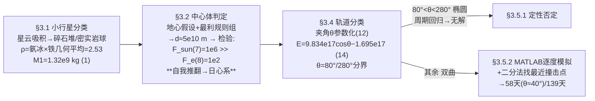

# 2022-GM-A-395（2022 题A · 队伍 395 · 36 页）

## 来自赏析

### 论文速览

同济大学 395 队的答卷在五篇中独树一帜：**整套采用 MCM/ICM 建模赛论文模板**（"Summary Sheet / Team Control Number 395 / Page N of 35"三栏页眉），解题思路也是数模式的"分类讨论 + 数值搜索"。他们先按星云吸积理论把小行星分成碎石堆与密实岩球两类（前者仅定性分析），后者取完全非弹性碰撞模型；密度取氨冰与铁的几何平均 $\rho\approx2.53\ \mathrm{g/cm^3}$，得 $M_1\approx1.32\times10^9$ kg（式(1)）。核心创新是引入**日心系视角**：以撞击时小行星对地速度方向与地球公转速度方向的夹角 $\theta$ 为参数，由余弦定理与轨道能量判据 $E=9.834\times10^{17}\cos\theta-1.695\times10^{17}$（式(14)）把轨道分为椭圆（$80°<\theta<280°$，动能撞击无法解决）与双曲（其余角度）两支，对双曲情形用 MATLAB 逐度模拟 + 二分法搜索最近可行撞击点，最终给出：最短 $t\approx5\times10^6$ s ≈ 58 天（$\theta\approx40°$，式(21)），最长 $t\approx1.2\times10^7$ s ≈ 139 天（$\theta\approx-80°$，式(22)）。

### 获奖密码

1. **日心系框架 + 单参数化。** 把"轨迹未知"化为夹角 $\theta$，用轨道能量符号把解空间切成椭圆（无解）/双曲（可解）两支——分类讨论不仅全面，而且每一类的可解性都有物理论证（椭圆的周期回归性），这是评委最认可的"结构化思维"。
2. **前提检验的自我纠错循环。** 3.2 节先立"地心主导"假设推出 $d$，再算出 $F_{sun}/F_e=10^4$ 推翻自己、切换到日心系——把"模型前提要自洽"演示成论文的一部分，几乎是为评委的 rubric 量身定做。
3. **约束驱动的燃料决策。** 用 $\frac{dp}{dm_t}$ 的符号论证 + 第三宇宙速度约束求出 $m_t=2161$ kg，飞船质量这一题目给定资源被真正"用"进了计算，而不是当摆设。
4. **数值搜索流程完整可复现。** 原轨道 → 撞击点扫描 → $\Delta v$ 注入 → 碰后积分 → 1.5 $R_E$ 判据 → 二分法 → 逐度扫描 → 拟合，每步都写了判据和理由，附录 19 页 MATLAB 代码支撑复现。
5. **诚实的分支处理。** 抛物线（测度为零）、碎石堆（定性）、椭圆（无解）都不回避，正面给出"为什么不算/为什么无解"的理由，答案的适用域因此清晰。
6. **极限情形法用得系统。** 200 km/s 对地速度、不损失质量的飞船、顺风叠加公转速度——所有"最利情形"都明示为估算上界，读者随时知道数字的保守/激进属性。

### 可借鉴清单

1. 遇到"轨迹/构型未知"的开放条件，先找一个参数（如方向角 $\theta$）把解空间参数化，再按物理判据（轨道能量符号）分而治之。
2. 建模型前先做"中心体/主导项判定"的数量级比较，且把检验写进论文——发现矛盾就升级框架，这比一步到位更显物理成熟度。
3. 题目给定的资源（飞船质量、燃料）要参与计算：用火箭方程 + 速度约束反推可用质量，让每个给定数都有出场机会。
4. 周期性轨道上的偏转问题要检查"碰后轨道是否仍与目标轨道相交"——有回归性时小 $\Delta v$ 方案天然失效，这一论证可迁移到三体/交会类题目。
5. 数值搜索题的标准链条：物理判据 → 二分法临界点 → 参数扫描 → 拟合极值，配合附录代码形成可复现闭环。
6. 警戒项：本文能拿金牌但符号表错行、图注缺失、摘要语法粗糙、仅 2 篇参考文献——说明 UPC 评审核心在物理与模型本身；但这些瑕疵在更激烈的年份完全可能变成减分项，排版还是越干净越保险。

## 来自精读

### 全文骨架

同一道题（100 m 小行星、25 km/s、2 万 kg 飞船、提前多久）：346 给"4.8 年或 15 小时"，395 给"**58 到 139 天**"。



**为什么这个骨架好？** "轨迹未知"是本题最大的开放条件，把它化为一个角 θ、再用轨道能量符号二分——**每个分支的可解性都有物理论证**（椭圆的周期回归性直接判死），最后只剩一个分支需要数值。分类即求解，这是评委最认可的结构化路线。

---

### 建模决策链

| 决策 | 作者的选择 | 被放弃的替代 | 为什么 |
|---|---|---|---|
| 成分分类 | 碎石堆/密实岩球二分 | 单一模型 | 成因决定力学响应；碎石堆定性、岩球定量 |
| 密度 | 冰铁几何平均 2.53 | 单一典型值 | 两端材料+岩石对照 sanity check |
| 中心体 | 太阳（先假设地球再自推翻） | 直接日心 | 力比检验 (7)(8) 写进论文，前提自洽可见 |
| 参数化 | 夹角 θ + 轨道能量符号 | 枚举轨迹 | 一次符号判别切分全空间 |
| 椭圆分支 | 回归性论证无解 | 数值尝试 | 小 Δv 推不开相交轨道 |
| 碰撞方向 | 垂直于原速度 | 顺向/逆向 | 横向 Δv 对轨道改变最有效 |
| 搜索算法 | 二分法+1° 步长扫描 | 全局优化 | 单调判据+参数扫描即够；区间宽度与判据同量级 |
| 判据 | 距地心 >1.5 R_E | 掠过大气层 | 抓住"实质性错过"的工程口径 |

**审计汇总**：✓ M1=1.325×10⁹ kg；✓ d≈5.8×10¹⁰ m（量级）；✓ F_sun/F_e=10⁶/10²；✓ m_t=2161.3 kg 逐位；✓ 式 (14) 系数与 80°/280° 分界；✓ 式 (20) 三系数逐位；⚠ 58 天与正文 Δv 链不闭合（Δv×t≈3.8×10⁵ m ≪ 10⁷ m 判据，需查附录 MATLAB，以 PNG 为准）；⚠ 式 (11) 丢 u 笔误、符号表错行（m_craft 写成速度、v_fst 写成太阳质量）、图注缺失、文献仅 2 篇——金牌也有粗糙面。

---

### 可复用模板

**结构模板**：
```
3.1 对象分类       成分/结构二分，一类定性一类定量
3.2 框架判定       立假设→极限估算→力比检验→（必要时）推翻重来
3.3 资源核算       火箭方程+约束反推可用质量，让题目给定数参战
3.4 解空间参数化   一个角/一个符号量切分全部情形，逐支判可解性
3.5 数值搜索       原轨道→注入扰动→碰后积分→判据→二分→扫描→拟合
4/5 结论与弱点     区间答案 + 分支边界 + 自曝局限
附录               全部脚本截图
```

**句式库（原文摘录）**：
- "we only consider the order of magnitude of its value in this part of numerical calculation, and do not care about its exact value"（估算的量级声明）
- "It can be seen that at this time, the gravitational force of the sun on the asteroid is much larger than that of the Earth..., which contradicts the hypothesis. Therefore, ..."（自我推翻的转折句）
- "in almost every case / it is almost impossible for us to make the orbit energy of the asteroid strictly equal to 0"（测度为零的分支排除）
- "as long as the asteroid's orbit has intersection with the earth's orbit, ... the asteroid will always collide with the Earth"（周期回归论证）
- "Of course, this is not possible in reality, and this is just for estimation purposes"（极限情形的诚实标注）

**图表配方**：分类问题画"能量-参数曲线+底色分区"；轨道问题一张"原轨道/碰后轨道/碰撞区圈注"三元素图；数值搜索的收敛区间宽度要与判据同量级并说明理由；答案为区间时配 t-θ 拟合曲线并标注极值点。

---

*对照阅读：`05_论文赏析/2022/2022-GM-A-395.md` 与 `07_题目解读/2022_题A_偏转小行星.md`；队友精读 2022-GM-A-346（同题的角动量判据路线，58 天–4.8 年的答案谱正好检验两文的框架差异）。*
