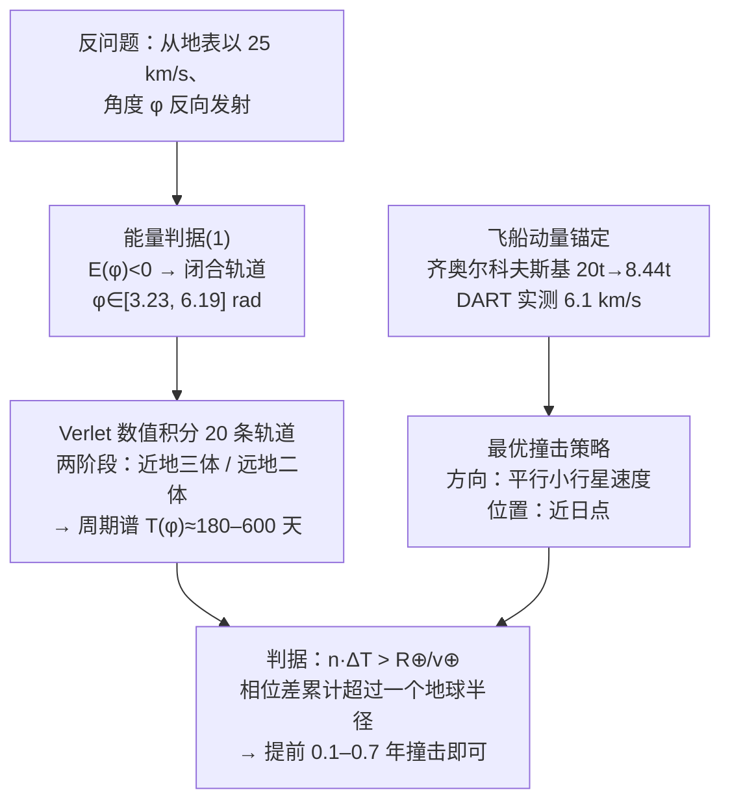

# 2022-GM-A-425（2022 题A · 队伍 425 · 21 页）

## 来自赏析

### 论文速览

论文将"以 25 km/s 撞击地球的 100 m 小行星"反演为一个单参数轨道族：从地球表面以 25 km/s、按径向角 $\phi$ 反向发射虚拟天体，用能量判据（式 1）筛出闭合轨道（$\phi \in [3.2305, 6.19424]$ rad），再用 Verlet 数值积分得到 20 条轨道的周期。撞击方案上借 DART 任务实测定标动量传递，数值搜索出最优撞击方式——在近日点沿小行星速度方向撞击；最后用"周期提前量"判据 $n\Delta T > R_z/v$ 得到最终答案：需在撞地前约 0.1–0.7 年撞击小行星。

### 获奖密码

1. **反问题参数化**：把"所有可能的小行星轨道"压缩为单一参数 $\phi$，用能量判据界定有效区间，问题从"猜轨道"变为"扫参数"，这是全场最漂亮的一步。
2. **以真实任务定标**：DART 任务（2022 年 9 月恰好发生）用于确定撞击速度与动量传递，$\beta$ 引用 Icarus 的定标论文并给出物理机制解释，工程参数全部有出处，评审最认可的"现实性"。
3. **机制排序、抓大放小**：明确论证"周期扰动逐圈累积而半长轴扰动不累积"，从而大胆只保留时间差判据——简化有物理理由而非偷懒。
4. **最优策略有数值支撑**：最优撞击方向与位置通过两组扫掠仿真（Fig.10、Fig.12）独立验证，且说明对其他 $\phi$ 结论相同。
5. **判据透明可复核**：$n\Delta T > R_z/v$ 一行写清"提前量须超过地球半径对应的时间窗"，最终 0.1–0.7 年的答案直接由 $y = R_z\cdot365/(v\Delta T(\phi)T(\phi))$ 给出，链条完整。

### 可借鉴清单

1. 遇到"某类天体"的开放题，先设计**单参数化的轨道族 + 能量/判据筛选**，把连续问题变成有限参数扫描。
2. 工程量（燃料、动量）优先**锚定真实任务的实测值**（如 DART、Tsiolkovsky 方程 + 具体比冲），比纯理论推导更让评委信服。
3. 建立类似 $n\Delta T > R_z/v$ 的**一行式命中判据**，让最终结论的物理含义一目了然。
4. 数值积分主动选择与问题对称性匹配的算法（Verlet 的时间可逆性），并在文中说明理由。
5. 多个可能的效应（轨道形变 vs 周期提前）出现时，**用"是否随圈数累积"这类量级论证决定取舍**并明说出来。
6. 引用外部图（策略适用范围、任务轨道）能有效撑起"方案选择"章节，但务必标注来源与 DOI。

## 来自精读

### 全文骨架



**为什么这个骨架好**：题面问"提前多久撞小行星能救地球"，队伍把它拆成三个可独立回答的子问题——**轨道族从哪来（反问题）**、**能传递多少动量（DART 锚定）**、**多少相位差算躲开（几何判据）**。三个接口（φ→T、p→Δv、ΔT→n）全部显式，链条任何一环都可独立替换成更精细的模型。

---

### 建模决策链

| 决策 | 作者的选择 | 被放弃的替代 | 为什么 |
|---|---|---|---|
| 威胁范围 | 只管闭合轨道小行星 | 含双曲线彗星 | CNEOS：>99.57% 威胁是闭合轨道 |
| 轨道族生成 | 时间反演+角度 φ 参数化 | 正向枚举轨道要素 | 一维参数扫出全部可能 |
| 数值方法 | Verlet + 自适应步长 | 欧拉/RK45 | 时间可逆保轨道结构；近远地步长差 20 倍 |
| 飞船建模 | DART 实测动量锚定 | 逐轨道任务优化 | 任务设计简化会引入量级误差，不如实测常数 |
| 撞击策略 | 方向与位置两轮一维扫描 | 二维联合优化 | 结论清晰可写进摘要；坐标下降式实验设计 |
| 躲避判据 | 相位累积（周期） | 几何偏移（半长轴） | 相位差每圈累积，收益随时间放大 |
| 地球引力 | 忽略聚焦 | 数值三体 | 25 km/s ≫ 逃逸速度，弯曲可略 |

**独立复现审计汇总**：闭合区间 [3.23, 6.18] rad ✓（式 1 逐点复算）；mf=8.42 t ✓；p_est=8440×6100=5.15×10⁷ ✓；ΔT 公式**缺 π** ⚠；**β 记账两套并存、终图未声明** ⚠；判据时间 214 s ✓；结论 0.1–0.7 年量级 ✓（与 p_est/β 组合复算一致）。

---

### 可复用模板

**结构模板**：
```
1 Introduction       范围裁剪（统计数字支撑）+ 真实案例
2 Numerics           方法+选择理由（物性）+步长策略
3 Model              3.1 反问题参数化（能量判据定域）
                    3.2 探测器锚定（真实任务标定）
                    3.3 传递机制（β 三情形+量级论证）
                    3.4 最优策略（两轮一维扫描）
                    3.5 判据选择（周期 vs 几何——累积性论证）
4 Result             答案随参数的曲线（结论区间读图）
```

**句式库**：
- "A vast majority (>99.57%) of objects considered as the threat are ... We have decided to exclude ..."（统计支撑的范围裁剪）
- "This assumption is quite reasonable, as Earth orbit's eccentricity is just 0.0167."（假设配一个数字）
- "We decide, that rather than optimizing for ..., we will estimate ... as a constant value ..., based on ..."（承认算不了+锚定策略）
- "These assumptions are rather more optimistic than they could be in reality, but we assume them only to get some qualitative results."（乐观参数的用途声明）
- "When we change the period by ∆T, then after three encirclements the total time difference becomes 3∆T."（累积效应的直觉解释）
- "The later probably bigger approximation could be easily reduced by numerical simulation of the collision."（近似+出路一句话）

**图表配方**：判据曲线画零线+满足域打影（Fig 2）；几何定义图与结果曲线**成对**出现（Fig 9/10、11/12）；策略选择配适用域图（Fig 6）；答案=随参数变化的曲线+结论区间（Fig 13）。

---

*对照阅读：`05_论文赏析/2022/2022-GM-A-425.md`、`07_题目解读/2022_题A_偏转小行星.md`（四队答案谱 58 天–14 年的口径分析）、队友精读 346/395/460。*
