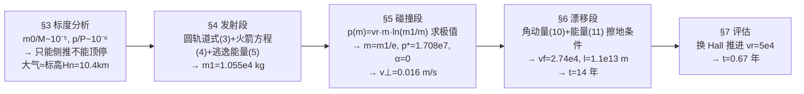

# 2022-GM-A-460（2022 题A · 队伍 460 · 13 页）

## 来自赏析

### 论文速览

本文是五篇 2022 金奖论文中唯一**全程解析、零数值模拟**的答卷。作者把任务切成三段——发射航天器、航天器–小行星碰撞、小行星漂移——每一段用守恒律加标度（scale）分析化简，最终纯手算得到：若用化学火箭（有效喷气速度 $v_r = 4.4\times10^3$ m/s），须提前 **14 年**撞击；若换用 Hall 效应推进器（$v_r = 5.0\times10^4$ m/s），缩短为 **0.67 年**，从而凸显 $v_r$ 对任务的決定性影响。摘要末尾还主动写明模型"强于普适与清晰、弱于精度"，自我定位清晰。

### 获奖密码

1. **标度分析贯穿全文**：先证明 $p/P\sim10^{-6}$ 才能"合法地"把碰撞简化为纯侧推、把 $v_{//}$ 冻结为 $v_0$；每一处简化都有量级背书，评委最看重的"假设合理性"被做成了显式论证链。
2. **自洽性反哺假设**：用角动量算出自转动能占比 $\sim10^{-12}$ 来回头证明"质点假设"成立（Section 5.2），模型内部互证而非各说各话。
3. **对数极值优化 $p^* = v_r m_1/e$**：在"撞击前还要不要携带/消耗燃料"这一别人容易忽略的环节上做出真优化，且 Section 3.2.2 的 $p = \frac{1}{e}v_rm_0$ 预告、Section 5.2 兑现，前后呼应。
4. **结果诚实评估 + 参数灵敏度**：公开承认 14 年、73 AU 的解"not satisfying"，并用 Hall 推进器参数重算出 0.67 年，把"物理答案"与"工程可行性"分开讨论，展现判断力。
5. **摘要质量高**：三阶段路线、两个数值答案（14 年 / 0.67 年）与"决定性参数"结论全部在摘要中出现，评委 5 分钟即可掌握全文。

### 可借鉴清单

1. 动笔前先做一页**标度分析**（质量比、动量比、时间尺度），用 $10^n$ 论证决定哪些效应可以扔掉——这比多算十页更得分。
2. 火箭动量预算别忘**对数极值**：最大化 $p(m) = v_rm\ln(m_1/m)$ 得 $m = m_1/e$，一个漂亮的小结论可反复引用。
3. "擦地刚好不撞"设切线条件 + 角动量/能量双守恒，是这类偏转问题最省力的解析骨架。
4. 每个近似旁标注**相对误差量级**（$10^{-3}$、$10^{-12}$、$10^{-7}$），让评委无需复算即可信任。
5. 对最敏感的输入参数（此处 $v_r$）至少做**两组对照取值**并重算全链路，即构成事实上的灵敏度分析。
6. 用**等效标高**（$\int\rho\,dh = H_n$）一类积分论证快速处理边缘效应（大气阻力），一段话解决别人可能纠结半页的问题。

## 来自精读

### 全文骨架

问题：20 t 航天器撞 100 m、25 km/s 来袭的小行星，要提前多久撞才能让它擦着地球飞过去？



**为什么这个骨架好**：三段各有一个"出口量"作为下一段的"入口量"（m₁→p\*→v⊥），接口全部是标量，链条任何一段都可以单独替换成更精细的模型而不动其余两段——这和 425 队"φ→T、p→Δv、ΔT→n"的接口化思路异曲同工，但 460 队连一个数值积分都没用。§3 的标度分析不是走过场：`p/P∼10⁻⁶` 这一行直接决定了后面"α=0、只给横向速度"的全部策略。

---

### 建模决策链

| 决策 | 作者的选择 | 被放弃的替代 | 为什么 |
|---|---|---|---|
| 总体方法 | 纯解析+守恒律 | 数值积分轨迹 | m/M、p/P 极小，一阶扰动解析就够了；清晰、可复算 |
| 撞击策略 | 侧推（α=0） | 正面减速 | p/P∼10⁻⁶，顶回无效（量级证明） |
| 动量传递 | 完全非弹性+碎片随机飞散 | 弹性/β 动量增强 | 保守；对比 425 队引 β≈8.4，本文少算了反冲加成（改进空间） |
| 大气 | 等效厚度 Hn | 分层大气/穿大气积分 | 一个积分定等效厚度，只留一位有效数字 |
| 漂移判据 | 擦地相切（距离判据） | 相位累积（425 队） | 解析可 closed-form；代价是忽略太阳引力——l≈73 AU 处该假设明显吃紧，论文自己承认可疑 |
| 灵敏度 | 重跑 vr=5e4 全链 | 参数扫描矩阵 | 单杠杆参数一次重算，性价比最高 |

**总规律**：每处"偷懒"都有数量级背书，每处假设都有回收点——这就是评审喜欢的 well-motivated simplification 的纯解析版本。

---

### 可复用模板

**结构模板**：
```
Abstract       两参数两答案 + 模型自评
3 General      3.1 阶段划分  3.2 标度分析（否决技术路线 + 等效化简）
4/5/6 三个阶段  每段: 假设(含伏笔) → 守恒律 → 闭式解 → 误差量级
7 Evaluation   结果不满意 → 归因 → 参数出路（重算一组）
```

**句式库（原文摘录）**：
- "we can deduce that it is impossible ... instead, the spacecraft needs to ..."（用量级否决路线）
- "This will be confirmed in the third stage."（假设埋伏笔）
- "we shouldn't waste any of the spacecraft's velocity on pushing back the asteroid"（结论写成行动指令）
- "only 2 significant figures are retained because ρ, thus M, thus v⊥ only has 2 significant figures"（有效数字记账链）
- "Such a long time mainly comes from ... Thus, it is essential that technology that can further increase vr is developed."（负结论→政策建议）

**图表配方**：解析流论文至少要一张**文献数据图**（支撑参数取值）+ 两张**几何定义图**（碰撞、擦地）；再补一张"答案 vs 关键参数"的灵敏度曲线（本篇缺，属于可改进项）。

---

*对照阅读：`05_论文赏析/2022/2022-GM-A-460.md`（宏观赏析）与 `07_题目解读/2022_题A_偏转小行星.md`（四队答案谱：14 年属"最保守/最长提前量"一端）；队友精读 42/43/44（346、395、425 队）。*
