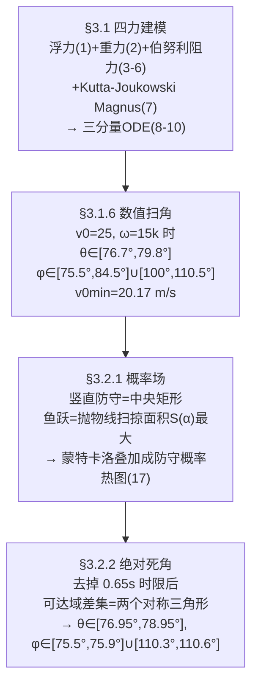

# 2022-GM-B-358（2022 题B · 队伍 358 · 24 页）

## 来自赏析

### 论文速览

论文以空气动力学为核心建立旋转足球的飞行动力学模型：计入重力、浮力、空气阻力与 Magnus 力，导出矢量运动方程 (8) 并分解为三分量 ODE 组 (10)，用 Python（scipy `odeint`）数值求解，再把初速度方向转为球坐标角 $(\theta, \phi)$ 做参数扫描，得到能命中上角的瞄准角区间（$v_0=25$ m/s、$\vec\omega=15\vec k$ 时 $\theta\in[76.7°,79.8°]$，$\phi\in[75.5°,84.5°]$ 及 $[100.0°,110.5°]$）与最小初速 $v_{0min}=20.17$ m/s。第二问先给守门员建模（直立防守与扑救两种模式），用蒙特卡洛给出扑救成功率分布，再反向求出"绝对死角"（两块对称矩形），最终给出必进射门的角度区间 $\theta\in[76.95°,78.95°]$、$\phi\in[75.5°,75.9°]\cup[110.3°,110.6°]$。

### 获奖密码

1. **受力分析滴水不漏**：浮力、阻力、Magnus、自转衰减四项全考虑，且每项要么现场推导（Bernoulli 压差）要么给出文献系数（$C_a=0.4$、Kutta–Joukowski 式 (7)），模型完整性拉满。
2. **"先纳入、再量级舍弃"的规范操作**：自转衰减一节先解出 $\omega=\omega_0e^{-kt}$、再证明变化小于 0.1%，比直接假设 $\omega$ 恒定高一个论证层次。
3. **守门员建模的物理感**：把守门员当成"蹬地发力 + 抛体运动 + 臂长偏移"的力学对象，起跳角 $\alpha$ 通过面积积分 (16) 真优化，人体参数全部有解剖学出处，不是拍脑袋。
4. **从"概率小"到"必进"的递进策略**：先用重叠次数加权 + 蒙特卡洛给出风险分布，再求绝对死角，两个层次直接回答题目的"最佳策略"，且最后都折算回 $(\theta,\phi)$ 区间，与第一问首尾呼应。
5. **代码附录全公开**：三段 Python 让所有数值结果可复现，配合"参数均来自官方或公认数据"的声明，可信度高。

### 可借鉴清单

1. 旋转球类问题按"重力+浮力+阻力+Magnus"四件套列式，Magnus 用 $\vec\omega\times\vec v$ 叉乘形式直接支持任意自转轴，代码通用性强。
2. 任何"想忽略的小效应"都先写出方程、再用数量级论证舍弃（如 $e^{-kt}>0.999$），一句话就能堵住评委的质疑。
3. 把初速度方向球坐标化为 $(\theta,\phi)$ 后做网格扫描，输出"可行角度区间"而非单点答案，更贴近"what velocities will result in a successful shot"的问法。
4. 对手/障碍物建模可用"可达域几何 + 时间约束 + 概率叠加"三层递进，最后用蒙特卡洛热图直观呈现风险地图。
5. 求绝对死角时记得**去掉时间限制重新优化**（本文 $\alpha$ 从 0.64 变为 0.92 rad），并扣除球体半径——细节决定结论可信度。
6. 人体工程参数（肩高、臂展、起跳高度）引用解剖学/运动科学文献，比自设数值更让生物力学类模型可信。

## 来自精读

### 全文骨架

问题：点球想踢进"上角"，初速度和旋转该是多少？守门员在时该瞄哪？



**为什么这个骨架好**：题面两问被拆成"能不能进上角"（纯物理，ODE 扫角）与"守门员能不能碰到"（人体工程学，可达域），两问共用同一套轨迹代码。第二问内部又分两层——**概率小的地方**（软约束）与**根本够不着的地方**（硬约束）——先软后硬，最终答案落在硬约束上，说服力层层递进。

---

### 建模决策链

| 决策 | 作者的选择 | 被放弃的替代 | 为什么 |
|---|---|---|---|
| 球的受力 | 四力全建模 | 只留重力+阻力 | Magnus 与重力同量级，不可略；浮力列出来证明可略 |
| Cd | 常数 0.4（文献） | Cd–Re 插值（471 队） | 点球速度带 20–25 m/s 正跨阻力危机，471 的做法更精；358 以区间答案消化了该误差 |
| 扫描变量 | 定 v₀、ω，扫 (θ,φ) | 全空间优化 | 两维扫描结果可画成"轨迹束"，直观且答案即容错带 |
| 防守建模 | 可达域（几何）+概率核（统计） | 博弈论/反应延迟模型 | 几何给硬约束（死角），统计给软排序，两层互补 |
| 死角定义 | 去时限的绝对死角 | 限时下的低概率区 | 绝对死角是"必进"保证，答案更硬 |
| 概率权重 | 重叠次数 n | 可调权重/学习参数 | 免调参、可解释 |

---

### 可复用模板

**结构模板**：
```
1 引言+操作化定义（"上角"=可判定矩形）
2 假设+符号表（含数值列）
3.1 动力学：四力逐个推导→矢量方程→分量方程→数值解→示例轨迹
      →固定量、扫两维→区间答案→v0min
3.2 对手模型：参数化人体→逐档可达域→叠加概率场
      →硬约束版本（去时限）→死角几何→回到轨迹模型重扫区间
4 优缺点（坦白数据不足）
附录 全部代码
```

**句式库**：
- "we divide the area of the goal into nine equal parts, and consider ... as the upper corners"（模糊词操作化）
- "It is worth noting that, comparing with ..., the trajectory of ... is more asymmetric, which is the effect of ..."（对照实验+归因一句话）
- "As the reasonable orientation angles can't be expressed by mathematical language such as equation and inequality, we only give the range ..."（承认答案形态+给出获取途径）
- "we neglect the time limit ... as we are pursuing the absolute dead angle area"（换判据时明说）
- "The lighter the color appears, the higher the probability ..."（图例自解释）

**图表配方**：扫描类答案用"**可行轨迹束+判定框同图**"（束的宽窄=容错）；可达域类用"逐层叠加，每档一图"；概率用蒙特卡洛热图；每张图都应能让读者不看正文读出结论。

---

*对照阅读：`05_论文赏析/2022/2022-GM-B-358.md`（宏观赏析）与 `07_题目解读/2022_题B_点球最优策略.md`（题目全解）；同题队友精读 47（471 队：Cd–Re 插值+变步长）、48（480 队：任意轴自转+反转结论）。*
