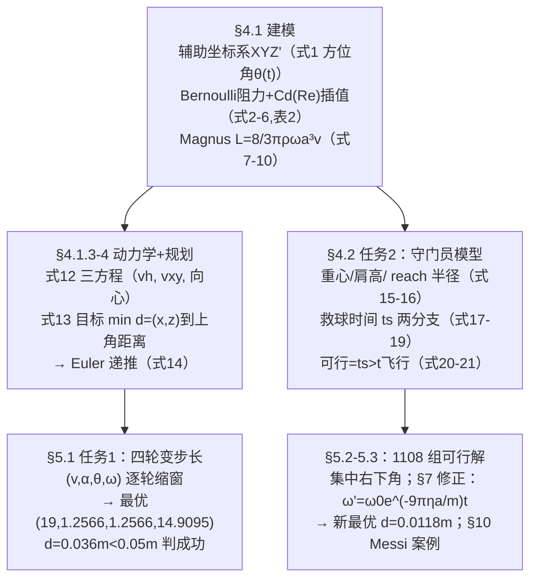

# 2022-GM-B-471（2022 题B · 队伍 471 · 44 页）

## 来自赏析

### 论文速览

五篇中最"工程化"的一篇：采用美赛（MCM）式 Summary Sheet 模板，把问题明确拆成 Task 1 / Task 2，建"受力分析 → ODE → 数值仿真 → 优化搜索"的完整流水线。Task 1 以 $Cd$–Re 插值曲线处理阻力系数随速度的变化（捕捉 drag crisis），用改进 Euler 法解微分方程 (12)，再以"距上角中心 < 0.05 m"为成功判据做四轮变步长搜索，得到最优踢法 $(v_0,\alpha,\theta_0,\omega) = (19, 1.2566, 1.2566, 14.9095)$、偏差 0.0363 m；Task 2 提出 Goalkeeper Save-ball Model，用守门员扑救时间 $t_s$（式 19）作为时间约束筛出 1108 组可行策略；第 7 节再用 Stokes 黏性力矩修正自转衰减（式 23–24），把最优解精度提升到距上角中心仅 0.0118 m。最后用梅西点球案例做现实校验。

### 获奖密码

1. **$C_d$ 随速度变化**：用 Asai 的实验曲线插值让阻力系数从 0.5 连续降到 0.06（Table 2），捕捉 drag crisis——同题其余队伍都用常数阻力，这一处物理细节直接把精度等级拉开。
2. **"物理 → 优化"的显式翻译**：式 (13) 把射门写成带运动方程约束的单目标规划，决策变量、目标、约束一目了然，方法论上比"枚举试参数"清晰一个档次。
3. **四轮变步长搜索 + 灵敏度分析闭环**：先用粗网格定位、再逐步细化（收敛到 0.0363 m），并用 Figure 20 证明"参数敏感所以必须细搜"，搜索策略与误差控制互为支撑。
4. **假设-修正的完整弧线**：假设 4 先声明光滑球、第 7 节用 Stokes 力矩 + 空心球转动惯量正式修正（式 22–24），修正后解的偏差从 3.6 cm 降到 1.18 cm——"先简后修"的叙事让评委看到模型的自我进化。
5. **守门员模型参数全部有出处**：身高取五大联赛统计、重心用黄金分割、弹跳 50 cm，式 (19) 分高低球两种时间公式，并给出"贴地球比高空球更难救"的物理讨论。
6. **案例研究接地气**：梅西 133 罚 103 中（77%）的统计与 8 次被扑位置"都在中路死角之外"的分析，把模型结论（提高球速、射死角）锚定在真实比赛数据与 The Economist 的研究上。

### 可借鉴清单

1. 涉及空气动力的球类问题，别用常数 $C_d$：查一条 $C_d$–Re 实验曲线做插值，工作量小但物理档次立升。
2. 用"辅助坐标系 + 方位角积分 $\theta = \theta_0 + \frac{G}{m}\omega_0 t$"把 Magnus 弧线降维成准二维问题，计算量和推导量同时大幅减少。
3. 把"命中目标区"写成规划问题 (13)：$\arg\min$ 目标 + 运动约束 + 初值约束，比自由搜索更显方法论。
4. 参数搜索用**多轮变步长**：每轮区间取上一轮最优解的邻域、步长缩小 10 倍左右，并给出每轮收敛图表。
5. 敢于设置"简化假设 + 编号"，后文专门一节回收修正（Stokes 力矩 → $\omega$ 指数衰减），形成完整叙事闭环。
6. 结尾做一个真实案例校验（球星数据、官方统计），一两页即可，却是"模型与现实现接"的最有力证据。

## 来自精读

### 全文骨架



**为什么这个骨架好**：任务 1 与任务 2 共用同一套动力学（式 12/14 原样复制进式 20/21），差别只在约束——任务 1 的约束是"落点进上角"，任务 2 加一条"ts>t"。**同一模型、两种约束、两次搜索**，结构经济学问。§6 敏感度分析反过来论证"为什么必须变步长"，§7 修正再回收假设 4——闭环完整。

---

### 建模决策链

| 决策 | 作者的选择 | 被放弃的替代 | 为什么 |
|---|---|---|---|
| 坐标系 | 主系+随动辅助系 | 直接三维笛卡尔 | Magnus→水平向心力，方程 6→3 个 |
| Cd | 文献曲线按 Re 插值（表 2） | 常数（358 队）/拟合 | 覆盖阻力危机；代价是 ρ 口径两处不一致 ⚠ |
| ω 处理 | 光滑球 ω=常数→修正模型 e 指数衰减 | 全程衰减 | 分层：先简后繁，且修正写成闭式（式 23/24） |
| 求解 | 四轮变步长网格 | 智能优化/贝叶斯 | 可解释、可复查；§6 敏感度反证小步长必要 |
| 成功判据 | d<0.05 m 连续判据 | 矩形命中（358 队） | 可优化、可排序 |
| 守门员 | 完全理性+反应瞬时，reach 半径+两分支 t_s | 反应延迟/博弈 | 给守门员"补强"（假设 7 自辩：otherwise goalkeepers at a disadvantage），对射方结论保守 |
| 验证 | 梅西 133 罚案例+Economist 统计 | 无 | 外部数据背书，罕见的加分层 |

---

### 可复用模板

**结构模板**：
```
Summary Sheet   两个最优四元组+判据+修正一句话
1 Jargon        把目标区域定义成可优化的几何对象
2 假设（带 Justification 一句话）
4 建模 4.1 动力学：坐标系→逐力推导→组合参数→方程组→递推格式
      4.2 对手/约束模型：参数化人体→判据函数
5 求解：变步长（每轮：区间/步长表+散点图+最优表）
6 敏感度 → 反证步长设计
7 修正：新物理项→闭式→重搜
10 案例：真实数据外部验证
附录 全部 MATLAB
```

**句式库**：
- "we define the 'ten-point angle' of the goal, that is, ..."（术语操作化）
- "Selecting a good coordinate system can greatly reduce the complexity of the problem."（方法论宣言）
- "The literature indicates that Cd is not only related to ..., but also to ..."（简化前先承认复杂性）
- "It is convinced that ... when the distance is small enough. Therefore, we build a single objective planning model intending to minimize distance"（把命中写成优化）
- "To increase the fairness of the problem, we give the goalkeeper a certain 'make-up'."（偏保守假设的自辩）
- "which implies that the step of searching needs be small enough ... avoiding missing the solution space"（用敏感度为方法辩护）

**图表配方**：搜索类论文的黄金三件套=**每轮"区间步长表+散点图+最优表"**；参数取值必配文献曲线（图 4）；修正必配前后对比图（图 21/22）；长文开头放流程图（图 2）。

---

*对照阅读：`05_论文赏析/2022/2022-GM-B-471.md`（宏观赏析）与 `07_题目解读/2022_题B_点球最优策略.md`（题目全解）；同题队友精读 46（358 队：四力 ODE+死角）、48（480 队：任意轴自转+反转结论）。*
