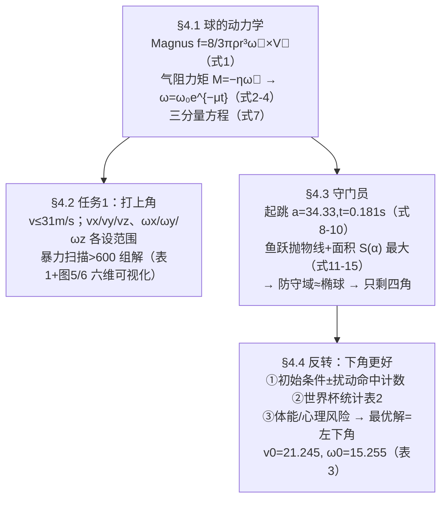

# 2022-GM-B-480（2022 题B · 队伍 480 · 19 页）

## 来自赏析

### 论文速览

本文最大的特色是把"旋转轴"解放出来：不作"只绕竖直轴旋转"的常见简化，令 $\vec\omega = (\omega_{0x},\omega_{0y},\omega_{0z})e^{-\mu t}$ 任意方向且随时间指数衰减，导出含衰减 Magnus 项的全三维非线性 ODE 组 (7)，数值枚举后得到 600 多组能命中上角的 $(\vec v_0, \vec\omega_0)$ 组合，并用"点大小=速度、点颜色=偏角、框颜色=仰角"的六维数据三维可视化呈现（Figure 5–6、Table 1 给出各速度档的参数上下界）。第二问在"守门员总能正确判断且即时反应"的最坏假设下只考虑防守面积，用蹬地-斜抛模型求最大控制域（$s_{max} = 13.34$ m²，$\alpha = 57.52°$），随后用一个漂亮的反转论证（鲁棒性 + 2002–2018 世界杯统计）主张**射下角优于上角**，最终给出最优踢法 $v_0 = 21.245$ m/s、仰角 0.2057 rad、方位角 1.4182 rad、自转 15.255 rad/s（Table 3）。

### 获奖密码

1. **多轴旋转 + 自转衰减一步到位**：$\vec\omega(t) = \vec\omega_0 e^{-\mu t}$ 的任意轴建模（式 4–5）比"只绕 z 轴"的简化更接近真实香蕉球，作者在 Strengths 中明确把这一点与"common theory"对标。
2. **六维数据可视化**：用点尺寸/点色/框色把 $(v_0,\theta_v,\varphi_v,w_0,\theta_w,\varphi_w)$ 压缩进一张三维图，解决了"参数太多讲不清"的呈现难题，是评委容易记住的独创性工作。
3. **结论敢于反转题目预设**：题目引导射上角，本文用鲁棒性检验 + 世界杯 16 年真实数据（Table 2）+ 风险论证三条证据主张下角更优——把"最优策略"答成了超越题面的决策建议，体现物理建模的判断力。
4. **最坏情形假设的清晰逻辑**：第二问开头即声明"三因素中假设判断与反应完美，只剩面积"，把难以量化的人类因素隔离掉，建模边界干净。
5. **守门员优化有完整推导链**：蹬地模型 (8)–(10) → 斜抛几何 (11)–(15) → 面积积分求极值（$\alpha = 57.52°$、$s = 13.34$ m²），与 358 的 $\alpha$ 优化异曲同工且给出面积目标函数。

### 可借鉴清单

1. 旋转球建模保留 $\vec\omega$ 的三分量与叉乘形式，并直接写入衰减因子 $e^{-\mu t}$，代码只需多三个状态量即可支持任意旋转轴。
2. 参数结果多时，学习其**六维→三维映射可视化**（大小、颜色、边框各编码一维），一张图讲清整个解空间。
3. 给"命中区域"下操作性定义（本文：角点外 1–2 倍球半径环带），比模糊的"上角"更可计算，也方便做容差分析。
4. 用**扰动重采样**（±2 m/s、±2 rad/s 数命中数）代替复杂的误差传播，快速评估策略鲁棒性。
5. 用真实赛事统计表（进球/射失/被扑/中框分列）为模型结论背书，体育类赛题尤其有效。
6. 写清"哪几个因素被假设掉、为什么"（三因素保留一个），再最强的对手模型也讲得通——这是处理含人的系统时的通用套路。

## 来自精读

### 全文骨架



**为什么这个骨架好**：§4.4 是全文的戏剧性转折——前两节都在老老实实解"上角"题，末节用三重独立证据**推翻题面预设**，把答案改写为"下角"。开放性竞赛里，"质疑题目隐含假设"往往是金牌与银牌的分界线。注意它的三重证据是**异质的**：模型内（扰动计数）、数据外（世界杯统计）、人因（疲劳心理）——一个结论被三个不相干的角度支撑。

---

### 建模决策链

| 决策 | 作者的选择 | 被放弃的替代 | 为什么 |
|---|---|---|---|
| 自转轴 | 任意方向三分量 | 锁 z 轴（471 队假设 5） | 卖点差异化；代价：搜索空间 6 维 |
| ω(t) | 指数衰减 μ=0.1 | 常数（358 队）/Stokes 推导（471 队） | 保留物理趋势；但 μ 无推导 ⚠ |
| Cd | 常数 0.5 | Cd–Re 插值（471 队） | 21 m/s 处 Cd 危机段取 0.5 偏保守 |
| 搜索 | 整数网格暴力+边界过滤 | 变步长（471 队） | 简单直接；解集>600 组以量取胜 |
| 结果呈现 | 六维散点可视化 | 多表分列 | 一图装六个变量，评委记忆点 |
| 最终策略 | 反转题面→下角 | 按题面给上角解 | 扰动鲁棒性+世界杯统计+人因三重证据 |
| 守门员 | 判断全对+反应即时，只算面积 | 概率模型（358 队） | 把不确定性全部推给"面积"，射方结论保守 |

---

### 可复用模板

**结构模板**：
```
Abstract    卖点前置（"区别于常规模型我们保留了……"）+ 结论敢反题面
3 假设      每条与后文式号挂钩
4.1 动力学  矢量式→衰减律→分量方程（组合参数）
4.2 任务1   变量域设定（来源声明）→暴力扫描→高维可视化+max/min 表
4.3 对手    人体参数模板→分段抛物线→面积寻优→几何结论（四角）
4.4 反转    证据1 模型内鲁棒性 / 证据2 真实统计 / 证据3 人因 → 最优解表
5 优劣势    承认模型理想化、ω 范围粗糙
附录        MATLAB（主程序+绘图函数分离）
```

**句式库**：
- "Distinguish from the common theory, we take ... into account and establish a physical model that can ..."（卖点前置）
- "many papers make a series of simplifications, ignoring ..., which is quite different from the actual situation. We have improved this by ..."（点名同行简化并逐一保留）
- "However, we have to choose shooting upper or bottom corner. The shooting player should shot to an bottom corner for the following reasons: Firstly... Secondly... Thirdly..."（让步+三重证据）
- "According to the World Cup statistics from 2002-2018, shooting bottom corner own higher goal and lower miss."（统计背书一句话）
- "The six-dimensional data can be represented in the three-dimensional coordinate system to complete data visualization."（图表创新点自评）

**图表配方**：多维参数解集 → **尺寸+双色编码的 3D 散点**；对比论证 → 四列统计表（进球/射失/被扑/中框）；结论解 → 单独一页的"最优一击"轨迹图（仪式感）。

---

*对照阅读：`05_论文赏析/2022/2022-GM-B-480.md`（宏观赏析）与 `07_题目解读/2022_题B_点球最优策略.md`（题目全解）；同题队友精读 46（358 队：四力 ODE+死角）、47（471 队：Cd–Re 插值+变步长）。*
