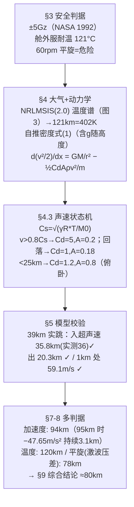

# 2023-GM-A-131（2023 题A · 队伍 131 · 33 页）

## 来自赏析

### 论文速览

本文以"多约束取最严"的思路求解太空跳伞最大安全高度：建立含跨声速阻力突变的一维下降 ODE 模型，用 Felix Baumgartner 39 km 跳伞实测数据校验模型，再分别以"过载 ≤5Gz"（得 94 km）、"舱外服耐温 ≤120 km"、"激波压差致水平旋转 ≤78 km"三条安全判据约束初始高度，最终综合给出约 **80 km** 的保守结论。摘要以 94 km（加速度判据）为主结论，结论章再收敛到 80 km。

### 获奖密码

1. **真实数据闭环验证**：用 Baumgartner 跳伞的进出超声速高度做定量误差分析（0.56%、1.5%），把"模型可信"从口号变成数字。
2. **权威数据源**：温度取 NRLMSIS 2.0 而非手绘分段线性大气，密度推导考虑 $g$ 随高度变化，物理严谨度高。
3. **跨声速阻力突变的状态机建模**：$C_D$ 随马赫数分段切换，抓住了本题最关键的物理（音障），且每段参数都有文献出处。
4. **多判据求交集**：过载、温度、激波致旋转三条独立约束各自建模再取最严（94/120/78 → 80 km），完整回应"challenges and dangers"的问法。
5. **对异常的解释力**：主动解释 16 km 尖峰与 v-x 图不连续的成因，展示物理洞察而非掩盖缺陷；Weaknesses 一节坦承 $C_D$ 常数化导致的不连续与缺少 a(t) 关系。

### 可借鉴清单

1. 用官方大气模式（NRLMSIS/US Standard Atmosphere）替代拍脑袋的分段大气，并叠图验证自推公式。
2. 用著名真实案例（Baumgartner 39 km）做模型标定与误差量化，一两个百分点的误差胜过千言论证。
3. 把 $C_D$、迎风面积写成马赫数/姿态的分段函数，用状态机组织数值积分，逻辑清晰易复现。
4. 以 $v^2/2$ 对 $x$ 的方程降阶 ODE，数值上更稳且直接得 v-x 关系。
5. 附录贴出完整可运行代码并注明步长，提升可信度与可复现性。
6. 多约束问题列出各判据独立结论再取交集，结论表述留有"保守值"的安全边际。

## 来自精读

### 全文骨架

问题：穿舱外服从多高跳下，能活着回到地面？



**为什么这个骨架好**：先把"安全"操作化成三条可计算的判据，再用同一套动力学分别求每条判据的临界高度，**最后取最严**——这个"判据先行、逐条约束、取 min"的框架是所有安全类问题（最大高度/最大载荷/最大速度）的通用解法。校验环节（§5）插在判据与扫描之间：**模型先对账历史实测，再外推到未知区间**——顺序不能反。

---

### 建模决策链

| 决策 | 作者的选择 | 被放弃的替代 | 为什么 |
|---|---|---|---|
| 温度模型 | NRLMSIS(2.0) 查表 | 分段解析拟合 | 温度谱复杂，查表无伪精度 |
| 密度模型 | 自推式 (1)（含 g(h)） | 标准指数大气 / 直接用 NRLMSIS | 展示推导+图 4 反验证 |
| 声障处理 | 0.8Ma 状态机切换 Cd/A | 连续 Cd(Ma) 函数 | 状态机可编程、门槛用实测标定；代价是不连续尖峰（§7.3 主动解释） |
| 数值格式 | ode45 分段+对 x 积分 | 对 t 积分 | d(v²/2)/dx 消去一个状态变量 |
| 校验 | 39 km 实跳三量对比 | 无校验直接外推 | 入口/出口/末速对账 ✓（但峰值速度未对账 ⚠） |
| 判据集 | 加速度+温度+平旋 | 只算加速度 | §7 明说 "based our final results on the 'worst' case" |
| 最终答案 | 80 km（比最严判据 78 再保守） | 94 km（主判据） | 工程冗余+模型不确定性 |

---

### 可复用模板

**结构模板**：
```
1 背景（历史案例：Baumgartner）
3 假设=安全判据操作化（每条带文献数值）
4 建模：4.1 环境（查表温度+自推密度）
        4.2 预检算例（简化模型答必要性问题）
        4.3 主模型（方程+状态机+分段参数表）
5 校验（权威实测逐量对账+相对误差）
7 扩展危险（激波+平旋：单式判据+柱状图）
8 结果（每判据一个临界高度）
9 结论（取最严+工程余量）
附录 全部 MATLAB
```

**句式库**：
- "we usually use Gx, Gy, Gz to describe the acceleration the human body endures"（术语先行）
- "Therefore, we use NRLMSIS (2.0) Atmosphere Model to simulate ... There is neither usable experimental data ... nor simple formula ..."（查表决策的理由句）
- "If the velocity is indeed greater than the speed of the sound at that stage, the program will enter 'transonic phase' ... the value of CD will abruptly be adjusted to 5."（状态机的一句式描述）
- "the standard error between previous researches value and ours is only ... = 0.56%, both of which are acceptable"（校验误差句）
- "This seems to be a unreasonable discontinuity in the result. ... This is reasonable. When ..."（反常点先承认再归因）
- "we have the rough modelling and deducing to discuss the effect of ..."（粗模型免责声明）

**图表配方**：自建模型必配**双线验证图**（自推 vs 权威数据）；扫描答案用"**量–初始高度**"曲线并在特征点放解剖图；危险判据用**柱状图+水平危险线**（图 7）；Cd/A 状态切换应在 a–x 图上留下可辨认的尖峰，并专门解释。

---

*对照阅读：`05_论文赏析/2023/2023-GM-A-131.md`（宏观赏析）与 `07_题目解读/2023_题A_太空跳伞安全高度.md`（题目全解）；同题队友精读 50（227 队：出舱即开伞+麦克斯韦阻力推导）。*
