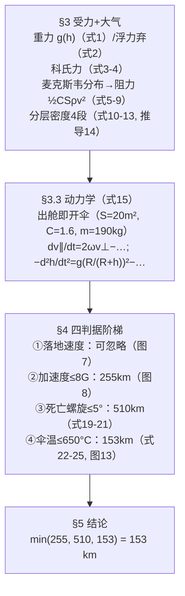

# 2023-GM-A-227（2023 题A · 队伍 227 · 22 页）

## 来自赏析

### 论文速览

本文最大特色是策略反转：假设跳伞员**一出舱立即开伞**（HAHO 式全程开伞下降），从而把问题从"自由落体+末段开伞"改写为"带大阻力伞的缓降"。系统受力分析含重力、浮力、科里奥利力与空气阻力（阻力甚至从麦克斯韦速率分布推导），随后对四类危险——落地速度、过载（≤8G）、"死亡螺旋"旋转（偏转角 ≤5°）、气动加热（≤650 °C）——分别数值求解给出上限 255 km、510 km、153 km，最终结论 **153 km**（受温度限制）。

### 获奖密码

1. **"立即开伞"的策略级创新**：一纸假设同时消解了跨声速阻力突变与开伞冲击两大难点，把不可控的自由落体变成可解的缓降问题——敢于改写问题边界是这篇论文最出彩之处。
2. **阻力从分子运动论推出**：由麦克斯韦分布积分得阻力公式，展示了物理系功底，虽结果与标准公式同形，但论证层次不同。
3. **科氏力全程在模型中**：不仅解释水平漂移，还被二次利用为"死亡螺旋"的力矩来源，一个物理效应贯穿两个危险分析。
4. **危险清单覆盖全面且各自定量化**：落地速度、过载、旋转、温度四条线索并行，每条都给出独立的高度上限数值，摘要中一次报齐（255/510/153 km），评委可快速核对。
5. **工程细节增可信度**：伞面张力—杨氏模量校核（式 16–18）、碳纤维选材与安全温度 650 °C 的论证，把"伞会不会坏"这种容易被忽略的问题正面回答了。

### 可借鉴清单

1. 当题目含糊时，可通过一个强假设（如出舱即开伞）重构问题，降低建模难度并形成差异化路线。
2. 用麦克斯韦分布/动量流推导稀薄气体阻力，可在"近太空密度极低"场景下替代经验 $C_D$。
3. 分段大气用带温度梯度的幂律气压公式统一推导，四层参数列表清晰，比查表更见功力。
4. 气动加热用 $\Delta T=v^2/2C_p$ 估驻点温度 + 含辐射项的热平衡 ODE，是处理"烧毁判据"的轻量级方案。
5. 对装备（伞衣强度）做独立校核，体现"系统级"安全思维。
6. 摘要直接报出各约束的高度上限与最终值，方便评委一分钟内抓住全部结论。

## 来自精读

### 全文骨架



**为什么这个骨架好**："一票否决"框架——四个危险各自独立建模、各自给出临界高度，最终答案取最小值。每条判据的建模深度刻意分级（末速只看图、螺旋用单式解析、加速度与温度用 ODE 数值解），**深度分配跟着判据的决定性走**：温度是最严的，所以温度模型最细（含气动加热功率、辐射散热、材料熔点）。这个"判据阶梯"本身就是可复用的论文结构。

---

### 建模决策链

| 决策 | 作者的选择 | 被放弃的替代 | 为什么 |
|---|---|---|---|
| 开伞时机 | 出舱即开伞 | 自由落体+低空开伞（131 队） | 加速度与温度同时最小化；机械开伞装置保证高空可行 |
| 声障 | 忽略（超声速处密度极低） | Cd 状态机（131 队） | 伞把速度压在声速以下的区域恰好密度低——**策略消解了现象** |
| 阻力来源 | 麦克斯韦推导+C=1.6 | 直接引经验公式 | 展示第一性原理；结构与 358 队伯努利+Ca 同构 |
| 密度 | 四段幂式（US Std Atm 锚点） | 指数大气/NRLMSIS | 160 km 内精度足够且可手推 |
| 科氏力 | 保留（驱动螺旋） | 弃算（131 队） | 它是死亡螺旋力矩的唯一来源 |
| 热吸收 | α=1（⚠ 与式 24 矛盾） | α=0.005（推导值） | 文中理由写反；若取推导值结论将变为 255 km |
| 判据深度 | 分级（末速看图/螺旋单式/加速与温 ODE） | 四条全上 ODE | 把资源投给决定性判据 |

---

### 可复用模板

**结构模板**：
```
Summary    判据阶梯三档数字 + min=答案
2 假设     战略级（开伞时机）单列并配反质疑预案
3 物理     3.1 逐力推导（含第一性原理推导秀）
           3.2 环境（分层密度：锚点+梯度三件套）
           3.3 方程组 + 四步过程剧本
4 危险     按决定性分级建模，每条给临界高度
           （顺手加一道保险校核：伞衣张力）
5 结论     min 判据 + 安全建议
附录       全部 Python（含逐曲线配色）
```

**句式库**：
- "Assume that the parachute is opened immediately after jumping to minimize the maximum acceleration and temperature experienced by the skydiver."（战略假设+两条理由）
- "there is no need to worry about the parachute not opening when the atmospheric density is low"（预答质疑）
- "The relationship between air resistance and velocity can be inferred from Maxwell's speed distribution"（第一性原理宣言）
- "Fortunately, the pressure difference ∆p ≪ ..., so the safety of the parachute is guaranteed."（保险校核的收束句）
- "While the limitation on maximum initial altitude imposed by the first factor is negligible, the second, third, fourth factors restrict ... to 255km, 510km, 153km, respectively."（判据阶梯的总括句——可直接背用）

**图表配方**：判据类答案统一用**"曲线族+水平限值线"**（图 8/13），曲线族按初始高度渐变配色；答案高度的那条线应"恰好压线"（153km↔923K），让结论从图上直接可读；机理推导配最小示意（Fig 3/9/12）。

---

*对照阅读：`05_论文赏析/2023/2023-GM-A-227.md`（宏观赏析）与 `07_题目解读/2023_题A_太空跳伞安全高度.md`（题目全解）；同题队友精读 49（131 队：跨声速 Cd 状态机，策略对照的最佳样本）。*
