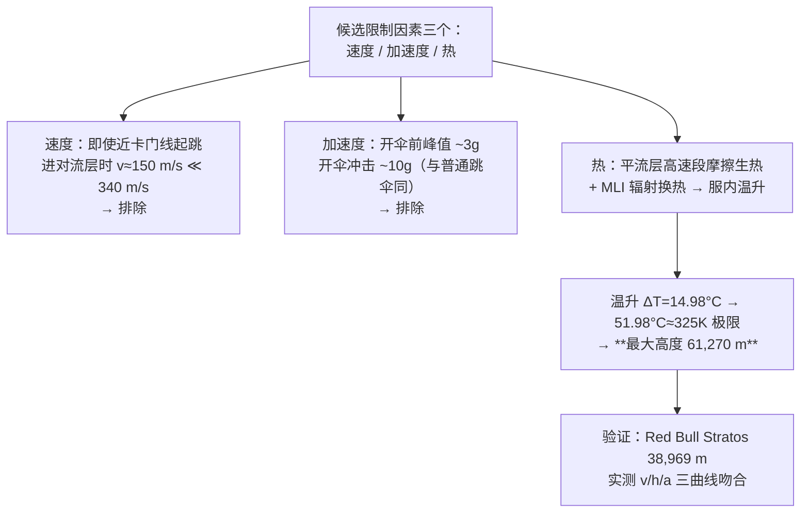

# 2023-GM-A-244（2023 题A · 队伍 244 · 28 页）

## 来自赏析

### 论文速览

本文的鲜明旗帜是"排除法"：建立全程速度/加速度/高度-时间模型后，论证速度与过载在卡门线以内都不是限制因素（进入对流层速度仅约 150 m/s、开伞前过载约 3g），真正卡死高度的是**摩擦热积累导致的舱内升温**。用摩擦生热 + MLI 航天服换热模型算得 61,270 m 起跳时舱内达 51.98 °C 接近人体耐受极限，故最大安全高度为 **61,270 m**——六篇论文中最低也最"热"的一个答案。

### 获奖密码

1. **反直觉主结论+清晰因果链**："不是速度、不是过载，而是热"——先用模型把前两者定量排除（150 m/s < 340 m/s；3g），再聚焦热，问题收敛路径干净利落，评委一眼看到物理洞察。
2. **逐帧实测数据验证**：用 Red Bull Stratos 真实数据做多曲线模型-实测叠加图（图 14–16），验证维度比只对一个数更立体。
3. **位势高度换算**：$H_{geop}=\frac{R_EH}{R_E+H}$ 的小细节体现对标准大气定义的准确理解。
4. **开伞充气过程离散化**：0.5 s 一档的面积/C_D 阶梯模拟伞的渐次充气，比阶跃假设更接近真实开伞冲击。
5. **热模型有实装参数**：MLI 发射率、PLSS/容器质量与比热、λ=0.2 全部落到 NASA 文献数值上，避免"拍参数"。

### 可借鉴清单

1. "排除法"叙事结构：先定量证明次要因素不构成约束，再深入主因素，论文主线极清晰。
2. 直接采用 US Standard Atmosphere 八层参数表 + 位势高度换算，比自己发明分段大气更权威省事。
3. 开伞过程用时间触发的面积/阻力阶梯逼近充气动态，可移植到任何开伞冲击计算。
4. 无解析解时用多项式拟合数值曲线再解析积分，是热积累类问题的实用技巧（记得讨论拟合误差）。
5. 摘要中把最终数值放进 Key Words，强化记忆点。
6. 引用真实任务的逐帧数据（视频/公开 Excel）做三量联检，验证成本低而说服力高。

## 来自精读

### 全文骨架



**为什么这个骨架好**：题目问"最高能从哪跳"，答案藏在"哪个因素先杀你"里。排除法把开放问题变成**三选一**，每个候选用同一个运动模型就能检验，最后只剩热需要新增物理（换热模型）——**模型复杂度花在刀刃上**。

---

### 建模决策链

| 决策 | 作者的选择 | 被放弃的替代 | 为什么 |
|---|---|---|---|
| 因素框架 | 速度/加速度/热三选一排除 | 全因素耦合 | 判据明确后排除法最省力 |
| 姿态 | arch（阻力最大） | 头朝下（速度更快更热） | 最保守姿态=热最不利情形，答案自带上界性质 |
| 大气模型 | 八层标准大气+位势高度 | 单指数拟合 | 分段可溯源；61 km 已超出单指数适用区 |
| Cd | 常数 1.3 | 分段 Cd(Ma) | 用 Red Bull 全曲线验证兜底精度 |
| 开伞时刻 | 实测锚定 255 s（Red Bull） | 参数化开伞高度 | 不确定性转移到有数据处 |
| 热模型 | 摩擦 ρv³ + MLI 辐射 + 集总热容 | CFD/边界层传热 | 48h 内集总模型可闭环（但常数记账断裂 ⚠） |
| 验证 | Red Bull v/z/a 三曲线全时段对比 | 仅对峰值速度 | 三曲线叠加是最硬的可信度证据 |

**独立复现审计汇总**：终端速度标尺（10 km 处 132 m/s ↔ 论文 ~150 m/s 入对流层 ✓）；峰值速度量级（61 km 跳 ≈500 m/s @ 35–40 km，与 39 km 纪录 377 m/s 相容 ✓）；式(4) 排版丢分数线（代码实现正确）⚠；$\dot Q_{fric}$ 记号复用致 ρ² 疑点 ⚠；**ΔT 与所列热容差 5 个数量级** ⚠⚠（结论由验证曲线独立支撑，但温升常数账目不透明）；与同题队友对照：热限答案聚在 57–64 km（355 队 57 / 447 队 63.78 / 464 队 60.7），本文 61.27 km 位于聚类中心 ✓。

---

### 可复用模板

**结构模板**：
```
1 Introduction        背景+风险清单+当场裁剪（判据化）
2-3 Assumptions+Notations   判据数字全部前置；系统质量分件列
4 Model               4.1 公共底盘：运动 ODE+分层大气+实测事件锚定
                     4.2 核心增量：热模型（生热/换热/集总温升）
5 Results             排除法收官：每因素给"离极限多远"的余量
6 Evaluation          真实事件三曲线验证（王牌）+弱点带偏差方向
```

**句式库**：
- "for clear demonstration of major factors, we only take major influence factor into consideration."（裁剪声明）
- "The timing of parachute deployment is a matter of debate. However, ... According to the data from Red Bull, ... the opening time is around 255 s."（实测锚定争议参数）
- "no matter how high we jump (within the Karman line), it is impossible for ... Therefore, we can assume that ... will not be a factor."（排除法收口句）
- "It makes no sense for the diver to carry a source to stabilize the temperature ..., which can destroy the force balance."（负约束的工程论证）
- "this still causes certain effects that make the theoretical maximum we calculate smaller."（弱点标注偏差方向）

**图表配方**：三联图（v/z/a vs t）同一 ODE 输出；模型零件（ρ(h)）单独公示；极端算例与常规算例分开；**验证=双曲线全时段叠加**；两自由度结果用三维面（Fig 10）。

---

*对照阅读：`05_论文赏析/2023/2023-GM-A-244.md`、`07_题目解读/2023_题A_太空跳伞安全高度.md`（六队答案谱 57–153 km 的判据分析）、队友精读 131/227/355/447/464。*
