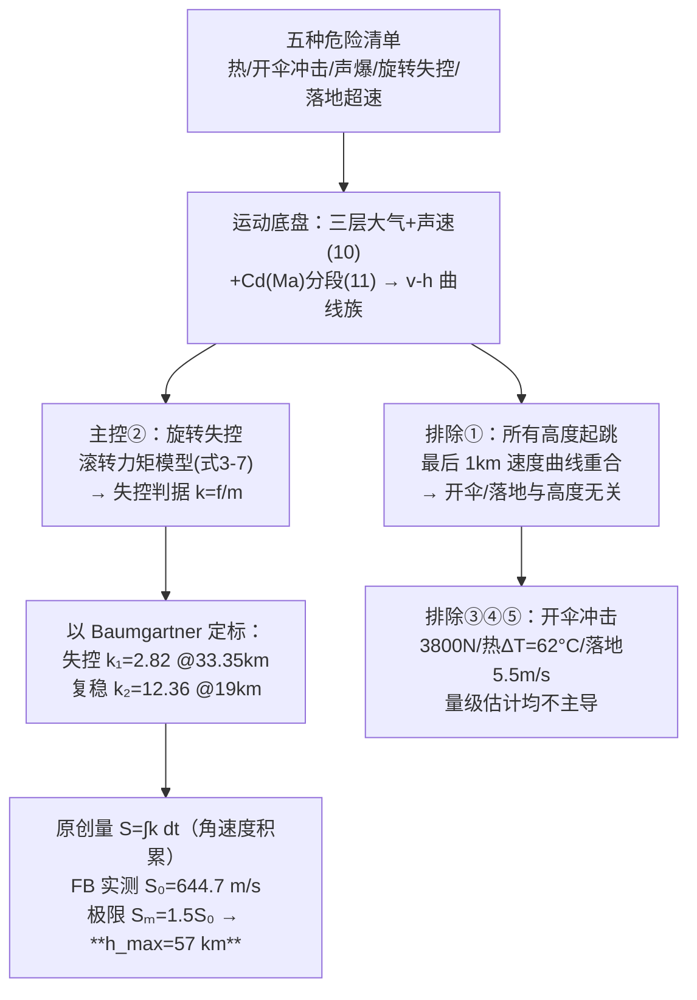

# 2023-GM-A-355（2023 题A · 队伍 355 · 27 页）

## 来自赏析

### 论文速览

本文把"最大安全高度"的主约束锁定在**旋转失控**上：先用数值模拟证明无论从多高跳下，临近地面速度一致、开伞过程与初始高度解耦；再以 Felix Baumgartner（FB）跳伞视频数据标定出"失控阈值 $k_1$=2.82 N/kg"与"恢复平衡阈值 $k_2$=12.36 N/kg"，并原创定义**旋转耐受特征值** $S=\int_{t_1}^{t_2}k\,dt$ 度量失控旋转的剧烈程度，取人体极限 $S_m=1.5S_0$（$S_0=644.68$ m/s 为 FB 实况），解得最大高度 **h = 57 km**；最后对落地速度、开伞冲击（3800 N）、摩擦升温（62 °C）做量级估算排除。

### 获奖密码

1. **原创物理量**：旋转耐受特征值 $S=\int k\,dt$ 把"失控多久+失控多猛"两个维度压缩成一个可比标量，是全文最具辨识度的智识贡献。
2. **单事件标定+闭环复现**：用 FB 的失控/恢复两个真实状态点定出 $k_1,k_2$，再复现失控时长（56.1 s vs 52 s），验证逻辑完整且成本低。
3. **连续 C_D(Ma) 二次拟合**：跨声速阻力以连续函数进入方程，物理上比阶跃切换更合理，图 3 与图 5 修正前后对比直观呈现其影响。
4. **先解耦再聚焦**：用"临地速度与初始高度无关"的数值事实把开伞问题从主问题中剥离，主攻旋转，论文主线干净。
5. **约束全覆盖**：旋转（主）+ 落地、开伞冲击、摩擦热（量级排除），每项危险都有交代，只是精度分级——这与题面"analyze the challenges and dangers"的要求精准对应。

### 可借鉴清单

1. 把难测参数用"单位质量阻力 $k=f/m$"这类无量纲化/归并技巧压缩，再用真实事件数据反演——参数少一个，可信度翻一倍。
2. 阻力系数用马赫数的二次多项式连续拟合（三段式），避免开关式 C_D 造成的伪不连续。
3. 定义论文自有特征量（积分型指标）来统一度量多因素危害，命名+编号+物理解释三件套做齐。
4. 用"临地速度收敛"这类普适数值规律证明某子问题与决策变量无关，从而合法地简化模型。
5. 危险因素分级处理：主因素精算、次因素量级估算并明说，把篇幅留给核心物理。
6. 摘要采用"总—分—总"三段式方法陈述，每段一句结论，评委 30 秒可读完全貌。

## 来自精读

### 全文骨架



**为什么这个骨架好**："清单 → 底盘 → 逐项排除/锁定 → 用真实事件标定 → 原创判据量收束"——把最不确定的因素（人体）交给最可信的数据（Baumgartner 实跳），把可计算的交给物理。**答案最低反而最显功力：他们多算了一个别人不敢算的自由度。**

---

### 建模决策链

| 决策 | 作者的选择 | 被放弃的替代 | 为什么 |
|---|---|---|---|
| 主控因素 | 旋转失控 | 热/开伞冲击 | v-h 曲线族收敛排除开伞；热账 62°C 口径可辩；唯旋转无人敢算 |
| 人体模型 | 圆柱+线性力矩+J=km | 全自由度姿态动力学 | 文献[1]有现成线性框架；参数全部被 FB 标定吸收 |
| 标定策略 | FB 两时刻定 k₁/k₂ | 文献阈值 | 真实事件>一切猜测；回代 52s vs 56.1s 验证 |
| 判据量 | S=∫k dt（累积 Δω） | 峰值或时长 | Fig 13 显示单一量不够 |
| 极限取值 | S_m=1.5×S₀ | 精确生理极限 | 无数据；取保守系数并自认弱点 |
| 其他因素 | 量级估计逐项排除 | 完整建模 | 主控已定，排除只需量级 |

**独立复现审计汇总**：曲线族尾端收敛 ✓（复现）；失控判据代数复推（式 10 排版多一个 J）⚠；**k₁/k₂ 与符号表常数差 2.4–2.6×（内部自洽、外部不可复现）** ⚠⚠；声速经验式越出对流层适用域（高空马赫数失真）⚠；热账 ΔT=62.8°C 逐位复算 ✓；S 量纲（速度代理 Δω）✓；对 1.5 系数稳健性尚可（±0.25 → ±3 km）。**总评：物理创意与定标手法是六队中最亮的；工程细节（常数表一致性、公式适用域）是它换取速度付出的代价。**

---

### 可复用模板

**结构模板**：
```
Summary          结论+主控因素+因果链三句话
1 Analysis       危险清单（编号）→ 求解顺序
4.1 运动底盘     分层大气+声速+Cd(Ma)；曲线族两版（修正前/后）
4.2 主控模型     力矩来源→线性化→平衡解→失控判据→实测定标→回代验证→原创判据量
4.3 次要因素     逐项量级排除（落地/开伞/热）
5 Discussion     优点=创新点命名；缺点=自认数据不足
```

**句式库**：
- "This paper believes that the key to limit ... is whether ... so as to avoid ... ultimately ..."（主控因果链句）
- "However, the parameters in the expression we did not have the time and conditions to test experimentally, so we could only approximate the simulation by Felix Baumgartner's real-world measurements."（**以事定参的方法声明**——这句是全文的诚信支点）
- "In order to get the limit ..., we need to define a new physical quantity, which needs to respond to both ... and ..."（原创量的需求驱动定义法）
- "This shows that ... don't heat up too much."（排除结论句）
- "The value of ... lacks the support of sufficient experimental data, so the final result ... is not sufficiently convincing."（自认弱点句）

**图表配方**：**曲线族六色同图看收敛**；修正前后双版对照；标定图=阈值线切实测轨迹；验证图=预测时长 vs 实际时长双图；f-t 曲线族展示"窗口变窄"引出积分判据。

---

*对照阅读：`05_论文赏析/2023/2023-GM-A-355.md`、`07_题目解读/2023_题A_太空跳伞安全高度.md`（六队 57–153 km 答案谱：判据选择如何决定答案）、队友精读 131/227/244/447/464（尤其 244 的热学口径对比）。*
