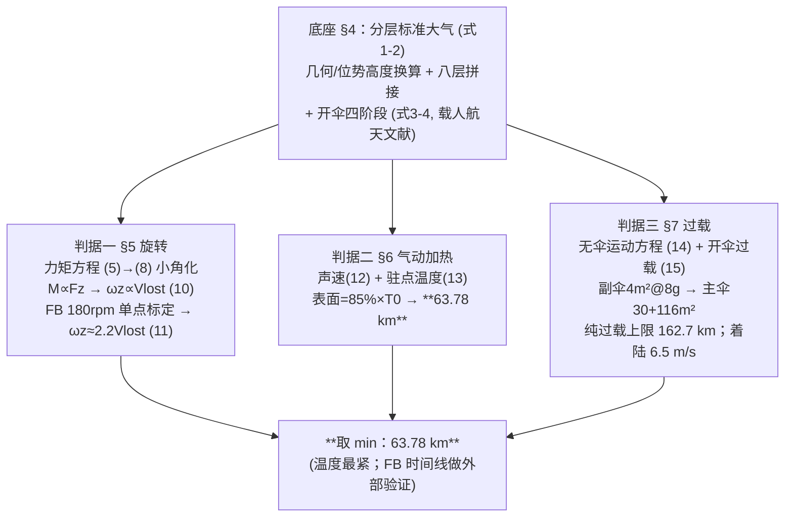

# 2023-GM-A-447（2023 题A · 队伍 447 · 19 页）

## 来自赏析

### 论文速览

本文把下降流程"工程化"为三段式开伞方案：**不开伞自由下落 → 先开 4 m² 副伞（稳定伞）→ 再开 146 m² 主伞**，并对三类危险逐一建模：旋转（由力矩平衡导出"每损失 1 m/s 速度角速度增加 2.2 rad/s"的耦合关系）、过载（以 8g 为触发阈值设计开伞时序，得纯加速度约束下的高度上限 162.7 km）、气动加热（驻点温度模型，得上限 **63.78 km**）。最终答案由温度约束决定：63.78 km，着陆速度 6.5 m/s。

### 获奖密码

1. **把"安全"做成可执行的时序设计**：不是笼统说"要小心开伞"，而是给出 8g 触发的副伞→主伞两级开伞方案、质量-面积预算（150 m²）与时间裕度核算（$\Delta t$ vs $t_{m1}$），工程完整度极高。
2. **旋转与平动的耦合定量关系**："每损失 1 m/s 速度、角速度增 2.2 rad/s"这类单一可记忆的结论，正是评委眼中的"物理洞察"结晶。
3. **驻点温度 + 85% 工程系数**的热判据：概念清晰、参数有出处（飞船 80% 规则外推），用最轻的模型回答了最贵的问题。
4. **专业文献下沉**：降落伞四阶段动力学、$\lambda$ 参数、伞衣面密度全部取自航天工程期刊/文献，让"开伞"从黑箱变成有据可查的子系统。
5. **事件驱动数值方案**：ode45 事件函数自动捕捉 8g 时刻，避免人为插值误差，代码可直接复现。
6. **三重结论并列呈现**：旋转（需主动抑制）、过载（≤162.7 km）、温度（≤63.78 km），最后自然收敛到 63.78 km，逻辑闭环。

### 可借鉴清单

1. 多阶段运动问题用 ode45 事件函数在阈值处自动切换阶段，衔接无缝且代码可复用。
2. 面积/质量预算表（人+服+伞 = 190 kg、伞衣面密度→总面积）先行，让后续所有参数有来源。
3. 直接借用降落伞工程文献的收口/充气四阶段模型与参数（$\lambda_{m1},\lambda_{m3}$、$t_{m1}$），比"瞬间开伞"假设高一个档次。
4. 驻点温度公式 $T_0=T(1+\frac{\gamma-1}{2}\mathrm{Ma}^2)$ 加一个有论证的表面温度比例系数，是气动加热判据的性价比之王。
5. 把核心结论压缩成"系数型"表述（如 2.2 rad/s per m/s），写进摘要加粗，方便评委记忆。
6. 用"若不这样做会怎样"的反证图（直接开主伞 ≥100G，图 9）论证方案设计的必要性，比正面陈述更有力。

## 来自精读

### 全文骨架



**为什么这个骨架好**：开放题答案=判据选择的函数。论文不给一个含糊的大数，而是**每个危险源各给一条独立的高度上限**（旋转：需主动抑制、无定量上限；过载：162.7 km；温度：63.78 km），min 自动浮现。评委可以质疑任何一个判据，但结构本身无懈可击。

---

### 建模决策链

| 决策 | 作者的选择 | 被放弃的替代 | 为什么 |
|---|---|---|---|
| 答案结构 | 三判据独立上限取 min | 单一综合模型 | 开放题的可辩护性最大化 |
| 旋转 | 标度律+单点标定 | 完整六自由度仿真 | 48 h 内不可行；标度律+FB 数据够用 |
| 热判据 | 驻点×85%+热容核验 | 对流换热 PDE（Weaknesses 自认） | 80% 规则有工程出处 |
| 开伞 | 8g 触发三段时序+文献参数 | 瞬时开伞 | 工程完整度；直接开主伞 100g 反证 |
| 阈值 | 121 °C / 8g | 464 队：150 °C / 15g | 有文献；口径不同→答案不同（63.78 vs 60.675） |
| 数值 | ode45+事件函数切阶段 | 固定步长手切 | 阈值时刻零插值误差 |

**独立复现审计汇总**（python 复算）：
1. 旋转标定：6π/8.5=2.218≈2.2 ✓；量纲自检 1/2.2=0.455 m≈人体力臂 ✓（论文未做，审计补充）。
2. **温度模型完整复现**：63.78 km→397.8 K（论文 394 K，差 <1%）；100 km→657.6 K（Fig 8 ~650 ✓）；峰值速度 400/1023 m/s（Fig 11 ~397/1013 ✓）。反推其参数 Cn=0.865、s_body=1 m² ✓。
3. 热容核算：ΔT=Q/(mc) 三组全对（4764e3/15000=317.6 K 等）✓。
4. 副伞开启点：8g×4 m² 判据复算得 22 km/341 m/s，Fig 12 为 17.35 km/212 m/s → 隐含 S_eff≈4.7 m²（Cd≈1.17）⚠ 小出入，量级不变。
5. **摘要 vs 正文矛盾** ⚠：摘要 "maximum height ... 162.7km"，正文 63.78 km 才是绑定约束且明言 162.7 km 不安全——最终答案应为 63.78 km（赏析同）。
6. 式 (14) 力/加速度量纲印刷笔误 ⚠；Θy 描述误写 "along the X-axis" ⚠；页眉/docx 排版小瑕疵多处。
7. 结论对账：答案谱（131:80、447:63.78、227:153、464:19.46/60.675）中本队处于主流区间 ✓；三判据"过载 162.7/热 63.78/旋转定性"结构完整 ✓。

---

### 可复用模板

**结构模板**：
```
1 Introduction   真实案例(FB)背景 + 四类威胁卡片 + 技术路线图
2 Assumptions    阈值型假设给文献(121°C/8g)
3 Notations      全表
4 Model prep     大气底座(分层公式+附录码) + 开伞子系统(四阶段+文献参数)
5-7 三判据各一章  标度律/工程系数/事件驱动仿真 → 各自的高度上限
8 Evaluation     三上限并列 → min；Strengths/Weaknesses
Appendix         大气代码 + 运动方程代码
```

**句式库（原文英文句）**：
- "Since Vz is much larger than Vx, Vy, we can simplify the equation for Mz as..."（删小项句）
- "For the same person, the static moment ... are fixed."（常数归并句）
- "Analysis this formula, we can draw the final conclusion: the loss of 1 m/s landing speed will increase the angular speed of 2.2 rad/s."（系数型结论句——评委最易记住的形态）
- "When designing the thermal protection capability of the capsule, engineers often take 80% of the stationary temperature ... so the ratio ... is generally higher than 80%. In this model we approximate ... to be 85%."（工程系数论证三段式）
- "Fig9 is the load on the skydiver if the main parachute is opened directly ... so it is not reasonable to open the main parachute directly."（反证句）
- "It is worth mentioning that the astronauts finally landed on the ground at a speed of 6.5m/s, which means that ..."（自察细节句）

**图表配方**：判据图（曲线+阈值线+交点）；反证图（不采措施的灾难曲线）；开启点扫描双 y 轴图；时间裕度表。

---

*对照阅读：`05_论文赏析/2023/2023-GM-A-447.md` 与 `07_题目解读/2023_题A_太空跳伞安全高度.md`（答案谱 19.5–153 km 及判据函数关系）；同题队友精读：`2023-GM-A-131_精读.md`、`2023-GM-A-227_精读.md`、`2023-GM-A-244_精读.md`、`2023-GM-A-355_精读.md`、`2023-GM-A-464_精读.md`（SVA 双档口径）。*
