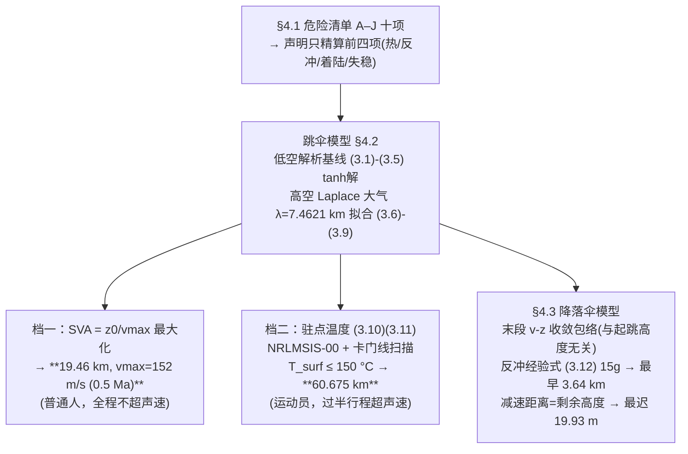

# 2023-GM-A-464（2023 题A · 队伍 464 · 38 页）

## 来自赏析

### 论文速览

本文给出"双档答案"：为普通人定义**比速度高度 SVA**（跳伞高度与最大速度之比 $z_0/v_{max}$），最大化 SVA 得绝对安全高度 **19.46 km**（最大速度仅 152 m/s ≈ 0.5 Ma，全程不碰超声速）；为挑战极限的专业运动员则以气动加热为判据，用驻点温度公式约束得 **60.675 km**。降落伞模型进一步证明"自由落体末段速度与起跳高度无关"，并解出开伞窗口：最早 3.64 km（15g 反冲限制）、最迟 19.93 m（减速距离限制）。

### 获奖密码

1. **把"最大高度"变成双目标优化**：SVA 指标将高度与峰值速度合成为一个可优化的标量，并区分普通/专业两类主体，直接回应了题目"maximum altitude"的语义模糊性——同一问题给出两个有条件的答案。
2. **大气模型数据同化**：等温大气的 λ 由标准大气数据拟合而来并与 NRLMSIS-00 叠图验证，"简单模型+数据标定"的路线兼顾效率与可信度。
3. **开伞窗口的完整量化**：最早（15g 反冲）与最迟（减速距离）两个边界各自独立求出并给出机理（"开伞越晚反冲越小"），把安全裕度变成可操作的区间 19.93 m–3.64 km。
4. **末段收敛性质两次复用**：既用于论证开伞难度与起跳高度无关，又用作数值近似（以 10 km 跳的末段代替所有高度），显示对解结构的深刻理解。
5. **危险清单管理**：A–J 十项危险先列全、再声明只精算前四项、其余"成熟技术可控"，边界诚实，避免被评委追问遗漏。
6. **文献质量高**：AJP、Physics Today、Eur. J. Phys.、AIAA 会议等一手来源支撑每个关键公式。

### 可借鉴清单

1. 为含糊的优化目标自定义复合指标（如 SVA = 高度/峰值速度），一次建模同时回答"多高才安全"与"多高有意义"。
2. 简单模型（等温大气）+ 实测数据拟合参数 + 高精度模型（NRLMSIS）交叉验证，是效率与严谨的黄金组合。
3. 驻点温度公式加耐温水平线求交点，一图定结论；把判据画成三维曲面/等高线更直观。
4. 发现并利用解的收敛结构（末段 v-z 包络与初值无关）简化大规模参数扫描。
5. 开伞窗口 = 反冲上限交点 与 减速距离=剩余高度 交点 的差集，模板可直接迁移到其他"时机窗口"类问题。
6. 摘要每段以加粗数值结论收尾；Future Work 给出具体可执行的公式路线而非空话。

## 来自精读

### 全文骨架



**为什么这个骨架好**：题面问 "the maximum altitude"，语义歧义在于**对谁安全、以什么为代价**。论文不回避歧义，而是**把"人"画像化**（普通 vs 专业），每个画像配一条判据链，摘要每段末加粗一个数——答案谱系（19.5–153 km）里它独占"普通人档"，这是它在六队中最具辨识度的地方。

---

### 建模决策链

| 决策 | 作者的选择 | 被放弃的替代 | 为什么 |
|---|---|---|---|
| 答案形态 | 双档（普通/专业）+ 开伞窗口 | 单一上限（131/447/355） | "安全"语义分层；六队中独一份 |
| 大气 | 等温 λ 拟合 + NRLMSIS 对比/判据用 NRLMSIS | 分层公式（447）/ 查表 | 效率与精度分工：扫描用快模型、判据用准模型 |
| 普通人判据 | SVA 极大化 | 固定姿态失稳阈值（355 的 S=∫k dt） | 便宜直观；但指标任意性未讨论 ⚠ |
| 运动员判据 | 驻点温度=表面温度 ≤150 °C | 85% 系数（447）/ 热容 ODE（227/244） | 最保守上界；假设 5 明示 |
| 反冲 | 经验式 F=0.14417m^0.85 v^1.87，15g | 冲量定理/动量法（447 式 15） | 文献标度律自带充气缓冲信息 |
| 数值 | 扫描用变步长单步积分+样条求极值 | 正文宣称的 RK4 | **文-码脱节** ⚠（附录 C 是欧拉格式） |

**独立复现审计汇总**（python 复算）：
1. **运动员档 60.675 km**：US76 复算 150 °C 交点 ≈60.0 km，差 <1 km ✓✓。
2. **最早开伞 3.64 km**：15g→v=61.9 m/s；包络 61.0 m/s @3.64 km → 14.6g ✓✓。
3. **最迟开伞 19.93 m**：开伞积分着陆 6.19 m/s ✓（其判据 ~6.25 m/s）；峰值过载 66g（经验式口径为 9.8g，两口径差异源于充气缓冲，论文用前者）。
4. **普通人档 19.46 km**：v_max 复算 144.5 vs 152 m/s（−5%，密度表差）；SVA 极值平台 16–20 km，argmax 不唯一 ⚠（应报区间）。
5. C-9 伞面积：D=5.95 m 半球面 2πr²=55.6 m² vs 代码 A=56.7678 m²（差 2%，疑用 D=6.01 或含排气孔）⚠ 小出入。
6. Baumgartner 验证：复算 38.969 km 起跳 v_max=359 m/s vs 实测 377（−5%）；代码内 event1 六个实测点标在理论曲线上 ✓ 验证意识好。
7. **文-码脱节** ⚠：正文与附录 B 宣称 RK4（式 5.2 完整给出），附录 C 实现为变步长欧拉——行文必须与代码一致。
8. 排版：大量公式/数值以图片嵌入导致文本层空洞（"as high as ,"），PDF 全文检索失效 ⚠——Word 流程的代价（447 队同样问题更轻）。
9. 答案谱定位：19.46/60.675 双档是六队谱系（19.5–153 km）的两端标尺——**"对谁安全"口径的开创性使用**（07 题目解读将其列为最高级去模糊化）。

---

### 可复用模板

**结构模板**：
```
1 Introduction   领域背景(Kittinger→FB) + 研究意义三层(极限运动/航天/旅游)
2 Restatement    钉死题给数据(190 kg)
3 Assumption     器材型号化(C-9, 5.95 m) + 已知近似声明
4 Physical Model 4.1 危险清单 A-J 穷举 → 收缩(留名舍去)
                 4.2 跳伞模型：低空解析基线(3.1-3.5) → 高空 Laplace(3.6-3.9)
                     + 指标 SVA + 热判据(3.10-3.11)
                 4.3 降落伞模型：反冲经验式(3.12) + 带伞下降(3.13)
5 Model Solution 三节各一档/一窗口；交点法+包络复用
6 Evaluation     简洁/真实/创新三分法
7 Future Work    具体公式路线(牛顿冷却 5.1)
Appendix         大气表 + RK4 说明 + 全部代码
```

**句式库（原文英文句）**：
- "we have set up a metric ..., which is the ratio of ... We should render SVA as big as possible to obtain ... and ..."（自定义指标定义句）
- "Of course, this is for ordinary people who are not professionally trained, and the minimum value obtained in this case is the safest altitude for ordinary people."（指标主体声明句）
- "It is easy to find that the ends of all curves converge to the same curve, indicating that the velocity change of the end of the free fall is independent of the skydiving altitude."（结构发现句）
- "Due to the time limit, we fail to take into account ..., thus take ... The derivation process of part of ... is moved to future work."（缺陷转移句——把缺陷写进路线图）
- "The later the opening of the umbrella, the smaller the recoil force will be, so it can be considered that the best opening height is ..."（窗口机理论证句）

**图表配方**：指标优化图（单峰+极值点）；判据交点图（曲线+阈值线）；结构发现图（曲线族收敛）；窗口双边界图（拟合直线与 y=x 的交点）；三维温度场+等高线（主视觉）。

---

*对照阅读：`05_论文赏析/2023/2023-GM-A-464.md` 与 `07_题目解读/2023_题A_太空跳伞安全高度.md`（答案谱系与"对谁安全"讨论）；同题队友精读：`2023-GM-A-447_精读.md`（三段开伞+85% 系数口径）、131/227/244/355。*
