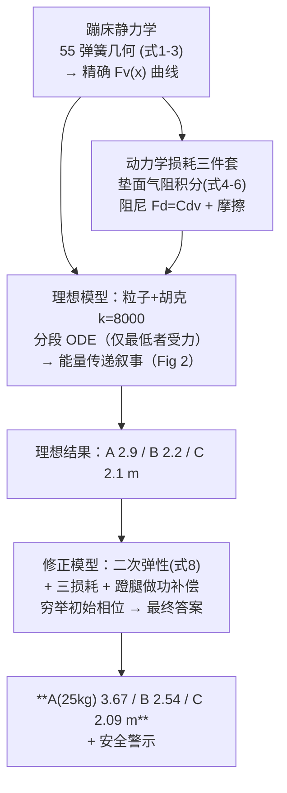

# 2023-GM-B-102（2023 题B · 队伍 102 · 16 页）

## 来自赏析

### 论文速览

本文研究三个孩子（25/40/50 kg）共用一张直径 5 m 蹦床时各自能达到的最大高度。核心思路是"能量传递"：先以单跳最大高度反推每个孩子的初始能量，再通过控制初始相位，让前一个孩子在最低点反弹时被后一个孩子"接住"压下，把能量经蹦床逐级转移给最后一人。理想模型（线性 Hooke 力 + MATLAB 数值积分）给出 2.9/2.2/2.1 m，修正模型（二次非线性弹性力 + 空气阻力/阻尼/摩擦 + 孩子做功能量补偿）后最终结果为 25 kg 孩子可达 **3.67 m**、40 kg 可达 **2.54 m**、50 kg 可达 **2.09 m**，并据此指出多人蹦床的安全隐患。

### 获奖密码

1. **抓住物理本质"double bounce"能量传递**：用两人追压机制图（Figure 2）先行讲透机制，再推广到三人，评委能一眼看懂能量如何逐级汇聚。
2. **参数全部落地**：蹦床用真实商品参数（55 弹簧 × 3000 N/m），弹簧伸长的几何展开式(1)与竖直分量式(3)推导严谨，避免"拍脑袋刚度"。
3. **理想→修正的两级结构**：理想模型定性回答"谁可以最高（任何人）"，修正模型定量回答"最高多少"，层次感强。
4. **非线性修正有据**：式(8)的二次力律不是凭空引入，而是由式(3)小形变展开并用 Figure 6 对比验证。
5. **孩子做功的巧处理**：把"发力"等效为补偿耗散的恒力并用 Figure 7 自洽标定，解决单人高度给定的约束如何进入动力学的问题。
6. **落地安全讨论**：结论指出 25 kg 孩子被抬到 3 m 以上的安全隐患，体现了对题目现实背景的回应。

### 可借鉴清单

1. 用"几何伸长 → 竖直投影 → 小量展开"三步推导蹦床/绳网类弹性力，并用对比图标定线性化适用区间（本文 Figure 6）。
2. 多体相位同步问题不求解析最优，改为遍历初始条件 + 数值积分找最大值，稳妥且易于实现。
3. 用"单人最大高度 → 初始能量"反推（$E=mgh$）把题目给定条件转成模型输入，是承接题设的标准手法。
4. 耗散参数（空气阻力、阻尼）引用实测文献并列表（Table 2），避免系数拍定。
5. 用第一跳能量衰减反推人做功的等效恒力，可推广到一切"人主动做功"类赛题。
6. 结论回收现实意义（安全警示），并诚实列出未建模因素（发力细节），体现模型边界意识。

## 来自精读

### 全文骨架



**为什么这个骨架好**：三人蹦床的核心困难不是方程而是**接触逻辑**（谁在垫上、能量何时易手）。论文用"理想模型先把能量传递讲清楚（Fig 2 的双弹叙事），修正模型再加真实弹性与损耗"的两级结构，让评委先懂物理再看数字——**短论文的正确打开方式**。

---

### 建模决策链

| 决策 | 作者的选择 | 被放弃的替代 | 为什么 |
|---|---|---|---|
| 弹性模型 | 静力学自推 F_v(x)，两版使用（线性 k / 二次式） | 直接假设胡克 | 几何出处的合法性 |
| 线性化点 | k=8000 @x≈0.25（隐含） | 原点切线 | 原点切线为零——但**未声明** ⚠ |
| 接触逻辑 | 分段 ODE（最低者受力） | 碰撞检测/冲量法 | 同轴问题下便宜稳健 |
| 气阻 | 微元积分（速度线性分布） | 常数阻力 | 垫面是分布结构 |
| 蹬腿 | 能量收支反推等效恒力 | 肌肉动力学 | 48h 内不可行；收支法数据自洽 |
| 求解 | 穷举初始相位 | 解析/优化 | "最高"是相位的多峰函数，穷举透明 |

**独立复现审计汇总**：式(6)积分逐项 ✓；式(8)@x=0.5 与精确式差 3% ✓；k=8000=x≈0.25 m 割线 ✓（未声明匹配点 ⚠）；初始能量 mgh 与独跳高度一致 ✓；**能量天花板 4.18 m → A 的 3.67 m=88% 传递效率，合理** ✓；蹬腿力≈半个体重 ✓ 生理合理；Table 5 单位笔误（N/m→N）⚠；"两人同时触垫"的模型边界未讨论 ⚠；与队友答案对照：471 队（3.20/2.74/2.39）、138 队（1.69/1.28/1.37）——102 队 A=3.67 偏高，源于更乐观的传递效率与蹬腿补偿口径，三队共同结论"最轻者弹最高" ✓。

---

### 可复用模板

**结构模板**：
```
1 Introduction   场景+风险（多人共享）
2 Analysis       数据表+两步路线声明（先简化后修正）
3 Model          3.1 器材力学（静力学自推+损耗积分）
                 3.2-3.3 理想模型：分段ODE+机制叙事图+独跳/共跳对照表
                 3.4 修正模型：精确弹性+损耗+蹬腿收支 → 穷举相位
4 Conclusion     局限+安全关照
```

**句式库**：
- "Here is what interesting happens. If A catches B when B slightly bounce up. Then, ..."（机制叙事的悬念句）
- "The majority of energy of B is stored in trampoline and will transfer to A when A bounce up."（能量易手的一句话版）
- "We predict that when one kid get to his maximum, the energy gain equals to the energy loss."（收支平衡假设的操作化句）
- "But because of the complexity of reality, there must be some factors we don't fully consider such as ..., hoping we can do experiment to determine them."（局限+实验展望句）
- "It can be seen that ... may produce some potential safety hazards, and we must pay attention to safety..."（现实关照收尾句）

**图表配方**：**机制叙事图**（轨迹交叠=事件）；近似合法性对比图（精确 vs 简化）；论据图（衰减曲线证明补偿必要性）；答案多解性"一解一图"。

---

*对照阅读：`05_论文赏析/2023/2023-GM-B-102.md`、`07_题目解读/2023_题B_三人蹦床.md`（上角定义与三队答案谱）、队友精读 138（物理引擎+视频校准）/471（周期平均解析+DOP853 双轨）。*
