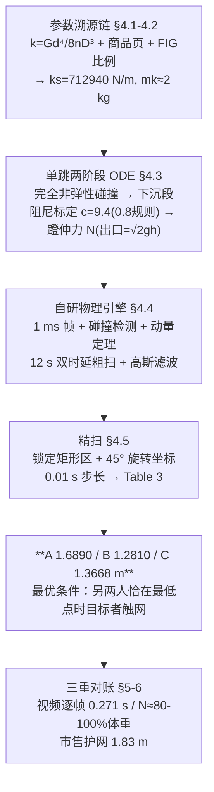

# 2023-GM-B-138（2023 题B · 队伍 138 · 25 页）

## 来自赏析

### 论文速览

本文把三人蹦床问题转化为一个"自研物理引擎 + 二维时延参数扫描"的仿真问题。基于市售真实蹦床参数（网面密度 300 g/m²、135 根弹簧、总刚度 $k_s\approx 712940$ N/m），建立含网面空气阻力、材料阻尼、完全非弹性碰撞和孩子腿部发力恒力 $N$ 的单自由度非线性 ODE，用 Python 写 1 ms 帧步长的物理引擎，对另外两名孩子的下落时延做 12 s 全窗口扫描并加高斯滤波去噪，再对候选区域做 45° 坐标旋转精扫。最终结果：25 kg 孩子最高 **1.6890 m**、40 kg **1.2810 m**、50 kg **1.3668 m**，且最优条件均为"目标孩子下落触网瞬间另两人恰好处于最低点"。结论与市售产品 1.83 m 护网高度交叉验证，给出厂商安全建议。

### 获奖密码

1. **全链条真实参数**：弹簧刚度由材料力学公式 + 商品参数推出、网面质量按电商面密度折算、弹簧数按 FIG 标准比例缩放，每个数都有出处（11 篇参考文献含 JD 商品页与 matweb）。
2. **假设—数据双向校准**：0.8 倍速度假设、阻尼系数、接触时间全部用视频实测闭环验证（Figure 13），把"拍脑袋假设"变成"可检验假设"。
3. **搜索策略清晰**：粗扫→局部精扫 + 坐标变换，既覆盖 12 s 相位空间又控制算力，且论证了 12 s 窗口的完备性（周期最小公倍数）。
4. **对数值伪影的自觉处理**：发现引擎在连续碰撞下产生噪声点，引入高斯滤波并做核宽灵敏度对比（Figure 14），体现数值实验素养。
5. **机制解释到位**：4.6 节用 Figure 11 展示最优解前 A、C 各压网约 1.4 s 的时序，并用 $E\propto x^4$ 解释小幅形变为何储能巨大。
6. **结果外推有应用价值**：与护网 1.83 m 对比给出安全建议，回应题目"确保使用者安全"的工程语境。

### 可借鉴清单

1. 用 $k=Gd^4/(8nD^3)$ + 商品参数 + 标准比例缩放反推"题目没给"的蹦床/弹簧参数，形成参数溯源链。
2. 把主观假设（反弹速度保留率）转化为定标条件：先设假设 → 反解未知系数（如 $c=9.40$ N·s/m）→ 用视频实测验证，闭环定参。
3. 二维参数扫描画"3D 曲面 + 俯视 + 切片"四联图，是展示时延/相位类优化问题最直观的版式。
4. 仿真出现数值毛刺时，对结果场做高斯滤波并展示不同核宽的对比，证明结论稳健。
5. 粗扫定位全局最优区域后旋转坐标系细扫，可推广到一切昂贵仿真优化。
6. 用外部独立数据（产品护网高度、视频帧数）交叉验证模型量级，比空谈"模型合理"更有说服力。

## 来自精读

### 全文骨架

论文回答：**25/40/50 kg 三个孩子同时跳，各自最高能到多少？怎样时延配合最优？**



**为什么这个骨架好**：三级漏斗——"先参数后动力学、先单跳后多人、先粗后细"。评委任何一步都能追问"这个数哪来的"，而每个数都有出处（11 篇参考文献里有 JD 商品页和 matweb）。**仿真类论文的可信度=参数可溯源度**，这条骨架就是证据链本身。

---

### 建模决策链

| 决策 | 作者的选择 | 被放弃的替代 | 为什么 |
|---|---|---|---|
| 总体路线 | 自研物理引擎+参数扫描 | 解析近似（102 队）/ 周期平均（471 队） | 多人碰撞时序复杂，仿真透明可查 |
| 刚度参数 | 商品弹簧公式+FIG 比例，ks=712940 | 直接假设 k=8000（102 队的线性化） | 参数可溯源；但数值上比 102 队硬 4 倍 |
| 等效质量 | 动量等效 mk=M_real/3≈2 kg | 动能等效（一半）/忽略网质量 | 碰撞问题动量守恒更贴切（未言明 ⚠） |
| 速度保留 | 0.8 规则 + 反解 c=9.4 | 直接设阻尼值 | 假设锚定在视频上 |
| 蹬腿 | 恒力 N（出口=√2gh 定标） | 肌肉动力学 / 能量收支（102 队） | 与"每跳回原高"稳态假设自洽 |
| 搜索 | 12 s 粗扫→45° 旋转精扫 | 均匀细扫 | 算力集中在最优脊线 |
| 噪声 | 高斯滤波 std=1.5（灵敏度对比） | 不管/更强滤波 | 保特征与去噪折中，有 Fig 14 为证 |

**独立复现审计汇总**（全部 python 复算）：
1. k=5280.7、ks=712,891 vs 论文 712,940 ✓；M_real=5.89 kg ✓；mk=M_real/3=1.96≈2 kg ✓（但印刷式漏 2πr 面积元，以 PDF 为准注明 ⚠）。
2. **两相 ODE 六个数全中**：t_bl=0.1360/0.1335/0.1270 s、x_m=−0.3327/−0.4147/−0.4765 m、t_al=0.1285/0.1281/0.1225 s，与 Table 2 四位小数一致 ✓✓（这是全文可信度的硬核证据）。
3. c=9.40 定标复核：平均速度比 0.7999 ✓；N 定标复核：v_exit/√(2gh)=0.9995/1.0002/1.0000 ✓。
4. E(0.4 m)=360.4 J（精确）/365.0 J（四次方近似），"E∝x⁴" ✓。
5. §5.2 引用的接触时间 0.2629/0.2512 s 与 Table 2 加和 0.2616/0.2495 s **不一致** ⚠（差 0.001–0.002 s，疑为另一轮运行；且 C 的 0.2495 s 已略低于视频下界 0.250 s）。
6. **附录代码不可复现** ⚠⚠：① `collisionCheck` 三处写 `10^-4`——Python 中 `^` 是按位异或，`10^-4 = −10`（同页 line 59 又正确写了 `10**(-4)`）；② 判碰撞逻辑要求**三个孩子全部**低于网面才合并，与 §4.4 正文 "When a frame indicates that a child is situated beneath the mat"（任一）矛盾。实测：按原样运行 12 s 得 A=0.934/B=0.800/C=1.200（B 恰好卡在悬停初值）；仅修 `10**(-4)` 得 A=2.87；再改成"任一"逻辑得 A=2.01——均非 Table 3 的 1.689。**结论：附录不是产出结果的代码版本**（B 目标情形还须换 MASS 排列，代码未体现）。
7. 答案对账：最优条件"目标者触网瞬间另两人恰在最低点"与 102/471 队机制一致 ✓；数值 1.69/1.28/1.37 m 是三队最低（0.8 规则+非弹性碰撞+c=9.4 三重损耗），排序 **A>C>B** 与 102 队 A>B>C 不同——C 独跳 1.2 m 能量基数大，在 138 队的高损耗模型下反超 B，**损耗口径决定排序**，这是同题对比最有意思的一点。
8. 页眉 "Team 144" vs 扉页 "Team 138" ⚠；§4.4 "Assumption A" 指代不明（应为 Assumption 2/5）⚠。

---

### 可复用模板

**结构模板**：
```
1 Introduction   安全数据引用 → 问题重述
2 Assumptions    每条假设给来源/理由（视频锚定）
3 Notations      表格（含"值待后文给出"列）
4 Model          4.1-4.2 参数溯源（公式+商品+标准）
                 4.3   单体两阶段 ODE + 两个稳态定标
                 4.4-4.5 引擎 + 粗扫(滤波) + 旋转精扫
                 4.6   机制叙事（标度律）
5 Discussion     假设偿还(V形PDE) + 视频对账 + 滤波核宽
6 Evaluation     Strengths/Weaknesses + 产品对照(护网高度)
7 Conclusion     答案+条件+用途
Appendix         4 个代码（⚠ 必须是实际运行版本）
```

**句式库（原文英文句）**：
- "We created a physics engine that can calculate X with respect to Y, using ..."（卖工具句）
- "From trampoline videos on Youtube, ... is approximately 60%-70%. Thus, a relatively realistic ... is set."（假设锚定句）
- "The least common multiple of ... is also less than 12s, meaning that ... are all considered in an way."（扫描范围完备性句）
- "Given that physics engines have inaccuracy in complex scenarios like successive collisions, noise points may influence the results... we apply a Gaussian blur ... ensuring the stability and reliability of the results."（数值伪影处理句）
- "It is manifested that ... Also, the whole mat is pulled straight with second derivative equal to zero."（简化极限的结论句）
- "This value falls below the established guard height of 1.83 meters ... thereby indirectly ensuring the credibility of our predictive model."（外部交叉验证句）
- "Therefore, we recommend that the vendor explore the possibility of ... to enhance safety."（工程建议收尾句）

**图表配方**：二维参数扫描 → "3D+俯视+双切片"四联版式；粗细衔接 → 热图上画矩形+新坐标系；机制 → 全实体时序图+放大窗口；标定 → 视频/商品数据对照图；滤波 → 核宽三联对比。

---

*对照阅读：`05_论文赏析/2023/2023-GM-B-138.md`（宏观赏析）与 `07_题目解读/2023_题B_三人蹦床.md`（题目全解与三队答案谱）；同题队友精读：`2023-GM-B-102_精读.md`（静力学自推+分段 ODE）、471 队（周期平均解析+DOP853）。*
