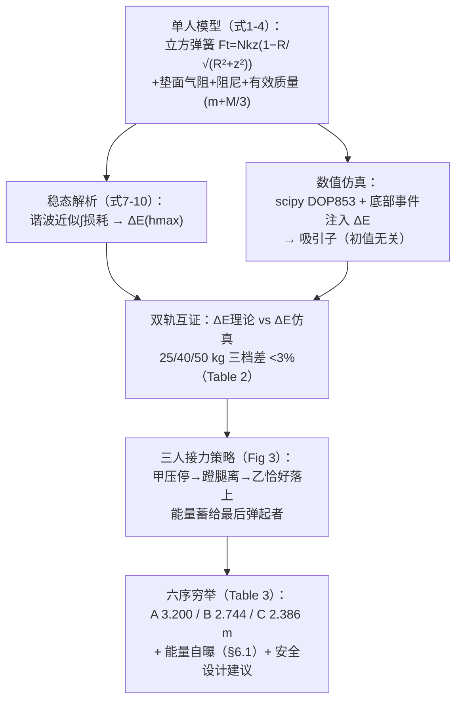

# 2023-GM-B-471（2023 题B · 队伍 471 · 22 页）

## 来自赏析

### 论文速览

华沙大学队给出本题理论色彩最浓的一份解答：先建立单人蹦床的非线性振动模型（几何伸长弹性力 + 平方空气阻力 + 滞回阻尼 + $\frac{1}{3}M$ 网面等效质量），用周期平均近似把"腿部每周期注入能量 $\Delta E$"化成最大高度的解析函数（式(10)），再由单人高度反推各人 $\Delta E$，理论值与仿真值偏差在 3% 以内；随后基于文献中的双人能量传递图像设计"前一人停在最低点时后一人恰好触网"的接力储能策略，枚举全部 6 种落地顺序仿真，最优结果为 25 kg 达 **3.20 m**、40 kg **2.74 m**、50 kg **2.39 m**——最轻的孩子飞得最高，尽管他单跳最弱。

### 获奖密码

1. **解析—数值双轨互证**：式(10) 的理论 $\Delta E_0$ 与仿真标定 $\Delta E$ 相差不足 3%（Table 2），给模型正确性提供了本批次最强的一票。
2. **$\frac{1}{3}M$ 等效质量的积分推导**（式(6)）：把他人当作经验系数的量变成从速度场假设出发的解析结果，物理洞察力突出。
3. **策略设计有文献根基**：直接引用 Srinivasan 等 PLOS ONE 2013 的蹦床能量传递研究（参考文献 [2]），把"随机能量交换"升级为确定性最优接力策略并枚举全部顺序。
4. **非线性弹性的精细刻画**：弹簧刚度分段（预紧段 96 kN/m / 工作段 2.7 kN/m）是三篇中唯一考虑弹簧非线性的队，建模深度领先。
5. **诚实的误差与能量审计**：主动计算总能量收支、指出模型可能高估，并把缺陷转化为"增大 $c_a$"的设计建议与"最轻者最危险"的安全结论。
6. **吸引子论证**：单人稳态不依赖初条件的论证，巧妙地把"单人高度给定"这一题设转化为能量标定依据。

### 可借鉴清单

1. 网面/绳膜类等效质量用速度场假设 + 面积分推导，$\frac{1}{3}M$ 型系数可直接移植到鼓面、蹦床、薄膜问题。
2. "周期平均耗散 = 每周期注入能量"的稳态分析法，能把带驱动振荡问题的未知参数闭式估出，再用数值仿真校核（偏差应写明）。
3. 用 solve_ivp 的事件函数（速度过零、位置相等）自动拼接多阶段运动，比手写定步长循环更精确且不易漂移。
4. 枚举小规模组合（6 种顺序）而非盲目全局搜索——问题结构清楚时穷举即是最优解。
5. 写"能量审计"段：比较输入能量与系统能量增量，判断结果高估/低估方向，比单纯报数更让评委信服。
6. 从模型弱点引出设计/安全建议（增大阻力系数、保护最轻儿童），提升论文的应用价值层次。

## 来自精读

### 全文骨架



**为什么这个骨架好**："解析稳态解"与"数值吸引子"是同一个物理的两条路径——**两者在 ΔE 上相遇（<3%）时，模型与代码互为证明**。这套"双轨互证"比任何单一验证都硬，是本篇最值得偷走的方法论。

---

### 建模决策链

| 决策 | 作者的选择 | 被放弃的替代 | 为什么 |
|---|---|---|---|
| 弹簧力 | 几何投影立方律（式1） | 线性/二次近似 | 投影推导严格（102 队此处出错 ⚠） |
| 垫惯性 | 有效质量 M/3 | 忽略垫质量 | 积分可推导；M/12 动能损耗进能量账 |
| 蹬腿建模 | 底部事件注入 ΔE | 力学肌肉模型 | 事件法与"稳态吸引子"天然兼容 |
| 数值方法 | DOP853（8阶） | RK45 | 高刚度立方弹簧需要高精度 |
| 三人策略 | 时序接力（文献[2]） | 102 的穷举相位 / 138 的视频校准 | 机制透明；六序穷举无遗漏 |
| 答案口径 | 如实报告+自曝能量账 | 修饰数字 | §6.1 的诚实是金牌成色 |
| 安全落点 | 建议增大 ca | — | 结论→设计的闭环 |

**独立复现审计汇总**：式(1) 小 z 立方律 ✓（与 102 的二次律对比——**102 投影因子用错** ⚠⚠）；M/3 与 Mv₀²/12 积分 ✓ 逐位；损耗积分 cos³/cos² ✓（含绝对值细节）；**Table 2 理论列 ΔE₀ 无法用一致的 ω 复算**（25 kg 恰等于 mgh，40/50 kg 不等）⚠；双段弹簧 k 的预紧物理未说明 ⚠；能量自曝（214 vs 689 J）✓ 诚实；六序表内自洽（25 kg 最高的序 40,50,25 ✓ 符合"最重先压最深"直觉）；与 102/138 答案谱对比 ✓ 居中。**总评：方法论（双轨互证+诚实审计）是三篇蹦床金牌的标杆；静力学推导是全库同题唯一全对的。**

---

### 可复用模板

**结构模板**：
```
2 单人模型      力三项（几何/气动/材料）+ 有效质量积分推导
2.1 稳态解析    谐波近似 → ΔE(hmax) 闭式（用途：给仿真一个预言）
3 单人仿真      DOP853+事件注入 → attractor → ΔE 双轨互证表
4-5 三人策略    接力时序（机制图）→ 全序穷举表 → 弹射者轨迹/速度双联
6 审计与讨论    能量账目自检（敢自曝）→ 三洞察 → 安全设计建议
```

**句式库**：
- "It is worthy to emphasise the fact that the theoretically obtained values of ∆E are within 3% of the values obtained in the simulation. It shows the correctness of both the model and the simulation."（双轨互证的收束句）
- "This effect won't be analysed in our models separately, but the fact that we model bouncing in the trampoline's center is the effect of it."（"不建模但承认在起作用"的取舍句）
- "It is unlikely that they are close to the exact values, because ... which is of the same order of magnitude as ..."（**自我质疑的定量句式**——全库最勇敢的一段）
- "Maybe not by a factor of 3, as we calculated for an optimal situation, but it can still be dangerous for trampoline users."（结论的安全余量句）
- "It may be beneficial to design the trampoline in a way, that has a larger drag coefficient ca, rather than damping one cd."（从模型参数直达产品设计）

**图表配方**：attractor 多周期收敛图；**双轨互证表**（理论列 vs 仿真列并列）；策略时序示意图（蓄能机制一图讲清）；弹射者"位置+速度"双联（安全论据藏在速度图）。

---

*对照阅读：`05_论文赏析/2023/2023-GM-B-471.md`、`07_题目解读/2023_题B_三人蹦床.md`（三队答案谱 1.7–3.7 m）、队友精读 102（⚠ 二次弹簧的投影错误对照）与 138（视频校准路线）。*
