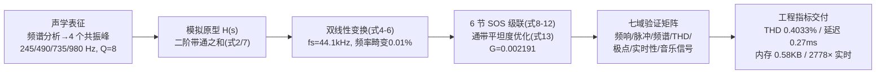

# 2025-GM-A-112（2025 题A · 队伍 112 · 26 页）

## 来自赏析

### 论文速览

本文把"让电声沙桑托复现传统 Lontar 叶共鸣器音色"的题目转化为一个**参数化 IIR 数字谐振器设计**问题：从琴的物理声学出发辨识出四个谐振模（245/490/735/980 Hz，呈谐波关系），用标准 biquad 带通节经双线性变换离散化、六节二阶节（SOS）级联并做极小化通带波纹优化。指标全面：通带平坦度 <0.1 dB、阻带衰减 >50 dB、冲激响应衰减 182 ms、THD 平均 0.4033%、2778 倍实时、时延 0.27 ms、内存 0.58 KB、极点在单位圆内（裕度 0.0479），并给出从频域、时频、瞬态到嵌入式实现的完整验证链条。

### 获奖密码

1. **把乐器问题翻译成工程指标**：题目没有给任何数值要求，本文自己设定通带 98–1047 Hz、平坦度 <0.1 dB、THD<1%、实时等指标体系，让"保真"可测可查。
2. **参数有物理出处**：四谐振峰的谐波关系 + 半波长共振解释（245 Hz ↔ 2×70 cm 竹管），使滤波器参数不沦为纯拟合，呼应物理竞赛的建模要求。
3. **验证维度空前完整**：频域、时域瞬态、失真、稳定性、实时性、音色感知量（谱质心）七位一体，每种指标都有编号图表支撑。
4. **工程落地闭环**：给出差分方程、运算量、内存、推荐芯片（Cortex-M4F/SHARC）与 VST 插件形式，评委看到的是可部署方案而非纸面设计。
5. **诚实的替代方案对比**：与 FDTD、深度学习对比论证选型合理性，并以第 8 节明确四条模型局限，体现成熟的研究素养。
6. **规范的 AI 使用声明**：在允许范围内透明披露，规避学术诚信风险。

### 可借鉴清单

1. 遇到"复现某声学/光学响应"类题，先建参数化二阶节模型（谐振频率 + $Q$ + 增益），再级联优化——参数少、可解释、算力低。
2. 用 $Q=f_0/\Delta f$ 与波长-几何对应关系（$\lambda=c/f$）把题给尺寸变成模型参数的物理依据。
3. 双线性变换后务必核算频率翘曲量级（本文 $\approx0.01\%$），以数值结论决定是否需要预翘曲。
4. 多指标验证模板：频响 + 冲激响应 + THD + 极-零稳定性 + 实时因子 + 一组感知代理量（谱质心），可直接迁移到任何滤波/振动类赛题。
5. 自设量化指标（平坦度、衰减、时延）把开放题的"好坏"变成可评分数字，方便评委给分。
6. 按 2025 年新规写 AI Usage Report，限定用途并逐条声明作者责任。

## 来自精读

### 全文骨架



**为什么这个骨架好**：题面要求"让电声沙桑托复刻原声"——一个模糊的美学目标被翻译成**四峰参数化模型**（可计算），再走标准 DSP 流水线（变换→级联→验证），最后以**嵌入式可部署的工程指标**收尾。"物理模型→数字替身→交付物"三层递进，是所有"乐器/振动+信号处理"类题目的通用骨架。

---

### 建模决策链

| 决策 | 作者的选择 | 被放弃的替代 | 为什么 |
|---|---|---|---|
| 复刻对象 | 4 个共振峰（频响特征） | 波形级/时域卷积复刻 | 听感由频谱包络主导（模态正交、参数少） |
| 峰参数 | 245/490/735/980（谐波系）+ Q=8 | 频谱细峰逐个拟合 | 半波共振几何论证：λ=1.4m≈2×管长 |
| 离散化 | 双线性变换 | 脉冲响应不变 | 无混叠；畸变 0.01% 已量化可忽略 |
| 结构 | 6×SOS 级联（DF-II 转置） | 12 阶直接型 | 数值稳健 + 嵌入式友好 |
| 平坦度 | min-max 优化增益 | 手调 | (13) 式正规化 |
| 验证 | 频域+时域+THD+极点+实时 七域 | 单一频响 | 每维单独不充分 |
| 合规 | AI 使用报告独立成节 | 不声明 | 2025 年赛制新要素 |

**独立复现审计汇总**：频率畸变 1.00012 ✓；表 1 带宽 Δf=f0/Q（30.6/61.3/91.9/122.5 ✓ 全对）；τ₆₀≈36 ms vs 声称 182 ms ⚠（定义未注明）；**系数表四处内部不一致** ⚠⚠（a1/a2 隐含极点 705 Hz≠245；b0 线性规律；增益全 1.000；六节四峰无说明）；MOPS 1.37 vs 2.4 两口径 ⚠；THD 对 LTI 系统概念存疑 ⚠。**结论的定性可信（方法链与验证框架完整），定量细节需以自算系数为准。**

---

### 可复用模板

**结构模板**：
```
1 Introduction     背景价值→核心问题句→五目标→范围
2 Notation+贡献    符号表+可检验贡献清单
3 物理表征         基础公式→参数化模型→参数识别表→物理出身论证
4 设计方法         采样率(四理由)→变换(误差量化→补偿决策)→结构→优化→稳定性
5 实现             差分方程+逐样本算力/内存账本
6-7 验证           七域矩阵(每域一图)+音乐信号
8-9 讨论+结论      局限四条分小节+替代方案对比
10 AI 使用报告     (新赛制要素)
```

**句式库**：
- "The fundamental challenge addressed by this research can be articulated as follows: how can we ...?"（核心问题句模板）
- "This 0.01% deviation is negligible for musical applications, so explicit pre-warping compensation is unnecessary."（误差量化→决策句）
- "Higher Q values indicate narrower, more selective resonances..., contributing to ..."（参数的听感翻译）
- "This modest load is easily handled by modern processors, including low-power ARM Cortex-M4..."（算力结论落到具体硬件）
- "The methodology is generalizable to other ... offering practical pathways to ..."（推广性声明）

**图表配方**：方法论四阶段流程图（每格列产物）；参数表带音乐音名列；频响图=对数轴+通带底色+峰参考线；验证矩阵"每域一图"；时频图展示动态处理；**系数表后附一行自检公式**（防誊写错误）。

---

*对照阅读：`05_论文赏析/2025/2025-GM-A-112.md`、`07_题目解读/2025_题A_电声沙桑托琴.md`（信号处理题全解）、队友精读 182/485（同题光学拾音与 DSP 路线）。*
