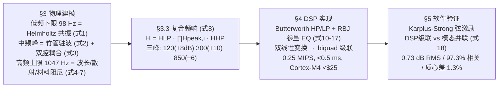

# 2025-GM-A-485（2025 题A · 队伍 485 · 31 页）

## 来自赏析

### 论文速览

论文把"电声沙桑托琴如何还原传统音色"转化为一条标准的信号处理链：先将 lontar 叶共鸣器建模为 Helmholtz 腔与竹管（70 cm 长、8 cm 直径）耦合的线性时不变系统，导出 98 Hz–1047 Hz 通带内三个共振峰（120 Hz/Q=2.0/+8 dB、300 Hz/Q=1.5/+10 dB、850 Hz/Q=2.5/+6 dB）；再用级联 IIR 滤波器（二阶 Butterworth 高通 + 三个 RBJ 参数均衡器 + 三阶 Butterworth 低通）在 8 kHz 采样率下数字化实现，算力仅 0.25 MIPS、延迟 <0.5 ms；最后用 Karplus-Strong 合成琴弦信号做软件仿真验证，频响 RMS 误差 0.73 dB、波形相关 97.3%、谱质心偏差 1.3%，并给出 <$25 硬件（ARM Cortex-M4）与 >6 h 续航的落地指标。

### 获奖密码

1. **问题转译准确**：把开放性的"文化保育"题压成"共鸣器=传递函数、DSP=滤波器组"的标准信号链问题，路线清晰可复现；
2. **全链路闭环**：物理模型→滤波器系数（含手算示例）→运算量/延迟/成本预算→硬件选型，回答了"能不能做成"而不只是"怎么算"；
3. **验收先行的验证体系**：Table 15 先定量化判据，Table 16 逐项打钩，自洽性和可信度一目了然；
4. **类比定标**：与吉他、曼陀林的已知声学参数对照（Table 5、Figures 2–4），弥补无法接触实物琴的验证缺口；
5. **摘要素质极高**：三峰参数、0.73 dB、97.3%、0.25 MIPS、<$25 全部前置，评委 3 分钟即可掌握全貌；
6. **诚实标注局限**（5.8.5），反而增强可信度。

### 可借鉴清单

1. 开篇放一张六分类全参数总表（Table 1），让评委随时查证；
2. 验证前先写"成功判据表"，再逐项给出实测值与 Pass/Fail；
3. 无法实测时，用文献中同类系统的已知参数做类比定标；
4. 把算法落到工程指标：MIPS、延迟、成本、续航，各给一行数字；
5. 给出至少一个滤波器系数的完整手算示例，证明公式真的会算而非抄 cookbook；
6. 设计覆盖各特征区的测试信号集（Table 14 的六个音），并单列一节讨论局限与缓解。

## 来自精读

### 全文骨架



**为什么这个骨架好**：这是**工程题的标准闭环**——每个设计决策都向上挂靠一个物理机制（98 Hz 挂 Helmholtz、1047 挂波长极限、三峰挂驻波+耦合），向下落实一个可实现构件（biquad、MIPS、硬件表）。§5 的验证虽然只能"软件对软件"，但指标体系(表 15)先于结果(表 16)给出，**判据先行**让 0.73 dB 这种数字有了"及格线"的含义。

---

### 建模决策链

| 决策 | 作者的选择 | 被放弃的替代 | 为什么 |
|---|---|---|---|
| 共振器模型 | 三峰带通+双边界滤波器组 | 全程 FDTD/有限元 | 48 h 内可算可验；参数化便于调音 |
| 峰参数来源 | 机制归因(式1-2)+乐器对标(表5) | 实测频响（182 队光拾取路线） | 无实物；但机制-参数映射不严格 ⚠ |
| 滤波结构 | 级联 biquad | 单高阶 IIR / FIR | 稳定性+独立调参+量化误差 |
| 验证 | KS 弦激励、软件对软件、判据先行 | 实物 A/B | 无实物；**层级声明诚实** |
| 激励信号 | Karplus–Strong 六音 | 白噪声扫频 | KS 有真实包络/谐波衰减，指标更全面 |
| 硬件 | Cortex-M4 <$25 | FPGA/VST | 嵌入琴体的实时性-成本折中 |

**独立复现审计汇总**（python 复算）：
1. c=346.1 m/s ✓（=√(1.4·287·298.15) 精确）；ρ=1.167 vs 500 m+25 °C 的 ISA 值 1.116 ⚠ 小矛盾。
2. **式 (1)+表 1 → 311.5 Hz ≠ 98/120 Hz** ⚠⚠；98 Hz 需 Leff=37.4 cm（印刷 3.7 cm 的 10 倍）；§3.2.1 第三组参数（r=8.9 mm、V=3.5e-3 m³）与表 1 矛盾且给 76.4 Hz ⚠。
3. 式 (2) 驻波 245/490/735/980 Hz ✓（但与峰 300/850 映射含糊；c 用 343 与表 1 的 346.1 不一致 ⚠）。
4. 式 (8) 级联复现：120/300/850 Hz 处 +8/+10/+6 dB 精确 ✓；BW=60/200/340 Hz。
5. **表 7/10/11 印刷系数全错**（77/164/1919 vs 98/120/1047）⚠⚠；正确系数已复算并列于 §3.5。
6. 运算量 28 乘/样本 → 0.224≈0.25 MIPS ✓；延迟算术 ✓。
7. 式 (18) 模态并联按字面（分子 Giωi·s）在峰点给出 Gi·Qi 增益（约 +14 dB），与级联 Gi（+8 dB）不符——0.73 dB 的验证结果暗示代码实际用了 Gi/Qi 归一化 ⚠ 印刷式与实现脱节。
8. 验证数字自洽性：谱质心 387→392 Hz（+1.3%）、rolloff 912→928（+16 Hz）与表 1 汇总一致 ✓；表 16 全 Pass 与判据表一一对应 ✓。
9. Fig 4 图题 "Format Peak"（应为 Formant）、正文 "fifirst/Cattering/セ" 等乱码（以 PNG 为准：Fig 4 中吉他 +12/+15/+10/+6/+5 dB、沙桑托 +8/+10/+6 dB）⚠ 排版瑕疵。

---

### 可复用模板

**结构模板**：
```
1 Introduction   张力(便携性 vs 音色) + 5 条贡献清单
2 Parameters     LTI 假设 + 全参数总表(可复现性契约)
3 Acoustics      低/中/高频三段机制分析 → 复合频响式(8) → 乐器横向对标
4 DSP            采样论证 → HP/EQ/LP 逐件设计(式号+系数表) → 级联
                 → 运算量/延迟/硬件三表(可行性闭环)
5 Validation     判据表先行 → KS 激励 → 双模型对照 → Pass/Fail + 局限声明
6 Conclusion     物理→数字的方法论 + 文化遗产外推 + 未来工作
```

**句式库（原文英文句）**：
- "This cavity acts as a frequency-selective amplifier, emphasizing partials roughly between ... and producing the distinctive formants that define ..."（机制一句话）
- "When these two conditions coincide or are close to each other, the energy transmission efficiency surges sharply, and this is manifested on the spectrum as a mid-frequency formant peak."（双机制耦合句）
- "This is the standard sampling rate used in audio applications, which is sufficient to meet the requirements..."（工程惯例背书句）
- "This cascading approach can maintain numerical stability, allow each part to be independently tuned, and minimize cumulative quantization errors."（结构选择三理由句）
- "In the absence of physical traditional sasando instruments for direct comparison, we validate ... through software-based acoustic simulation."（无实物验证声明句）
- "The validation demonstrates that the DSP correctly implements the designed transfer function. As long as the resonator model from Section 2 is accurate ..., the DSP implementation is valid."（验证层级划界句——本篇最诚实的一句）

**图表配方**：信号链流程对照图（传统 vs 电声逐环节对应）；判据-结果 Pass/Fail 对照表；指标六联图（每图挂一个指标）；乐器横向对标柱状图（10 dB 参考线）。

---

*对照阅读：`05_论文赏析/2025/2025-GM-A-485.md` 与 `07_题目解读/2025_题A_电声沙桑托琴.md`（题面参数与评分视角）；同题队友精读：`2025-GM-A-112_精读.md`（参数化 IIR 设计路线）、`2025-GM-A-182_精读.md`（光拾取实测+双二阶滤波路线——其共振峰来自测量而非机制设定，恰补本篇短板）。*
