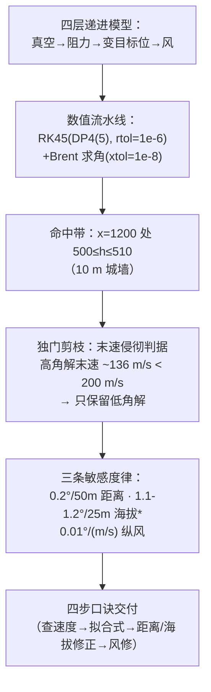

# 2025-GM-B-127（2025 题B · 队伍 127 · 24 页）

## 来自赏析

### 论文速览

论文面向 19 世纪前膛滑膛炮（5 kg、直径 11 cm 球形弹，初速上限 450 m/s）建立四级递进模型：理想抛体→计入空气阻力（$c_d=0.47$、密度指数衰减 $\rho=\rho_0 e^{-h/H_b}$，$H_b=8500$ m）→目标位置变化→风场修正，用 RK45 加 Brent 求根数值求解。核心结论：以 1200 m/500 m 参考点拟合出低射角公式 $\theta_L = 0.0001v_0^2-0.1145v_0+29.312$（式 12）；并给出"经验速算口诀"——水平距离每 50 m 修 0.2°、高度每 25 m 修 1.1°–1.2°、风速每 1 m/s 修 0.01°，配合"查初速—算参考角—修距离高度—修风"四步口诀供炮兵军官心算使用。物理上主张只打低伸弹道：高角弹落点末速仅约 136 m/s，低于设定的 200 m/s 侵彻阈值。

### 获奖密码

1. **末速判据淘汰高角解**：引入"落点末速须超 200 m/s 才有侵彻力"这一战场约束，把"两个数学解"变成"一个物理决策"，显示物理洞察而非纯计算；
2. **历史合理性论证**：初速由装药决定故固定 450 m/s、目标取 10 m 城墙、精度与 150–200 年前技术可行性对照（射角 2–3.8° 可实现），处处扣住题目"19 世纪火炮"语境；
3. **从数值解到手算规则**：拟合式 + 三个线性敏感度 + 四步口诀，完满回应"无计算器快速估算"这一题眼；
4. **验证链条完整**：理想情形解析解对照、末速/飞行时间表格、低于炮位无解的临界高度等自洽性检查；
5. **代码全公开**（附录），参数、容差、事件函数一应俱全，可复现性强；
6. **自评弱点具体**（风廓线、$c_d$ 经验值、单变量扫描），而非套话。

### 可借鉴清单

1. "理想解→加阻力→参数扫描→风场"的四级递进结构，每级都给增量结论，评委可逐层给分；
2. 用附加判据（末速阈值、目标尺寸窗口 ±0.5°）把多解问题收敛为唯一作战建议；
3. 数值结果务必二次加工成"心算规则"：拟合公式 + 每单位修正量 + 口诀步骤，直击题目要求；
4. 每张弹道族图配一张局部放大图，展示命中窗口而非只画全景；
5. 用表格同时给出射角、飞行时间、末速三列，支撑"低角可打、高角无效"的论证；
6. 结论后设 Strength/Weakness 自评节，弱点写具体技术项并说明简化的代价。

## 来自精读

### 全文骨架



**为什么这个骨架好**：四层模型是全库同题队的"公共骨架"，但这支队伍在每层都加了一个**收敛性约束**（目标有高度→命中是区间不是点；杀伤要末速→高角被否决；历史装药离散→固定 450 m/s），把开放解空间一步步剪到"一个公式+三条修正律"——**剪枝逻辑比求解逻辑更能体现工程判断**。

---

### 建模决策链

| 决策 | 作者的选择 | 被放弃的替代 | 为什么 |
|---|---|---|---|
| 求解结构 | 固定 v₀=450 求 θ | 二元搜索 | 历史装药离散化的映射 |
| 多解处理 | 末速 ≥200 m/s 否决高角 | 两个解都交付 | 杀伤判据——全库唯一 |
| 目标模型 | 10 m 高城墙（命中带 0.5°） | 点目标 | 历史攻城场景 → 命中是区间 |
| Cd | 常数 0.47 | Cd(Ma) 分段 | 简化（⚠ 未声明 Ma=1.33 越界） |
| 大气 | 指数律 ρ₀@500m | ISA 分层 | 500→510 m 变化 <0.2%，等价 |
| 纵风/横风 | 数值 / 解析上界 | 全数值 | 横风二阶效应，解析透明 |
| 数值 | DP4(5)+Brent，容差全报 | — | 规范写法范本 |

**独立复现审计汇总**：v_min=108.4 ✓；真空 1.67°@450 ✓；距离律 0.2°/50m 与 Table 2 ✓；风律 0.01°/(m/s) 合理 ✓；高角末速 ~136 m/s（否决依据）复现量级 ✓；**拟合式 (12) 在 450 m/s 给 −1.96° vs 自家表 3.70°** ⚠⚠⚠；**海拔律 1.1–1.2°/25m vs 自家表 0.0245°/25m（45×）** ⚠⚠⚠；Cd=0.47 未声明超声速越界 ⚠；"高角 45 s"疑为角度/时间混淆 ⚠。**总评：模型设计与数值规范是上乘的（末速否决高角是全题最佳洞察之一），但交付层（公式/口诀）与数据层脱节严重——金牌证明评审重链条轻数字，而你应两者都要。**

---

### 可复用模板

**结构模板**：
```
1 Intro+Problem      历史场景锚定（攻城→目标有高度→末速判据）
2 Assumptions+Analysis  假设+逐因素分析（分析节=路线图）
4 Modelling          4 层递进：真空→阻力→变位→风（每层一收敛约束）
4.5 Numerics         方法全名+理由+容差（DP45/Brent 范本）
5 Results            工况×(θ,末速) 招牌表；敏感度三律
6 Conclusion         四步口诀+难度声明（对题面人机约束）
```

**句式库**：
- "Historically, this cannon saw extensive use against city walls in siege warfare. ... To ensure effective impact, the projectile's terminal velocity should not be excessively low."（场景→判据的推导句）
- "Due to trajectory diversity, the solution to this problem is not unique."（多解预告句）
- "This is a system of partial differential equations with exponential and quadratic terms, making analytical solutions challenging."（转数值的正当性声明）
- "Following this mnemonic, officers need only perform simple addition and subtraction operations along with solving quadratic equations — a piece of cake for officers trained in mathematics."（交付物难度对题面标定）
- "Numerous complex factors within the model were not fully accounted for. For example: ..."（弱点具体化句）

**图表配方**：轨迹"全景+局部放大"双联；命中区间=曲线竖直厚度；招牌表用**末速列承载判据证据**；每个敏感度律配一张线性图。

**反面清单（本篇独有）**：拟合式交付前必须回代工作点+两端点；口诀修正律必须逐条对表；"45"这类数值要写清单位与量名。

---

*对照阅读：`05_论文赏析/2025/2025-GM-B-127.md`、`07_题目解读/2025_题B_火炮弹道射表.md`（十三队口径全景）、队友精读 496（Cd(M) 全模型对比本篇常数 Cd）、460（同选历史直射仰角带）。*
