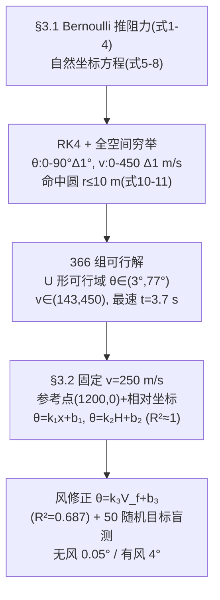

# 2025-GM-B-155（2025 题B · 队伍 155 · 20 页）

## 来自赏析

### 论文速览

论文从空气动力学视角出发，先用 Bernoulli 原理导出阻力并建立在切向/法向自然坐标系下的弹道微分方程，用 RK4 对 $(\theta, v)$ 全参数空间（$\Delta\theta=1°$、$\Delta v=1$ m/s）穷举，找出命中 1200 m 同高程固定目标的全部 366 组可行解（$\theta\in(3°,77°)$、$v\in(143,450)$ m/s，最速解 $t=3.7$ s 对应 $v=450$ m/s、$\theta=3°$）；随后固定半装药初速 250 m/s，用控制变量法 + 最小二乘拟合出"参考点 (1200, 0) + 相对坐标线性修正"的经验公式 $\theta=k_1 x+b_1$、$\theta=k_2 H+b_2$（$R^2$ 分别 0.999/0.996），再加风修项 $\theta=k_3 V_f+b_3$（$R^2=0.687$）。随机目标盲测：无风偏差约 0.05°，有风约 4°——并诚实报告了风修精度短板。

### 获奖密码

1. **答"全解"而非"一解"**：参数空间穷举给出 366 组可行解与 U 形可行域分布图，正面回答了弹道命中多解性这一题目内禀特征，覆盖率远超"打靶求根"式做法；
2. **物理推导有出处**：阻力从 Bernoulli 圆盘模型推出再乘 $C_D$ 修正，切向/法向坐标系的方程 (5)(6) 简洁优雅，显示扎实的分析力学功底；
3. **经验公式的工程化设计**：参考点 + 相对坐标 + 线性叠加，军官只需心算 $k\Delta x$、$k\Delta H$、$k V_f$ 三项加法——直接命中"无计算器快速估算"题眼；
4. **统计素养**：最小二乘、$R^2$ 定义式、交互项显著性检验、随机目标盲测，把"拟合是否可靠"变成可检验命题；
5. **诚实的精度分级**：摘要即声明有风偏差 4°、$R^2=0.687$，Strengths/Weaknesses 具体到"首发射击需微调"，可信度高。

### 可借鉴清单

1. 用"全参数空间遍历 + 命中半径判据"系统枚举多解问题，并用一张颜色编码散点图（可行域 + 时间代价）呈现；
2. 经验公式采用"参考点 + 相对量 + 线性叠加"结构，先做交互项显著性检验证明可加性，再给出系数；
3. 阻力等常见公式可用 Bernoulli/动量等基础原理现场推导一遍，再引文献系数修正，提升物理深度；
4. 用随机生成的测试集做盲测，并分别报告不同工况（无风/有风）下的误差量级；
5. 切向-法向自然坐标系写弹道方程，比直角坐标分量式更简洁且便于引入风修正；
6. 明确模型的适用包线（如 1000–1500 m、相对高程 −178 至 778 m）并写入 Strengths，让评委看到使用边界意识。

## 来自精读

### 全文骨架

论文回答两问：**固定目标 1200 m 的全部可行 (θ, v) 是什么？** 以及 **军官没有计算器时怎么快速估射角？**



**为什么这个骨架好？** 第一问没有选"打靶求根"而是"穷举计数"——因为题目问的是"确定初速与射角"（复数），穷举直接把多解性变成一张 U 形散点图；第二问的所有经验式都从这张图的局部（v=250 切片）蒸馏出来，"模型→交付物"是一条单向流水线，与 496 队同构，但本队多做了两步别人没做的：**交互项显著性检验**和**随机目标盲测**。

---

### 建模决策链

| 决策 | 作者的选择 | 被放弃的替代 | 为什么 |
|---|---|---|---|
| 坐标系 | 自然坐标 (τ,n) | 直角坐标 | 控制量恰为 (θ,v)；风修只需 (τ,n) 分解 |
| 阻力 | Bernoulli 现推 + C_D=0.47 常数 | Mach/Cd 模型（204/207/188） | 20 页篇幅取舍；但 450 m/s 出膛 M≈1.33，Cd 实际 ~0.9，低角解系统偏平 |
| 密度 | 常数 1.1679（500 m） | ISA/指数（428/204/392） | 弹道顶点 <50 m，密度变化 <0.6% |
| 求解 | 全空间穷举（Δθ=1°, Δv=1） | 打靶/fsolve（204）、双向搜索（392） | 覆盖率换精度；多解性一目了然 |
| 经验式 | 参考点+相对坐标+线性叠加+交互项检验 | 二元曲面拟合（392）、修正系数表（188） | 军官心算成本最低 |
| 验证 | 50 随机目标盲测、分无风/有风报精度 | 单点对照 | 精度声明有统计支撑 |

**独立复现审计汇总**（Python + scipy，RK45，rtol 1e-9）：
- 可行域端点 θ∈[3,77]° ✓ 精确；v∈[142–143, 450] ✓（摘要 147 ⚠ 笔误）；最速解 (450,3°) 最近点 7.5 m、t=3.72 s ✓ 与"3.7 s"吻合。
- b₁=8.834 ✓（复算 8.73）；k₃=−0.0498 方向与量级 ✓；R²₃=0.687 与"有风 4°"互洽 ✓。
- **⚠ 发现 1**：k₁/k₂ 数值真实但与 Case1/Case2 文字定义**对调**（0.0475 是 H 斜率、0.0122 是 x 斜率）。
- **⚠ 发现 2**：风的符号约定正文（正=逆风）与代码/拟合（正=顺风）相反。
- ⚠ 发现 3：式 (4) 记号 v⃗² 不严格；常数密度 + 常数 Cd 使 450 m/s 档低角解比 Mach 敏感模型偏小约 0.3–1°（对比：本文 2.65° vs 207 队 Loth 3.82°）。

---

### 可复用模板

**结构模板**：
```
1 Introduction    背景→重述→分析(判据前置+装药假设)
2 Assumptions     5 条(均匀密度/光滑/忽略超声速 Cd/忽略自旋)
3.1 第一问        阻力推导→自然坐标方程→穷举判据→U形可行域+最速解
3.2 第二问        装药降维→参考点+双一元拟合→交互项检验→加法合成→风修拟合→盲测
4 S&W             适用包线写进 Strengths(1000-1500 m, ΔH∈[-178,778] m)
5 Conclusion      区间+方法+一句"highly likely to strike"
Appendix          全部 MATLAB 代码
```

**句式库（原文英文句）**：
- "To ensure all feasible solutions are found, we employ a full parameter space traversal strategy."（算法选择的合法性）
- "Since this feasible region is difficult to express precisely through analytical equations or inequalities, only its distribution characteristics and approximate range are provided here."（可行域的诚实交付）
- "Considering historical context, artillery muzzle velocity was typically controlled by charge quantity..."（降维找现实原型）
- "Significance testing indicates the interaction term ... has negligible influence. Therefore, the x and y values can be substituted into their respective linear fitting equations, and the results summed."（可加性的统计证明）
- "The first shot may require a minor adjustment based on observation."（把短板转成操作建议）

**图表配方**：多解问题 → "可行域散点 + 颜色编码代价（时间/能量）+ 端点写进图题"；经验式交付 → "(a) 误差折线 + (b) 预测-实际" 双联盲测图。

---
*对照阅读：`05_论文赏析/2025/2025-GM-B-155.md`、`07_题目解读/2025_题B_火炮弹道射表.md`；同题流派对比——装药量子化看 207（精读 64），响应面拟合看 392（精读 65），线性度检验看 188（精读 62）。*
